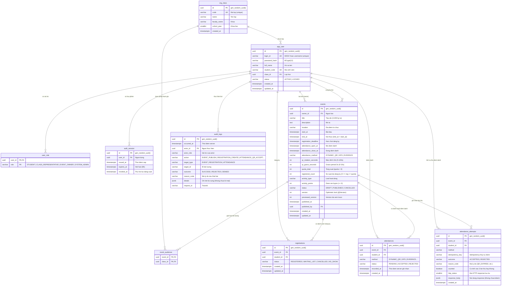

# Thiết kế CSDL (ERD) — Sprint 1

> Lược đồ cơ sở dữ liệu quan hệ cho Sprint 1 của hệ thống **QNU-Events**, được ánh xạ trực tiếp từ file migration Flyway [`V1__sprint1_core_schema.sql`](../../src/main/resources/db/migration/V1__sprint1_core_schema.sql).

---

## 1. Sơ đồ Thực thể - Mối quan hệ (Entity-Relationship Diagram)

---

## 2. Các Ràng buộc & Chỉ mục Đặc biệt (Constraints & Indexes)

1. **`uq_registrations_active`**:
   - `CREATE UNIQUE INDEX uq_registrations_active ON registrations(event_id, student_id) WHERE status IN ('REGISTERED', 'WAITING_LIST');`
   - *Ý nghĩa:* Một sinh viên chỉ được giữ tối đa 1 suất kích hoạt (Registered/Waiting) trong một sự kiện. Nếu đã `CANCELLED`, cho phép đăng ký lại.

2. **`uq_attendances_valid`**:
   - `CREATE UNIQUE INDEX uq_attendances_valid ON attendances(event_id, student_id) WHERE status = 'ACCEPTED';`
   - *Ý nghĩa:* Một sinh viên chỉ có duy nhất 1 bản ghi điểm danh thành công (`ACCEPTED`) cho mỗi sự kiện.

3. **`attendance_attempts` Unique**:
   - `UNIQUE (event_id, student_id, idempotency_key)`
   - *Ý nghĩa:* Đảm bảo tính Idempotent tuyệt đối cho API điểm danh QR khi client gửi lại cùng một key.

4. **Tính Bất biến của `audit_logs` (Append-Only Trigger)**:
   - Trigger `trg_audit_logs_immutable` chặn hoàn toàn các câu lệnh `UPDATE` hoặc `DELETE` trên bảng `audit_logs`.
