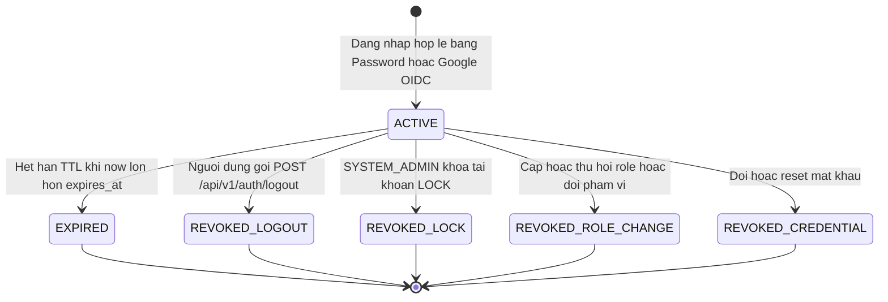
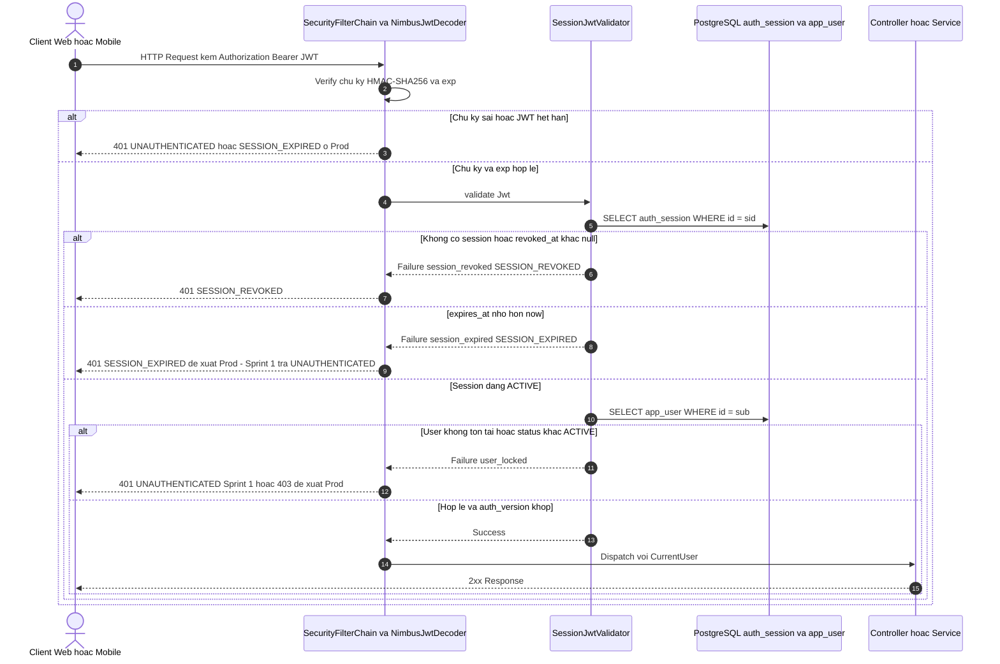
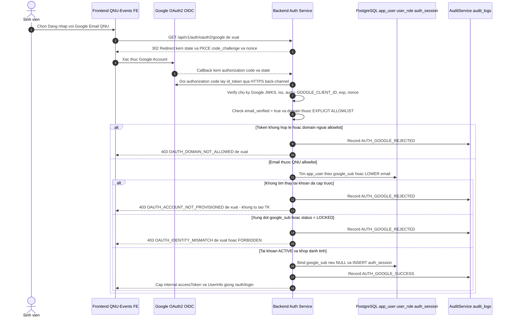

# Đặc tả Kiến trúc Xác thực & Vòng đời Phiên (`QE-36`)

> **Jira Key:** `QE-36` (*Xác định phương thức đăng nhập và vòng đời phiên*, 3 SP)  
> **Trạng thái tài liệu:** Design Baseline — Chờ stakeholder chốt các mục `TBD-*` và duyệt danh sách `ASSUMPTION (chưa duyệt)`  
> **Cơ sở tham chiếu:**
> - `docs/QNU_Event_Participation_Management_Project_Proposal_v2.docx` (§2, §11.1–11.2, §18 #4) — trích xuất tại `#9`
> - `docs/QNU_Event_SRS.docx` (SRS v1.0: `REQ-AUTH-001..015`, `UC001–UC003`, `UC025`, `NFR-SEC-001..004, 012`, `NFR-QUAL-011`, `Appendix A`, `Appendix C`) — trích xuất tại `#9`
> - Mã nguồn thực tế Backend (`QNU-Events BE`, nhánh `develop` @ `4ac5da1`) và Frontend (`QNU-Events FE`, nhánh `develop` @ `0fe4a3c`), đối chiếu kiểm chứng từ `#8`
> - Figma Design (`HX4313AoLQX4zNidDz2Ixo`): `01 · login` và `System Admin / US1.1` (9 màn hình)
> - Quy tắc ràng buộc: `AGENTS.md` (`R1`, `R6`, `R7`, `R8`, `R9`, `R11`, `R12`)

---

## 1. Mục tiêu & Đối chiếu Sprint 1 Baseline (`QE-64`) vs Production Target (`QE-30`, `QE-73`, `QE-74`)

Sprint 1 (`QE-64`, trạng thái `Done`) xây dựng một lát cắt xác thực tối giản để phục vụ luồng lõi với tài khoản mẫu trong môi trường phát triển/demo (`DemoDataSeeder`). Tài liệu này chốt thiết kế kiến trúc mục tiêu cho môi trường **Production** theo Proposal v2 §11.1 và SRS v1.0, đồng thời chỉ rõ các khoảng trống kỹ thuật của nền tảng Sprint 1 hiện tại và các quyết định còn chờ stakeholder phê duyệt (`R11`, `R12`).

### 1.1 Bảng so sánh Baseline Sprint 1 (`QE-64`) vs Production Target

| Hạng mục | Hiện trạng Sprint 1 (`QE-64`) — Đã kiểm chứng trong code | Mục tiêu Production (`QE-30`, `QE-73`, `QE-74`, `QE-35`) | Khoảng cách & Rủi ro chính |
|---|---|---|---|
| **Phương thức đăng nhập** | Chỉ `loginId + password` qua `POST /api/v1/auth/login` (`AuthController`). Dữ liệu mẫu nạp từ `DemoDataSeeder` (`@Profile({"dev","demo"})`). FE `LoginPage.tsx` có 2 nút quick-fill demo (`owner01`, `sv001` dùng `Demo@12345`). | **2 phương thức song song** (`Proposal §11.1`, `REQ-AUTH-001/002`):<br>1. `loginId` (MSSV/username, 5–50 ký tự `[a-zA-Z0-9._]`) + `password` (8–64 ký tự, `REQ-AUTH-014`).<br>2. Google OAuth2/OIDC với email do QNU cấp (`QE-74`). | Chưa có Google OAuth2 (`pom.xml` đã có `spring-boot-starter-security-oauth2-client` nhưng chưa cấu hình). Nút quick-fill trong `LoginPage.tsx` chưa ẩn theo biến môi trường `import.meta.env.DEV`. |
| **Lược đồ CSDL (`V1`)** | `V1__sprint1_core_schema.sql`: `app_user` (`id`, `login_id`, `password_hash NOT NULL`, `full_name`, `student_code`, `class_id`, `status IN ('ACTIVE','LOCKED')`), `user_role` (`STUDENT`, `CLASS_REPRESENTATIVE`, `EVENT_OWNER`, `SYSTEM_ADMIN`), `auth_session` (`id`, `user_id`, `issued_at`, `expires_at`, `revoked_at`). | Bổ sung qua migration mới (`V2__...`, chỉ A0 tạo theo `R6`): `email` (unique, case-insensitive), `google_sub` (unique), `auth_version` (hoặc cơ chế thu hồi theo lần đổi quyền), trường phục vụ khóa tạm thời (`failed_login_attempts`, `locked_until`), `must_change_password`, phạm vi quản trị (`unit_id`), và quyết định về vai trò `CVHT` (`SRS`). | `app_user` thiếu cột `email` và `google_sub` để ánh xạ Google OAuth (`QE-74`). `password_hash` đang `NOT NULL`. `V1` không được phép sửa (`R6`). |
| **JWT & Phiên làm việc** | `JwtService` ký HS256 (`sub`, `sid`, `roles`, `classId`, `iat`, `exp`). `AuthService.java:60` hardcode TTL `8 giờ` (`ChronoUnit.HOURS`), chưa đọc `app.security.jwt-access-token-validity-seconds` (`28800`) từ `application.yml`. `JwtService` và `SecurityConfiguration` có secret fallback dev cứng trong code. | Không cho phép fallback secret ở production (fail-fast nếu thiếu `JWT_SECRET` ≥ 32 byte). Áp dụng TTL & cơ chế `"Lưu đăng nhập"` đã chốt (`TBD-AUTH-01`). Phiên bị thu hồi tức thì khi logout, lock, đổi role, hoặc reset mật khẩu (`REQ-AUTH-007/010/011`). | `CurrentUserProvider.require()` đọc `roles` và `classId` từ **claim trong JWT**, không đọc DB -> đổi role/class không có hiệu lực tức thì nếu không thu hồi `auth_session` hoặc kiểm tra version. |
| **Lưu trữ phía Client (FE)** | `AuthContext.tsx` lưu `qnu_events_access_token` và `qnu_events_user_info` trong `sessionStorage`. `LoginPage.tsx` không có checkbox `"Lưu đăng nhập"`. `api/client.ts` tự xóa session khi gặp HTTP `401`. | Tuân thủ `NFR-SEC-004`: không ghi token vào URL/log; token ngắn hạn trong memory + refresh/session qua `HttpOnly; Secure; SameSite` cookie (nếu dùng cookie) hoặc cơ chế lưu trữ an toàn được duyệt, kèm UX `"Lưu đăng nhập"` và thông báo rõ khi phiên hết hạn. | Lưu JWT dài hạn trong `sessionStorage`/`localStorage` nhạy cảm với XSS; FE `api/client.ts` xử lý `401` bằng cách đẩy về `/login` nhưng chưa hiển thị lý do `SESSION_REVOKED`/`SESSION_EXPIRED`. |
| **Chống thử mật khẩu & Tài khoản khóa** | `AuthService.login` dùng `DUMMY_HASH` khi không tìm thấy `loginId` để giảm khác biệt thời gian và trả `401 INVALID_CREDENTIALS`. Tuy nhiên kiểm tra `status == LOCKED` **trước** `passwordEncoder.matches(...)` và trả `403 FORBIDDEN`. Chưa có đếm sai mật khẩu / khóa 15 phút. | Thực thi `REQ-AUTH-015`: sai mật khẩu **5 lần liên tiếp -> khóa đăng nhập tạm thời 15 phút** + ghi log cảnh báo bảo mật; thông báo lỗi không cho phép dò tài khoản (`REQ-AUTH-004`, `REQ-AUTH-015`). | Thứ tự kiểm tra `LOCKED` trước password match ở Sprint 1 tạo lỗ hổng dò trạng thái tài khoản (*user enumeration*). Chưa có bảng/bộ đếm chống brute-force. |
| **Phân quyền RBAC & Scope** | `SecurityConfiguration` cấu hình tường minh cho `STUDENT` và `EVENT_OWNER`, kết thúc bằng `anyRequest().denyAll()`. `CLASS_REPRESENTATIVE` và `SYSTEM_ADMIN` đã có trong `user_role` CHECK & `CurrentUser`, nhưng chưa có endpoint nào mở cho 2 role này. | Đủ 4 role Proposal (`STUDENT`, `CLASS_REPRESENTATIVE`, `EVENT_OWNER`, `SYSTEM_ADMIN`) + chốt phương án `CVHT` của SRS (`REQ-AUTH-005/006`). Kiểm tra cả role lẫn object scope (`class_id`, `unit_id`, `owner_id`) ở backend (`R9`). | `EventService.java:219-236` và `245-269` dùng `if (EVENT_OWNER) ... else if (STUDENT)` sẽ che mất quyền `STUDENT` nếu một tài khoản mang đồng thời cả 2 role. FE `AuthContext.tsx:147` điều hướng `/unauthorized` nhưng `router.tsx` chưa có route này. |
| **Audit Logging** | Bảng `audit_logs` bất biến (`trg_audit_logs_immutable`), `AuditService` chạy `REQUIRES_NEW` đã gắn cho các nghiệp vụ event/registration/attendance (`EventService`: `EVENT_PUBLISH`/`EVENT_PUBLISH_DENIED`, `SecurityConfiguration.accessDeniedHandler`: `EVENT_PUBLISH_DENIED`, `RegistrationService`: `REGISTRATION_CREATE`, `AttendanceService`: `ATTENDANCE_CHECKIN`/`ATTENDANCE_DENIED`). Riêng `AuthService` chưa ghi audit đăng nhập/đăng xuất. | Ghi đầy đủ audit cho luồng xác thực và quản trị tài khoản: login thành công/thất bại, cảnh báo brute-force, logout, cấp phát/import tài khoản, đổi/reset mật khẩu, khóa/mở khóa, cấp/thu hồi role — tuyệt đối không ghi password, hash, hoặc token đầy đủ (`REQ-AUTH-013`, `NFR-SEC-012`, `R7`). | `AuthService` thiếu `AuditService` calls; thiếu `actor_id` (khi chưa đăng nhập) và thiếu mã hành động chuẩn cho module `auth` và `admin`. |

> [!WARNING]
> **Ghi chú tính trung thực (`R1`, đối chiếu `#8`):** Tài liệu `docs/test/sprint1-test-execution-report.md` (§2.2) hiện ghi nhận sai lệch so với mã nguồn Sprint 1 thực tế: báo cáo đó mô tả *"Khóa tài khoản sau 5 lần đăng nhập sai liên tiếp -> 423 `ACCOUNT_LOCKED`"* và *"sai mật khẩu -> 401 `UNAUTHENTICATED`"*. Thực tế kiểm chứng trong `AuthService.java`, `ErrorCode.java` và `AuthIT.java` cho thấy: (1) `AuthService` chưa cài đặt đếm số lần sai / khóa 5 lần; (2) sai mật khẩu trả `401 INVALID_CREDENTIALS`; (3) tài khoản có sẵn `UserStatus.LOCKED` trả `403 FORBIDDEN`. Tài liệu này lấy **mã nguồn thực tế** làm chuẩn.

---

## 2. Cấp phát Tài khoản & Vòng đời Credential theo Vai trò (`QE-73`, `QE-35`)

### 2.1 Ma trận vai trò và nguồn cấp phát (`Proposal §2, §11.1` vs `SRS v1.0`)

| Vai trò (`user_role` / SRS) | Nguồn cấp phát & Thẩm quyền | Phạm vi dữ liệu (`Scope`) | Ghi chú đồng bộ Proposal vs SRS |
|---|---|---|---|
| **`STUDENT`** *(Sinh viên)* | **System Admin** tạo hàng loạt từ dữ liệu/định danh do trường cung cấp qua CSV/Excel (`UC025`, `QE-73`). Cấm tự đăng ký (*no self-signup*). | Chỉ xem và thao tác trên dữ liệu của chính `userId` (`registrations`, `attendances`, `history`, `appeals`) và sự kiện thuộc `class_id` của mình. | Thống nhất giữa Proposal v2, SRS v1.0 và `V1`. |
| **`CLASS_REPRESENTATIVE`** *(Ban cán sự - BCS)* | **System Admin** gán vai trò `CLASS_REPRESENTATIVE` cho tài khoản sinh viên đã có (kèm gán lớp phụ trách). | Chỉ duyệt/từ chối evidence và ca điểm danh bán tự động thuộc lớp được phân công; **không có quyền cộng/trừ điểm rèn luyện** (`Proposal §2`). | Đã có trong `V1` (`user_role` CHECK & `CurrentUser.isClassRepresentative()`). Chưa có bảng phân công nếu BCS quản lý khác `app_user.class_id` hoặc chuyển nhiệm kỳ. |
| **`EVENT_OWNER`** *(Admin / Event Owner)* | **System Admin** cấp/gán khi có yêu cầu và có thẩm quyền tổ chức hoạt động (Đoàn, Hội, CLB, Khoa — `Proposal §2, §11.1`, `UC002`). Bắt buộc gắn phạm vi đơn vị quản lý (`unit_id`, `REQ-AUTH-009`). | Quản lý sự kiện do mình sở hữu/trong phạm vi đơn vị (`owner_id` / `unit_id`); không mặc định xem toàn bộ minh chứng ngoài phạm vi nghiệp vụ (`Proposal §2`). | Trong Jira `QE-30`, cần thống nhất dùng nhãn `"Admin/Event Owner"` thay cho `"Admin/Student Affairs"` (`docs/backlog_solutions.md §2.4`). |
| **`SYSTEM_ADMIN`** *(Quản trị hệ thống)* | Khởi tạo an toàn qua quy trình vận hành/bootstrap ngoài public UI; có thể phân cấp quản trị bởi System Admin hiện hữu theo quy chế (`TBD-AUTH-02`). | Toàn quyền kỹ thuật: import danh mục/sinh viên, cấp/khóa/thu hồi role, cấu hình tham số, tra `audit_logs`, chạy retention (`UC029`). **Không phải business actor** trong luồng duyệt điểm danh thường nhật (`Proposal §2`, `NFR-SEC-002`). | Đã có trong `V1` (`DemoDataSeeder` tạo `admin01` chỉ trong profile `dev`/`demo`). |
| **`CVHT`** *(Cố vấn học tập — SRS v1.0)* | **Chưa có trong `V1` và Proposal v2 §2.** SRS v1.0 (`User Classes`, `REQ-AUTH-005`, `UC007`, `REQ-REV-014`) bổ sung `CVHT` với quyền xem lịch theo phạm vi lớp và xử lý/duyệt khiếu nại (`UC024`). | Theo lớp được phân công cố vấn (`class_id`). | **Cần stakeholder chốt:** Nếu triển khai `CVHT` ở Sprint 2–3, `A0` phải tạo migration `V2+` mở rộng `CHECK` constraint của `user_role` và bổ sung mapping phân công `CVHT ↔ lớp`. |

### 2.2 Quy trình cấp phát tài khoản Sinh viên từ Import Trường (`QE-73`, `UC025`)

Theo `Proposal §11.1–11.2` và AC của `QE-73`:

1. **Đầu vào chuẩn hóa:** File CSV/Excel do nhà trường cung cấp được `SYSTEM_ADMIN` tải lên và xem trước (*import preview*, `QE-62`), bắt buộc có tối thiểu:
   - `student_code` (MSSV — khóa định danh nghiệp vụ bất biến của sinh viên, `app_user.student_code` UNIQUE).
   - `full_name` (họ và tên).
   - `class_code` (ánh xạ tới `org_class.id`; lỗi nếu lớp chưa tồn tại trong danh mục khoa/ngành/lớp — `UC026`).
   - `email` (email do QNU cấp dùng để đối chiếu `QE-74`, kiểm tra định dạng + domain allowlist `TBD-AUTH-03`).
   - `login_id` (mặc định bằng `student_code` đã `trim()`, thỏa regex `REQ-AUTH-014`: `^[a-zA-Z0-9._]{5,50}$`).
2. **Nguyên tắc Idempotent & Không ghi đè ngầm (*No Silent Overwrite*, `QE-73` AC):**
   - **Sinh viên mới** (`student_code` chưa có trong `app_user` và `login_id`/`email` chưa trùng ai): Tạo mới `app_user` (`status = ACTIVE`), gán `user_role = 'STUDENT'`, cấp credential khởi tạo (Mục 2.4).
   - **Import lại cùng sinh viên** (khớp `student_code` đã tồn tại):
     * **Tuyệt đối không** reset/ghi đè `password_hash`, không tự mở khóa tài khoản đang `LOCKED`, không xóa các role bổ sung như `CLASS_REPRESENTATIVE`, và không ghi đè `google_sub` đã liên kết.
     * Nếu `full_name` hoặc `email` mới khác dữ liệu cũ: ghi nhận trạng thái `SKIPPED` hoặc chỉ cập nhật metadata hành chính khi có cờ cấu hình tường minh kèm audit diff (lưu ý `Proposal §11.2`: MVP không quản lý chuyển lớp/chuyển khoa sau nhập học nên thay đổi `class_id` trên user đã có cần cảnh báo/chặn hoặc xử lý theo quy định riêng).
   - **Xung đột định danh (Reject row, không tạo bản ghi lỗi):**
     * `email` của dòng CSV đã thuộc về một `student_code` khác -> từ chối dòng đó với mã xung đột *(đề xuất: `DUPLICATE_EMAIL`)*, không gắn nhầm tài khoản.
     * `login_id` đã bị tài khoản khác (ví dụ `EVENT_OWNER`) chiếm dụng -> từ chối dòng đó *(đề xuất: `DUPLICATE_LOGIN_ID`)*.
     * Thiếu trường bắt buộc hoặc `class_code` không hợp lệ -> từ chối dòng đó; dữ liệu thiếu không được mặc định là hợp lệ (`REQ-REG-005`).
3. **Báo cáo kết quả Import:** Trả về tổng số dòng (`createdCount`, `skippedCount`, `conflictCount`, `errorCount`) và danh sách lỗi theo số dòng/mã sinh viên để `SYSTEM_ADMIN` xử lý. Không xuất mật khẩu hay hash trong báo cáo lưu dài hạn.

### 2.3 Quy trình cấp phát `EVENT_OWNER` & `SYSTEM_ADMIN` (`QE-35`, `UC002`, Figma `US1.1`)

Khớp với `REQ-AUTH-009` (`UC002`) và 9 màn hình `System Admin / US1.1` trong Figma (`HX4313AoLQX4zNidDz2Ixo`):

1. **Cấp quyền cho tài khoản đã tồn tại (`GRANT_ROLE`):** `SYSTEM_ADMIN` chọn user từ danh sách tài khoản, chọn vai trò cần gán (`EVENT_OWNER` hoặc `CLASS_REPRESENTATIVE` / `SYSTEM_ADMIN`), nhập bắt buộc **phạm vi quản lý** (`unit_id` / khoa / đoàn thể hoặc lớp) và **lý do cấp quyền** (`reason`).
2. **Mời / Tạo tài khoản mới (`INVITE_ADMIN` — khớp Figma `US1.1`):** Khi cấp cho trưởng đơn vị (Đoàn, Hội, CLB, Khoa) chưa có tài khoản (`Proposal §2`): nhập `email`, `role`, `scope` (`unit_id`), `reason`. Hệ thống tạo `app_user` với trạng thái phù hợp (`ACTIVE` hoặc chờ kích hoạt — `TBD-AUTH-01`), gán vai trò và gửi/cấp credential khởi tạo theo kênh được chốt.
3. **Thu hồi quyền (`REVOKE_ROLE` / `REVOKE_ADMIN`):** Bắt buộc có `reason`; xóa dòng tương ứng khỏi `user_role` (không xóa tài khoản gốc nếu user vẫn còn vai trò khác như `STUDENT`, khớp `UC001` precondition & `REQ-AUTH-011`), đồng thời vô hiệu hóa tức thì quyền đó trên mọi phiên đang mở (Mục 3.4).

### 2.4 Vòng đời Mật khẩu & Reset Credential (`TBD-AUTH-01`)

- **Thuật toán băm (`NFR-SEC-003`):** Giữ nguyên `BCryptPasswordEncoder(12)` như `SecurityConfiguration.java:262-264` (`strength = 12`, đã có test xác nhận prefix `$2` trong `AuthIT.java:75`). Cần stakeholder xác nhận thêm mức cost cho môi trường tải cao trong `TBD-SEC-01`.
- **Ràng buộc `V1` hiện tại:** Cột `app_user.password_hash` có ràng buộc `NOT NULL`. Trong Sprint 1, `DemoDataSeeder` băm chuỗi `DEMO_PASSWORD` (mặc định `Demo@12345`). Với Production, **tuyệt đối không** dùng mật khẩu mặc định chung kiểu `Demo@12345` hay ngày sinh dễ đoán cho hàng loạt sinh viên.
- **Đề xuất vòng đời cấp/đổi/reset credential (`ASSUMPTION (chưa duyệt)` chờ `TBD-AUTH-01`):**
  1. **Khởi tạo mật khẩu lần đầu (`QE-73`):** Khi import sinh viên, hệ thống sinh token kích hoạt/đặt mật khẩu một lần (có thời hạn, lưu bản băm SHA-256 của token trong DB) gửi qua QNU email hoặc cấp mật khẩu ngẫu nhiên mạnh một lần kèm cờ `must_change_password = true` bắt buộc đổi ngay sau lần đăng nhập đầu tiên. (Trong thời gian chưa kích hoạt/hoặc khi `V1` đòi `NOT NULL`, lưu hash ngẫu nhiên không đoán được thay cho hash trống).
  2. **Tự đổi mật khẩu & Quên mật khẩu (`QE-30`):** User đã đăng nhập có thể tự đổi mật khẩu (yêu cầu nhập mật khẩu cũ + mật khẩu mới 8–64 ký tự, khác mật khẩu cũ). Luồng *Quên mật khẩu* gửi OTP/link một lần qua email QNU đã khai báo; không phân biệt thông báo giữa email tồn tại và không tồn tại để chống dò tài khoản.
  3. **Admin hỗ trợ reset mật khẩu (`SYSTEM_ADMIN`):** Nếu sinh viên chưa vào được email hoặc bị khóa phục hồi, `SYSTEM_ADMIN` kích hoạt thao tác *Reset credential* (nhập `reason`), sinh mật khẩu tạm ngẫu nhiên hoặc link đặt lại mật khẩu một lần hiển thị **đúng 1 lần duy nhất** trên màn hình thao tác (hoặc gửi kênh bảo mật), đánh dấu `must_change_password = true` và thu hồi toàn bộ phiên cũ.

### 2.5 Nguyên tắc Audit cho Tài khoản & Credential (`QE-73`, `R7`, `NFR-SEC-012`)

Mọi thao tác quản trị tài khoản và xác thực phải ghi vào bảng bất biến `audit_logs` (trigger `trg_audit_logs_immutable` trong `V1`) thông qua `AuditService` (`Propagation.REQUIRES_NEW`):

- **Các `action` bổ sung cho Production:** `USER_IMPORT_BATCH`, `USER_PROVISION`, `CREDENTIAL_RESET`, `PASSWORD_CHANGE`, `ROLE_GRANT`, `ROLE_REVOKE`, `USER_LOCK`, `USER_UNLOCK`, `AUTH_LOGIN_SUCCESS`, `AUTH_LOGIN_FAILED`, `AUTH_LOGIN_LOCKED_BRUTEFORCE`, `AUTH_GOOGLE_SUCCESS`, `AUTH_GOOGLE_REJECTED`, `AUTH_LOGOUT`.
- **Quy tắc chống lộ bí mật (`R7`, `QE-73` AC):** Trường `details` (`jsonb`) và log ứng dụng (`Slf4j`) **cấm tuyệt đối** chứa: `password`, `passwordHash`, mật khẩu tạm, reset token gốc, `accessToken` JWT, `id_token` Google, hoặc chuỗi OTP. Chỉ lưu `target_id` (UUID user), `batchId`, `role`, `unitId`/`classId`, `reason`, `reasonCode` (ví dụ `DUPLICATE_EMAIL`, `DOMAIN_NOT_ALLOWED`), và địa chỉ IP/hash tối giản nếu được phép theo chính sách log.

---

## 3. Vòng đời Phiên Đăng nhập (`auth_session`, JWT HS256 & Thu hồi Tức thì)

### 3.1 Sơ đồ trạng thái Phiên (`auth_session`)



### 3.2 Kiến trúc JWT & Kiểm tra Phiên trên từng Request

Hiện tại ở Sprint 1 (`JwtService.java`, `SessionJwtValidator.java`, `SecurityConfiguration.java`):
- **Phát hành token:** `AuthService.login` tạo 1 bản ghi `AuthSession` trong DB (`id = sessionId`, `userId`, `issuedAt`, `expiresAt`) và gọi `JwtService.createToken(...)` để ký JWT HS256 (`JWSAlgorithm.HS256`, `MACSigner`) với các claim: `sub` (`userId`), `sid` (`sessionId`), `roles`, `classId` (nếu có), `iat`, `exp`.
- **Xác thực request:** Spring Security Resource Server (`NimbusJwtDecoder`) chạy chuỗi `DelegatingOAuth2TokenValidator`:
  1. `JwtTimestampValidator`: kiểm tra chữ ký HS256 và `exp`.
  2. `SessionJwtValidator`: kiểm tra `sid` trong bảng `auth_session` (phải tồn tại, `revokedAt == null`, `expiresAt >= Instant.now(clock)`) và kiểm tra `app_user` (tồn tại, `status == UserStatus.ACTIVE`).



### 3.3 Các khiếm khuyết của Sprint 1 cần sửa cho Production

1. **Secret fallback cứng trong mã nguồn (`R7` / Bảo mật):**
   - Cả `JwtService.java:28-30` và `SecurityConfiguration.java:147-149` đều fallback về chuỗi `"qnu-events-dev-secret-key-must-be-at-least-256-bits-long-for-hmac-sha256!"` nếu `app.security.jwt-secret` rỗng hoặc `< 32` ký tự.
   - **Yêu cầu Production:** Chỉ cho phép secret mẫu ở profile `dev`/`demo`/`test`. Nếu khởi chạy ở môi trường production mà `JWT_SECRET` thiếu hoặc `< 32` byte (256 bit), ứng dụng phải **từ chối khởi động (fail-fast)**. Ngoài ra cần gộp logic đọc khóa về một bean/properties class dùng chung thay vì nhân bản ở 2 file.
2. **TTL hardcode trong `AuthService`:**
   - `application.yml:58` khai báo `app.security.jwt-access-token-validity-seconds: ${JWT_ACCESS_TOKEN_VALIDITY_SECONDS:28800}`, nhưng `AuthService.java:60` lại hardcode `now.plus(8, ChronoUnit.HOURS)`.
   - **Yêu cầu Production:** Tiêm giá trị cấu hình vào `AuthService` (đã có `Clock` bean để test deterministic với `MutableClock`).
3. **Phân loại mã lỗi `401` trong `SecurityConfiguration.authenticationEntryPoint`:**
   - Hiện tại `SessionJwtValidator` trả về 3 mã `OAuth2Error` khác nhau (`"session_revoked"` / `"SESSION_REVOKED"`, `"session_expired"` / `"SESSION_EXPIRED"`, `"user_locked"`), nhưng `SecurityConfiguration.java:168-173` chỉ kiểm tra chuỗi `"SESSION_REVOKED"` hoặc `"session_revoked"` để trả `ErrorCode.SESSION_REVOKED`, còn `SESSION_EXPIRED` và `user_locked` đều rơi về `ErrorCode.UNAUTHENTICATED`.
   - **Yêu cầu Production:** Ánh xạ rõ ràng: `SESSION_REVOKED` -> `401 SESSION_REVOKED` (bị thu hồi do logout/lock/đổi quyền), `SESSION_EXPIRED` -> `401 SESSION_EXPIRED` *(đề xuất bổ sung vào `ErrorCode` nếu tách riêng khỏi `SESSION_REVOKED`)*, và khóa tài khoản giữa phiên cần phản hồi rõ ràng theo `REQ-AUTH-010`.
4. **Dữ liệu `roles` và `classId` cũ trong JWT (`Stale Claims`):**
   - `CurrentUserProvider.java:29-38` lấy `roles` và `classId` trực tiếp từ JWT claim mà không đọc từ DB. Trong khi đó `RegistrationService.java:89` đọc `student.getClassId()` từ DB, còn `EventService.java:224-252` lại đọc `currentUser.classId()` từ JWT!
   - Xem mục 3.4 dưới đây để xử lý triệt để.

### 3.4 Thu hồi Phiên tức thì khi Khóa, Đổi Quyền, Reset Mật khẩu (`REQ-AUTH-010`, `REQ-AUTH-011`)

- **Khi khóa tài khoản (`LOCK`, `REQ-AUTH-010`):**
  1. Cập nhật `app_user.status = 'LOCKED'` trong DB.
  2. Thu hồi ngay mọi phiên đang mở của user đó: `UPDATE auth_session SET revoked_at = :now WHERE user_id = :uid AND revoked_at IS NULL`.
  3. Nhờ `SessionJwtValidator` kiểm tra cả `auth_session.revoked_at` lẫn `app_user.status == ACTIVE` trên mọi request, mọi JWT đã phát trước đó lập tức bị từ chối ở request kế tiếp.
- **Khi cấp hoặc thu hồi vai trò (`GRANT_ROLE` / `REVOKE_ADMIN` / đổi phạm vi, `REQ-AUTH-011`) hoặc đổi mật khẩu / reset credential:**
  - Nếu chỉ cập nhật bảng `user_role`, các JWT cũ vẫn giữ claim `roles` cũ cho đến hết TTL! Để tuân thủ tuyệt đối `REQ-AUTH-011` (*"từ chối các request quản trị tiếp theo kể cả trên phiên cũ và không tự khôi phục quyền sau khi đăng nhập lại"*):
    * **Cơ chế bắt buộc (`ASSUMPTION A-AUTH-02`):** Trong cùng một `@Transactional` khi thay đổi `user_role`, `unit_id`, `class_id` hoặc `password_hash`, server đồng thời **thu hồi tất cả `auth_session` đang mở** của user (`SET revoked_at = :now`), HOẶC tăng cột `app_user.auth_version` (đối chiếu với claim `ver` trong `SessionJwtValidator`) và nạp `roles`/`scope` tươi từ DB/cache ngắn hạn. Việc thu hồi toàn bộ `auth_session` giúp FE tự động nhận `401 SESSION_REVOKED`, xóa state cũ và yêu cầu người dùng đăng nhập lại để lấy quyền mới nhất.
- **Lỗi bóng mờ đa vai trò trong `EventService`:**
  - `EventService.java:219-236` (`getEventDetail`) và `245-269` (`listEvents`) viết `if (currentUser.roles().contains("EVENT_OWNER")) ... else if (currentUser.roles().contains("STUDENT"))`. Nếu một tài khoản (hoặc một lớp trưởng/CTV câu lạc bộ) mang đồng thời cả `STUDENT` và `EVENT_OWNER`, nhánh `STUDENT` bị bỏ qua. Cần tách rõ chế độ xem/endpoint hoặc tham số ngữ cảnh thay vì `else if` ngầm.

### 3.5 Ngữ nghĩa `"Lưu đăng nhập"`, Logout (`UC003`) & Chính sách Phiên Đồng thời

1. **Ngữ nghĩa `"Lưu đăng nhập"` (`UC001`, Figma `01 · login`, `TBD-AUTH-01`):**
   - Figma `01 · login` có checkbox `"Lưu đăng nhập"`, trong khi SRS `UC001` định nghĩa là cờ boolean `True/False` nhưng mở tại `TBD-AUTH-01`, còn Sprint 1 FE chưa có checkbox này và lưu JWT trong `sessionStorage`.
   - **Đề xuất chờ chốt (`ASSUMPTION A-AUTH-07`):**
     * **Khi KHÔNG chọn `"Lưu đăng nhập"` (`rememberMe = false`):** Phiên ngắn hạn (ví dụ Access Token / session TTL `8 giờ` hoặc hết hạn khi đóng phiên trình duyệt); FE không lưu token vào `localStorage`.
     * **Khi CHỌN `"Lưu đăng nhập"` (`rememberMe = true`):** Không kéo dài access JWT HS256 lên nhiều tuần; thay vào đó phát hành **Refresh Token / Persistent Session** lưu bản băm trong `auth_session` với thời hạn dài hơn (ví dụ 7–14 ngày, sliding hoặc rotating refresh token) truyền qua cookie **`HttpOnly; Secure; SameSite=Lax`** (`NFR-SEC-004`) để cấp lại Access Token ngắn hạn (ví dụ 15–60 phút hoặc 8 giờ). Nếu có thao tác khóa tài khoản/đổi quyền/đổi mật khẩu, thu hồi cả refresh session.
     * Lưu ý với FE hiện tại: `SecurityConfiguration.corsConfigurationSource` đang đặt `configuration.setAllowCredentials(false)`. Nếu chuyển sang cookie `HttpOnly` trên môi trường khác origin, cần cấu hình `allowCredentials(true)` đi kèm `allowedOrigins` tường minh và bật cơ chế bảo vệ CSRF phù hợp (`docs/backend-foundation.md` dòng 30).
2. **Đăng xuất (`POST /api/v1/auth/logout`, `UC003`, `REQ-AUTH-007..008`):**
   - **Trực tuyến:** Server đặt `auth_session.revoked_at = Instant.now(clock)` trả `204 No Content`. FE xóa token và `UserInfo` khỏi bộ nhớ/storage và chuyển về `/login`.
   - **Phiên đã hết hạn/thu hồi trước đó (`UC003` nhánh A1):** `POST /api/v1/auth/logout` trả `401 UNAUTHENTICATED` hoặc `401 SESSION_REVOKED`; FE bắt trạng thái `401` trong `logout()`, xóa state cục bộ và đưa về `/login` êm đẹp, không báo lỗi nghiệp vụ giả.
   - **Mất mạng khi đăng xuất (`UC003` nhánh A2):** FE xóa state xác thực cục bộ và hiển thị cảnh báo *"Đã đăng xuất trên thiết bị này, nhưng chưa xác nhận thu hồi phiên trên máy chủ do mất kết nối"* — **không** xóa hàng đợi điểm danh offline (`UC019`) chưa đồng bộ mà chỉ khóa quyền gửi dưới phiên mới cho đến khi đăng nhập lại đúng tài khoản.
   - **Phạm vi Google (`UC003`):** Đăng xuất khỏi QNU-Events chỉ thu hồi phiên của ứng dụng, **không** đăng xuất tài khoản Google trên trình duyệt/thiết bị.
3. **Chính sách phiên đồng thời (*Concurrent Sessions*):**
   - Bảng `auth_session` (`V1`) cho phép nhiều bản ghi `ACTIVE` cùng `user_id` (`ix_auth_session_user`).
   - **Thực tế nghiệp vụ QNU-Events:** Một sinh viên hoặc Event Owner thường đăng nhập đồng thời trên **laptop** (xem lịch/chiếu QR) và **điện thoại** (quét QR/chụp evidence). Nếu áp dụng chính sách *"đăng nhập mới đá văng phiên cũ"* (`single-session`) sẽ làm gián đoạn buổi điểm danh thực tế.
   - **Đề xuất (`ASSUMPTION A-AUTH-04`):** Cho phép nhiều phiên đồng thời nhưng giới hạn trần hợp lý theo user (ví dụ tối đa **5 phiên active**; vượt trần sẽ thu hồi phiên cũ nhất theo `issued_at` hoặc yêu cầu đăng xuất bớt), kèm tùy chọn *"Đăng xuất khỏi tất cả thiết bị"* thu hồi mọi `auth_session` của user.

---

## 4. Chống Thử Mật khẩu (Brute-Force) & Xử lý Tài khoản Bị Khóa

### 4.1 Cơ chế Brute-Force (`REQ-AUTH-015`, `UC001` 6c)

- **Quy tắc SRS bắt buộc (`REQ-AUTH-015`):** Nhập sai mật khẩu **5 lần liên tiếp** -> hệ thống **khóa đăng nhập tạm thời trong 15 phút**, ghi nhận log cảnh báo bảo mật (`audit_logs`), và thông báo lỗi không được để lộ sự tồn tại của tài khoản.
- **Đề xuất triển khai chống dò user & chịu tải nhiều node (`NFR-QUAL-011`, `TBD-SEC-01`):**
  - Trạng thái đếm lỗi phải lưu tập trung (trong PostgreSQL qua cột/bảng chuyên biệt hoặc Redis nếu có ở giai đoạn scale) — tuyệt đối không lưu `ConcurrentHashMap` trong RAM nếu chạy nhiều instance BE.
  - Theo dõi bộ đếm theo `login_id` (`failed_login_attempts`, `last_failed_at`, `locked_until`) kết hợp **rate-limit theo IP/subnet** tại tầng gateway hoặc filter để ngăn kẻ tấn công cố tình nhập sai 5 lần nhằm khóa tài khoản hàng loạt sinh viên khác (*Targeted Account Lockout DoS*).
  - **Chuẩn hóa phản hồi chống enumeration:** Khi tài khoản không tồn tại, sai mật khẩu, hoặc đang trong trạng thái khóa tạm thời 15 phút (`locked_until > now`), phản hồi đăng nhập phải đồng nhất về thông điệp/hành vi để không giúp dò `loginId` hợp lệ (`REQ-AUTH-004`, `REQ-AUTH-015`). Nếu áp dụng ngưỡng khóa theo IP (`429 Too Many Requests` với `Retry-After`), áp dụng đồng đều bất kể `loginId` có tồn tại hay không.
  - Khi đăng nhập thành công trước khi bị khóa: reset `failed_login_attempts = 0`, `locked_until = null`. Sau khi hết 15 phút (`now >= locked_until`), lần thử đúng tiếp theo được phép đăng nhập và reset bộ đếm.

### 4.2 Khắc phục Lỗ hổng User Enumeration ở Sprint 1 (`AuthService.java:51`)

Trong mã nguồn Sprint 1 hiện tại (`AuthService.java:44-57`):
```java
// AuthService.java (Sprint 1 hiện tại)
Optional<AppUser> userOpt = appUserRepository.findByLoginId(request.loginId());
if (userOpt.isEmpty()) {
    passwordEncoder.matches(request.password(), DUMMY_HASH);
    throw new ApiException(ErrorCode.INVALID_CREDENTIALS);
}
AppUser user = userOpt.get();
if (user.getStatus() == UserStatus.LOCKED) {
    throw new ApiException(ErrorCode.FORBIDDEN, "Tài khoản của bạn đã bị khóa.");
}
if (!passwordEncoder.matches(request.password(), user.getPasswordHash())) {
    throw new ApiException(ErrorCode.INVALID_CREDENTIALS);
}
```

- **Vấn đề:** Kiểm tra `user.getStatus() == UserStatus.LOCKED` nằm **trước** `passwordEncoder.matches(...)` (và test `AuthIT.loginWithLockedUserReturnsForbidden` gửi `"password": "AnyPassword"` vẫn nhận `403 FORBIDDEN`). Điều này cho phép bất kỳ ai chưa xác thực dò được `loginId` nào tồn tại và đang bị khóa.
- **Thiết kế Production (`ASSUMPTION A-AUTH-03`):**
  1. **Luôn chạy `passwordEncoder.matches(request.password(), user.getPasswordHash())` trước** (hoặc `DUMMY_HASH` nếu không tìm thấy user) để cân bằng thời gian xử lý và không xác nhận trạng thái trước khi đúng mật khẩu.
  2. Nếu mật khẩu **SAI**: tăng bộ đếm sai (nếu user tồn tại) và trả `401 INVALID_CREDENTIALS` (`"Thông tin đăng nhập không chính xác."`), **kể cả khi user đang `LOCKED`**.
  3. Chỉ khi mật khẩu **ĐÚNG** nhưng `user.getStatus() == UserStatus.LOCKED` (khóa quản trị bởi `SYSTEM_ADMIN`): mới từ chối với `403 FORBIDDEN` (hoặc `ACCOUNT_LOCKED`, ghi rõ đã bị quản trị viên khóa, khớp `UC001` 6b) và ghi audit.
  4. *(Lưu ý chuyển tiếp:* Khi áp dụng sửa đổi này ở Sprint sau, cần cập nhật lại test `AuthIT.loginWithLockedUserReturnsForbidden` dùng mật khẩu đúng cho case `403` và thêm test gửi mật khẩu sai cho user `LOCKED` phải trả `401 INVALID_CREDENTIALS`).*

### 4.3 Phân biệt Hai Loại Khóa Tài khoản

| Thuộc tính | Khóa tạm thời do Brute-Force (`locked_until > now`) | Khóa quản trị (`app_user.status = 'LOCKED'`) |
|---|---|---|
| **Nguyên nhân** | 5 lần nhập sai mật khẩu liên tiếp (`REQ-AUTH-015`). | `SYSTEM_ADMIN` khóa thủ công qua `US1.1` kèm lý do (`UC002`). |
| **Thời hạn** | Tự hết sau 15 phút (hoặc `SYSTEM_ADMIN` can thiệp mở sớm nếu `TBD-AUTH-02` cho phép). | Vô thời hạn cho đến khi `SYSTEM_ADMIN` thực hiện `UNLOCK`. |
| **Phiên hiện tại** | Không tự động thu hồi phiên đang hợp lệ trên thiết bị khác (chỉ chặn tạo phiên mới bằng mật khẩu). | **Thu hồi tức thì toàn bộ `auth_session`** và chặn mọi request kế tiếp (`REQ-AUTH-010`). |
| **Google OAuth2 (`QE-74`)** | Cần stakeholder chốt: chặn cả Google hay chỉ chặn đăng nhập mật khẩu (`Open Question`). | **Bị chặn tuyệt đối** cả password lẫn Google OAuth (`REQ-AUTH-010`). |

---

## 5. Xác thực Google OAuth2 / OIDC (`QE-74`, `REQ-AUTH-002`, `NFR-SEC-001`)

### 5.1 Luồng Xác thực & Ánh xạ Tài khoản Phía Server

`pom.xml` đã khai báo sẵn `spring-boot-starter-security-oauth2-client`, nhưng `SecurityConfiguration` hiện mới chỉ cấu hình `oauth2ResourceServer` cho JWT nội bộ của ứng dụng. Với `QE-74`, Google chỉ đóng vai trò **Identity Provider (xác nhận danh tính qua email trường)** — hệ thống **không** dùng access token của Google làm session token nội bộ, mà đổi/xác minh phía server rồi cấp `AuthSession` + JWT nội bộ của QNU-Events như đăng nhập thường.



### 5.2 Quy tắc Kiểm tra & Ánh xạ Bắt buộc (`QE-74`, `REQ-AUTH-002`, `UC001` 3a)

1. **Xác minh hoàn toàn tại Backend (`R9`, `NFR-SEC-001`):**
   - Nếu dùng Authorization Code Flow + PKCE (khuyến nghị, hỗ trợ sẵn qua `spring-boot-starter-security-oauth2-client`): Backend nhận `code` từ callback (kiểm tra `state`, `PKCE`, `nonce`), tự gọi Google token endpoint và giải mã `id_token` bằng Google JWKS (`https://www.googleapis.com/oauth2/v3/certs`).
   - Nếu client gửi trực tiếp Google `id_token` (ví dụ Google Identity Services One-Tap hoặc Mobile SDK qua `POST /api/v1/auth/google`): Backend vẫn phải verify chữ ký JWKS, `iss` (`https://accounts.google.com` hoặc `accounts.google.com`), `aud` khớp chính xác `GOOGLE_CLIENT_ID` của QNU-Events, và `exp` theo `Clock` server. **Tuyệt đối không** nhận `email`, `sub`, hay `role` dạng JSON thô từ client.
2. **Xác minh `email_verified` & Allowlist Miền Email QNU (`TBD-AUTH-03`):**
   - Bắt buộc `email_verified == true`.
   - Chuẩn hóa `normalizedEmail = email.trim().toLowerCase(Locale.ROOT)`, tách phần domain sau `@` (chỉ có đúng 1 ký tự `@`).
   - Đối chiếu `domain` với danh sách **allowlist tường minh** cấu hình qua biến môi trường (ví dụ `APP_GOOGLE_ALLOWED_DOMAINS` — chưa chốt giá trị chính thức cho đến khi stakeholder xác nhận `@st.qnu.edu.vn` / `@qnu.edu.vn`).
   - **Cấm** kiểm tra bằng `email.endsWith("qnu.edu.vn")` vì sẽ bị lọt tên miền giả mạo kiểu `fakeqnu.edu.vn` hoặc subdomain không được phép (`#9`). Nếu sử dụng claim `hd` (Google Workspace Hosted Domain), chỉ dùng làm lớp kiểm tra bổ sung sau bước kiểm tra `domain` trong allowlist.
3. **Ánh xạ chặt chẽ về `app_user` đã cấp trước & Xử lý Trùng / Không khớp:**
   - Trong `V2` migration (do `A0` tạo theo `R6`), `app_user` cần bổ sung `email varchar(255)` với unique index không phân biệt hoa thường (`CREATE UNIQUE INDEX uq_app_user_email_lower ON app_user (LOWER(email)) WHERE email IS NOT NULL`) và `google_sub varchar(128)` với unique constraint (`UNIQUE (google_sub)`).
   - **Không tồn tại bản ghi khớp (`Unmatched`):** Từ chối ngay *(mã lỗi đề xuất cho `ErrorCode`: `OAUTH_ACCOUNT_NOT_PROVISIONED`)* với thông báo chuẩn SRS (`UC001` 3a.4a): *"Chỉ chấp nhận tài khoản email do Trường Đại học Quy Nhơn cấp và đã được khai báo trên hệ thống"*. **Không bao giờ tự tạo `app_user` mới** (*No auto-provisioning / auto-signup*).
   - **Lần đầu liên kết (`google_sub IS NULL`):** Khi tìm thấy duy nhất 1 `app_user` khớp `LOWER(email)` và đang `ACTIVE`, cập nhật `google_sub = token.sub` bằng điều kiện nguyên tử (`WHERE id = :id AND google_sub IS NULL`) để tránh race condition khi người dùng bấm đúp.
   - **Không khớp (`Mismatch`):** Nếu `app_user` tìm thấy theo `email` đã có `google_sub` khác với `token.sub` (hoặc `token.sub` đã liên kết với một `app_user` khác có `email` khác), **TỪ CHỐI** *(mã lỗi đề xuất: `OAUTH_IDENTITY_MISMATCH`)*, ghi cảnh báo vào `audit_logs` để `SYSTEM_ADMIN` kiểm tra (tránh chiếm tài khoản khi email trường bị tái cấp phát cho người khác).
   - **Trùng dữ liệu (`Duplicate`):** Nhờ ràng buộc `UNIQUE` ở DB và kiểm tra trước khi import CSV (`QE-73`), không thể tồn tại 2 user dùng chung 1 `email` hoặc 1 `google_sub`. Nếu dữ liệu legacy vi phạm trước khi thêm constraint, migration/import phải chặn lại trước.
4. **Chống Leo thang Đặc quyền (`NFR-SEC-001`, `Appendix A`) & Quy tắc Vai trò:**
   - Khi tài khoản Google đã khớp `app_user` đang `ACTIVE`, hệ thống đọc danh sách quyền từ bảng `user_role` trong DB. Không bao giờ tự cấp `EVENT_OWNER`, `CLASS_REPRESENTATIVE` hay `SYSTEM_ADMIN` dựa trên domain email.
   - Tài khoản bị khóa (`LOCKED`) bị từ chối mọi đăng nhập Google (`REQ-AUTH-010`).
   - **Cộng sinh với MSSV + Mật khẩu:** Cả hai phương thức đăng nhập trỏ về **cùng 1 `app_user.id`** và tạo phiên trên **cùng bảng `auth_session`**. Sinh viên đã đăng nhập bằng Google hay bằng `loginId + password` đều dùng chung lịch sử, đăng ký, điểm danh và chịu chung lệnh khóa/logout.
   - **Lưu ý `password_hash NOT NULL` trong `V1`:** Vì `V1` đặt `app_user.password_hash` là `NOT NULL`, mọi tài khoản sinh viên vẫn có `password_hash` hợp lệ (hoặc hash ngẫu nhiên trước khi kích hoạt mật khẩu); nếu sau này cho phép tài khoản *Google-only* (`password_hash IS NULL`), luồng login mật khẩu phải kiểm tra `user.getPasswordHash() != null` trước khi gọi `passwordEncoder.matches` để tránh `IllegalArgumentException` từ BCrypt.
   - **Chú ý cho Stakeholder (`QE-74`):** Xác nhận xem Google OAuth chỉ mở cho `STUDENT` (bao gồm `STUDENT` kiêm `CLASS_REPRESENTATIVE`) hay cho phép cả `EVENT_OWNER` / `SYSTEM_ADMIN` nếu email QNU của họ có trong `app_user`.

---

## 6. Phân tích Khoảng trống Giao diện Figma (`HX4313AoLQX4zNidDz2Ixo`) & FE Hiện tại

Đối chiếu thiết kế Figma đã xác minh (`01 · login` và `System Admin / US1.1`) cùng mã nguồn `QNU-Events FE` (`0fe4a3c`) với yêu cầu của `QE-30`, `QE-36`, `QE-73`, `QE-74`, `QE-35`:

### 6.1 Màn hình Đăng nhập (`01 · login` vs `LoginPage.tsx` vs `QE-30/36/74`)

| Thành phần UI / Luồng | Figma (`01 · login`) | FE hiện tại (`LoginPage.tsx`, `AuthContext.tsx`) | Khoảng trống cần bổ sung cho Production |
|---|---|---|---|
| **Form Tài khoản + Mật khẩu** | Có `Tài khoản`, `Mật khẩu`, nút `Đăng nhập`. | Có `Tên đăng nhập / Mã sinh viên` (`loginId`), `Mật khẩu` (`password`), nút `Đăng nhập`. | Bổ sung hint/validation rõ cho MSSV/username (`5–50` ký tự, không dấu cách). |
| **Checkbox `"Lưu đăng nhập"`** | **Có** trên frame `01 · login`. | **Thiếu** hoàn toàn; `AuthContext.tsx` chỉ lưu `sessionStorage`. | Bổ sung checkbox `"Lưu đăng nhập"` gửi cờ `rememberMe` lên API sau khi `TBD-AUTH-01` được chốt. |
| **Nút Đăng nhập Google (`QE-74`)** | **Thiếu** trên Figma `01 · login`. | **Thiếu**. | Cần bổ sung frame Figma & component nút *"Đăng nhập bằng Google (Email QNU)"* + trang/xử lý `/auth/callback` (hiển thị lỗi rõ khi dùng Gmail cá nhân hoặc email chưa cấp phát). |
| **Quên / Đặt lại / Đổi mật khẩu (`QE-30`, `QE-73`)** | **Thiếu** trên Figma `01 · login`. | **Thiếu**. | Cần bổ sung link *"Quên mật khẩu?"*, màn hình nhập email/mã xác nhận đặt lại mật khẩu, và màn bắt buộc đổi mật khẩu lần đầu (nếu chọn phương án temp password ở `TBD-AUTH-01`). |
| **Tài khoản Demo Quick-fill** | Không có. | Có 2 nút `Chủ sự kiện` (`owner01`) và `Sinh viên (K49)` (`sv001`) gắn cứng `'Demo@12345'` trong `LoginPage.tsx:59-63, 112-136`. | **Phải ẩn/loại bỏ khỏi build production** (chỉ bật khi `import.meta.env.DEV` hoặc cờ demo tường minh). |

### 6.2 Vòng đời Phiên, Đăng xuất & Đa vai trò trong Shell Ứng dụng

| Thành phần UI / Luồng | Figma (`HX4313AoLQX4zNidDz2Ixo`) | FE hiện tại (`Layout.tsx`, `router.tsx`, `api/client.ts`) | Khoảng trống cần bổ sung |
|---|---|---|---|
| **Nút Đăng xuất & Xác nhận** | **Thiếu** trên các frame Figma. | **Đã có** trong `Layout.tsx:102-110, 161-170`: nút `Đăng xuất` trên header desktop + `ConfirmDialog` gọi `POST /api/v1/auth/logout`. *(Lưu ý: mobile bottom nav lines 116-155 chưa có nút Đăng xuất!).* | Bổ sung khung Logout trên Figma và đưa nút/menu Đăng xuất vào giao diện Mobile (`< 640px`). |
| **Thông báo hết phiên / bị thu hồi (`SESSION_REVOKED`)** | **Thiếu**. | `api/client.ts:80-82` gọi `clearSession()` trên mọi HTTP `401` (kể cả khi `login` sai mật khẩu), rồi `RequireRole` đẩy về `/login` âm thầm, **không** báo cho user biết phiên đã hết hạn hay bị khóa. | Phân biệt `401` tại `/auth/login` với `401` trên API nghiệp vụ; khi gặp `SESSION_REVOKED`/`SESSION_EXPIRED` hiển thị banner/toast rõ trên `/login` (*"Phiên đăng nhập đã hết hạn hoặc bị thu hồi, vui lòng đăng nhập lại"*). |
| **Chuyển vai trò / Đa vai trò (`BCS`, `EVENT_OWNER`)** | **Thiếu** UI Role-Switching. | `Layout.tsx` dùng `hasRole('EVENT_OWNER')` & `hasRole('STUDENT')` nhưng `router.tsx` không có route cho `CLASS_REPRESENTATIVE` hay `SYSTEM_ADMIN`. `AuthContext.tsx:147` redirect về `/unauthorized` nhưng `router.tsx` **không có route `/unauthorized`** (rơi vào `* -> /`). | Tạo trang `/unauthorized` (403 rõ ràng); bổ sung Role Switcher hoặc menu phân vùng rõ khi 1 sinh viên giữ thêm role `CLASS_REPRESENTATIVE` (hoặc user có nhiều role). |

### 6.3 Quản trị Tài khoản (`System Admin / US1.1` vs `QE-73`, `QE-35`)

Figma đã thiết kế **9 màn hình** trong luồng `System Admin / US1.1` bao gồm các chức năng:
- Danh sách tài khoản (*account list*)
- Cấp quyền cho người dùng hiện có (*grant role to existing user*)
- Mời quản trị viên / chủ sự kiện mới (*invite new admin: `email, role, scope, reason`*)
- Chi tiết tài khoản + nhật ký vai trò (*account detail + role audit*)
- Khóa / mở khóa tài khoản (*lock/unlock account*)
- Thu hồi vai trò (*revoke role*)
- Màn hình xác nhận cấp quyền thành công (*grant success*)
- Nhật ký cấp / thu hồi vai trò (*role grant/revoke audit log*)

**Khoảng trống đối chiếu:**
- **FE hiện tại (`router.tsx`):** Có **0/9** màn hình `SYSTEM_ADMIN`.
- **Import sinh viên (`QE-73` / `UC025`):** Trong Figma, các màn Master Data CRUD (Khoa / Ngành / Lớp / Import Sinh viên CSV / Học kỳ) đang đặt dưới nhánh **`ADMIN / EVENT OWNER`**, trong khi `Proposal §11.1` và `SRS UC025` quy định **`System Admin`** mới là người tạo tài khoản sinh viên từ dữ liệu nhà trường! Cần chốt lại quyền màn hình này trên Figma để không gán nhầm quyền tạo tài khoản hệ thống cho `EVENT_OWNER`.
- **Reset mật khẩu bởi Admin:** Luồng `US1.1` chưa thể hiện nút/modal *Đặt lại mật khẩu* trên màn chi tiết tài khoản nếu `TBD-AUTH-01` chọn hướng Admin hỗ trợ reset.

---

## 7. Câu hỏi Chờ Stakeholder (`R12`), Giả định `ASSUMPTION (chưa duyệt)` (`R11`) & Ma trận Tác động

### 7.1 Câu hỏi Mở Chờ Stakeholder Xác nhận (`R12` — Tuyệt đối không tự bịa)

| Mã | Nội dung cần Stakeholder chốt | Nguồn tham chiếu | Ảnh hưởng nếu chưa chốt |
|---|---|---|---|
| **Q-AUTH-01** | **Danh sách tên miền email QNU chính thức (`Allowlist`):** Trường dùng `@st.qnu.edu.vn` cho sinh viên (`UC001` mới chỉ nêu ví dụ) và `@qnu.edu.vn` cho giảng viên/CBVC, hay còn domain/subdomain nào khác? Tài khoản Google cá nhân/cựu SV có bị loại không? | `TBD-AUTH-03`, `QE-74` | Không thể đóng allowlist Google OAuth; có nguy cơ chặn nhầm SV thật hoặc lọt email ngoài trường. |
| **Q-AUTH-02** | **Phạm vi vai trò dùng Google SSO:** Google OAuth (`QE-74`) chỉ áp dụng cho `STUDENT` (và `CLASS_REPRESENTATIVE`) theo `Proposal §11.1`, hay cho phép cả `EVENT_OWNER` / `SYSTEM_ADMIN` nếu email đã khai báo? | `Proposal §11.1`, `QE-74`, `QE-30` | Ảnh hưởng logic kiểm tra role sau khi xác thực OIDC và UI nút Google trên `/login`. |
| **Q-AUTH-03** | **Cấu hình Google Cloud Project & OAuth Consent Screen:** Dùng Google Workspace tenant nội bộ của QNU (`Internal`) hay `External` (cần Google app verification), ai cấp & luân chuyển `GOOGLE_CLIENT_ID` / `GOOGLE_CLIENT_SECRET`, redirect URI chính thức cho staging/prod là gì? | `TBD-AUTH-03`, `TBD-SEC-01`, `QE-74` | Chặn triển khai và kiểm thử tích hợp thực tế của `QE-74`. |
| **Q-AUTH-04** | **Cơ chế cấp mật khẩu ban đầu & kênh Quên/Đổi mật khẩu (`QE-73`, `QE-30`):** Sinh viên được import qua CSV sẽ nhận mật khẩu đầu bằng cách nào (link kích hoạt gửi email QNU, mật khẩu ngẫu nhiên 1 lần bắt buộc đổi, hay kênh khác)? Khi quên mật khẩu sẽ tự reset qua email QNU hay qua `SYSTEM_ADMIN`? Quy tắc độ phức tạp mật khẩu ngoài độ dài 8–64 ký tự là gì? | `TBD-AUTH-01`, `REQ-AUTH-014` | Không thể hoàn thiện `QE-73` (hành vi ghi `password_hash` khi import) và UI/API quên mật khẩu của `QE-30`. |
| **Q-AUTH-05** | **Thời hạn phiên & cơ chế `"Lưu đăng nhập"`:** Chốt Access Token TTL (Sprint 1 đang tạm là `8 giờ`), thời hạn phiên khi tích `"Lưu đăng nhập"`, cơ chế truyền tải (`HttpOnly` cookie refresh token hay token bearer), và số phiên đồng thời tối đa/thiết bị. | `TBD-AUTH-01`, `NFR-SEC-004`, `QE-36` | Ảnh hưởng trực tiếp đến thiết kế `auth_session`, cookie/CORS trên BE và `AuthContext` trên FE. |
| **Q-AUTH-06** | **Chi tiết Brute-Force, Khóa & Mở khóa:** Khóa 5 lần sai / 15 phút (`REQ-AUTH-015`) đếm theo `login_id`, `(login_id, IP)`, hay kèm rate limit IP? Google OAuth có bị chặn khi tài khoản đang bị khóa brute-force mật khẩu không? Quy trình/thẩm quyền mở khóa tài khoản ngoài `SYSTEM_ADMIN`? | `REQ-AUTH-015`, `TBD-AUTH-02`, `TBD-SEC-01` | Ảnh hưởng khả năng chống DoS khóa nhầm tài khoản hàng loạt và luồng hỗ trợ SV tại điểm thi/sự kiện. |
| **Q-AUTH-07** | **MFA cho Admin & Vai trò `CVHT` / Quyền Import SV:** (a) `SYSTEM_ADMIN` hoặc `EVENT_OWNER` có bắt buộc MFA không (`TBD-SEC-04`)? (b) Có triển khai vai trò thứ 5 `CVHT` (`SRS v1.0`) hay giữ 4 vai trò (`Proposal §2` & `V1`)? (c) Thống nhất lại Figma: Import SV (`QE-73`/`UC025`) chỉ thuộc `SYSTEM_ADMIN` (đúng SRS), không đặt dưới `EVENT_OWNER`. | `TBD-SEC-04`, `Proposal §2`, `SRS UC007/UC025` | Ảnh hưởng migration `V2` (`user_role` CHECK), thiết kế phân quyền `QE-35`/`QE-73` và màn hình Figma. |

### 7.2 Danh sách Giả định Kỹ thuật — `ASSUMPTION (chưa duyệt)` (`R11`)

> Các mục dưới đây là **ASSUMPTION (chưa duyệt)** cần được nhóm xem xét, ghi nhận vào `docs/decisions.md` (lưu ý hiện tại `docs/decisions.md` mới chỉ có `A-001`, còn `A-01..A-06` trong `docs/agent/sprint1-rescue-plan.md §6.9` vẫn chưa được chuyển sang) và trình stakeholder xác nhận trước khi code Sprint 2–3:

| Mã | Nội dung Giả định (`ASSUMPTION (chưa duyệt)`) | Lý do kỹ thuật | Liên quan |
|---|---|---|---|
| **A-01** *(kế thừa §6.9)* | Trong Sprint 1 (`QE-64`), phiên dùng JWT HS256 TTL `8 giờ` (`28800s`), không có `"Lưu đăng nhập"`. | Đã hiện thực trong `AuthService.java` (hardcode `8h`) và `application.yml`. | `TBD-AUTH-01`, `QE-64` |
| **A-AUTH-01** | Production phải **fail-fast lúc khởi động** nếu `JWT_SECRET` thiếu hoặc `< 32` byte (loại bỏ fallback dev secret khỏi runtime production); `AuthService` đọc TTL từ `app.security.jwt-access-token-validity-seconds`. | Ngăn rủi ro ký JWT bằng secret mặc định công khai trong repo (`JwtService.java:28-30`, `SecurityConfiguration.java:147-149`). | `QE-36`, `QE-30`, `R7` |
| **A-AUTH-02** | Mọi thao tác `LOCK`, `GRANT_ROLE`, `REVOKE_ROLE`, đổi `class_id`/`unit_id`, và đổi/reset mật khẩu đều **thu hồi tất cả `auth_session` đang mở** trong cùng DB transaction (kèm `auth_version` nếu cần). | Khắc phục việc `CurrentUserProvider` đọc `roles`/`classId` từ JWT claim tĩnh, bảo đảm hiệu lực tức thì theo `REQ-AUTH-010/011`. | `QE-36`, `QE-35`, `QE-30` |
| **A-AUTH-03** | Ở luồng login mật khẩu, luôn chạy `BCrypt` match trước khi kiểm tra `UserStatus.LOCKED`; sai mật khẩu trên tài khoản `LOCKED` vẫn trả `401 INVALID_CREDENTIALS` thay vì `403 FORBIDDEN`. | Bịt lỗ hổng dò trạng thái tài khoản (`AuthService.java:51-53`); yêu cầu cập nhật lại `AuthIT.loginWithLockedUserReturnsForbidden` khi lên Production. | `QE-36`, `QE-30`, `REQ-AUTH-004/015` |
| **A-AUTH-04** | Cho phép đa phiên đồng thời có giới hạn (tối đa **5 phiên active** / tài khoản, thu hồi FIFO phiên cũ nhất nếu vượt quá) thay vì chính sách 1 phiên duy nhất. | SV/Owner thực tế dùng đồng thời laptop (xem/chiếu QR) và điện thoại (quét QR); không làm văng phiên hợp lệ khi điểm danh. | `QE-36`, `QE-57` |
| **A-AUTH-05** | Google OAuth2 dùng Authorization Code Flow + PKCE (hoặc backend OIDC `id_token` verification qua Google JWKS), bắt buộc `email_verified=true` + allowlist domain + liên kết nguyên tử `google_sub` (`UNIQUE`) và `LOWER(email)` (`UNIQUE`) trong `V2__...`, không bao giờ ghi đè `google_sub` âm thầm. | Đáp ứng `QE-74`, `REQ-AUTH-002`, `NFR-SEC-001`, chống chiếm tài khoản khi email trường bị tái cấp phát. | `QE-74`, `R6`, `R9` |
| **A-AUTH-06** | Bộ đếm brute-force (`5` lần sai -> khóa `15` phút) lưu tập trung trên PostgreSQL (hoặc store dùng chung) kèm rate-limit theo IP, phản hồi đồng nhất chống enumeration. | Đảm bảo nhất quán khi scale nhiều instance BE (`NFR-QUAL-011`) và giảm rủi ro DoS khóa tài khoản người khác. | `QE-36`, `QE-30`, `REQ-AUTH-015` |
| **A-AUTH-07** | Lộ trình lưu token phía FE: Sprint 1 chấp nhận `sessionStorage` (`AuthContext.tsx`); Production hướng tới Access Token ngắn hạn + Refresh/Persistent Session (`"Lưu đăng nhập"`) qua `HttpOnly; Secure; SameSite=Lax` cookie kèm CSRF protection. | Tuân thủ `NFR-SEC-004`, giảm bề mặt tấn công XSS so với lưu token dài hạn trong Web Storage. | `QE-36`, `QE-30`, `NFR-SEC-004` |
| **A-AUTH-08** | Cấp phát tài khoản SV (`QE-73`): sinh mật khẩu tạm ngẫu nhiên hoặc token kích hoạt 1 lần qua email QNU + cờ `must_change_password = true`; tuyệt đối không đặt mật khẩu mặc định chung dễ đoán và không ghi mật khẩu vào `audit_logs` hay file kết quả lưu trữ. | An toàn dữ liệu khởi tạo theo `R7` và `NFR-SEC-003` trong lúc chờ chốt kênh chính thức tại `TBD-AUTH-01`. | `QE-73`, `TBD-AUTH-01` |

### 7.3 Ma trận Tác động lên `QE-30`, `QE-73`, `QE-74` (và `QE-35` / `QE-64`)

| Ticket | Điểm chặn Stakeholder | Tác động Schema DB (`V2__...` bởi `A0`, `R6`) | Tác động Backend (`QNU-Events BE`) | Tác động Frontend & Figma (`QNU-Events FE`) | Yêu cầu Kiểm thử & Audit |
|---|---|---|---|---|---|
| **`QE-64`** *(Done — Sprint 1)* | Không chặn (dùng tạm `A-01`, `DemoDataSeeder`). | Giữ nguyên `V1` (bất biến theo `R6`). | Đã có `AuthController`, `AuthService`, `JwtService`, `SessionJwtValidator`, `SecurityConfiguration`. Ghi nhận 4 nợ kỹ thuật cần xử lý khi mở rộng: secret fallback, TTL hardcode, thứ tự check `LOCKED`, và stale JWT claims. | `LoginPage.tsx` cần ẩn quick-fill ở production; `Layout.tsx` đã có logout nhưng thiếu trên mobile nav; `api/client.ts` cần hiển thị lý do khi `401`. | 8 test `AuthIT` + 5 test `SecurityConfigurationTest` đang là baseline; cần cập nhật case `LOCKED` khi vá enumeration. |
| **`QE-30`** *(Login & phát hiện vai trò)* | `Q-AUTH-02`, `Q-AUTH-04`, `Q-AUTH-05`, `Q-AUTH-06`, `Q-AUTH-07` | Thêm cột theo dõi brute-force (`failed_login_attempts`, `locked_until`), `auth_version`, `must_change_password`; chốt `CVHT` trong `user_role` nếu có. | - Tiêm TTL & `"Lưu đăng nhập"` (`rememberMe`) vào `AuthService`.<br>- Cài brute-force 5 lần / 15 phút (`REQ-AUTH-015`).<br>- Sửa thứ tự check `LOCKED` sau BCrypt.<br>- Sửa `EventService` bỏ `else if` che quyền khi user đa vai trò.<br>- Tách error code `SESSION_EXPIRED` *(đề xuất)* vs `SESSION_REVOKED`. | - Thêm checkbox `"Lưu đăng nhập"` khớp Figma `01 · login`.<br>- Thêm luồng Quên/Đổi mật khẩu.<br>- Tạo route `/unauthorized` (đang bị `AuthContext.tsx` gọi tới nhưng thiếu).<br>- Xử lý hiển thị rõ lỗi `SESSION_REVOKED`/`SESSION_EXPIRED` và hỗ trợ chuyển ngữ cảnh khi user có nhiều role. | Test unit + IT cho: 5 lần sai -> khóa 15p (`MutableClock`), không lộ `LOCKED` khi sai pass, thu hồi phiên khi đổi role/pass, test đa role (`STUDENT` + `CLASS_REPRESENTATIVE` / `EVENT_OWNER`), audit `AUTH_LOGIN_*`. |
| **`QE-73`** *(System Admin cấp TK SV từ import trường)* | `Q-AUTH-01`, `Q-AUTH-04`, `Q-AUTH-07` | Thêm `email` (unique `LOWER(email)`), `must_change_password` trên `app_user`; cân nhắc bảng batch lịch sử import nếu cần truy vết chi tiết. | - API import/preview cho `SYSTEM_ADMIN` (`QE-62`/`QE-73`) khớp `UC025`.<br>- Khóa đối chiếu theo `student_code`, idempotent retry **không ghi đè** `password_hash`, `status`, `roles`, `google_sub`.<br>- Sinh credential khởi tạo an toàn, trả tóm tắt theo dòng (`CREATED`/`SKIPPED`/`CONFLICT`/`FAILED`). | - Xây dựng module/route `SYSTEM_ADMIN` (đang bằng 0 trong FE).<br>- Làm rõ vị trí màn Import SV trên Figma (`System Admin` thay vì `EVENT_OWNER`).<br>- Hiển thị bảng preview và lỗi từng dòng khi import. | IT chứng minh: re-import không ghi đè mật khẩu/trạng thái khóa/role; trùng email khác MSSV bị từ chối sạch; `audit_logs` và response/log không chứa mật khẩu hay hash (`R7`). |
| **`QE-74`** *(Sinh viên đăng nhập Google email QNU)* | `Q-AUTH-01`, `Q-AUTH-02`, `Q-AUTH-03`, `Q-AUTH-06` | Thêm `google_sub` (`UNIQUE`) và `email` (`UNIQUE LOWER(email)`) trên `app_user` (hoặc bảng `user_identities`). | - Cấu hình `spring-boot-starter-security-oauth2-client` / endpoint xác thực OIDC.<br>- Verify chữ ký JWKS, `iss`, `aud`, `exp`, `email_verified=true`.<br>- Kiểm tra `domain` theo **allowlist cấu hình**, ánh xạ tới `app_user` đã cấp trước, bind `google_sub` một lần duy nhất, chặn mismatch/unprovisioned/locked.<br>- Đọc `roles` từ DB (không leo thang đặc quyền), dùng chung `auth_session`. | - Bổ sung nút *"Đăng nhập với Google (Email QNU)"* vào Figma `01 · login` và `LoginPage.tsx`.<br>- Xử lý callback OAuth2/PKCE và hiển thị thông báo tiếng Việt chuẩn cho từng lỗi (mã đề xuất: `OAUTH_DOMAIN_NOT_ALLOWED`, `OAUTH_ACCOUNT_NOT_PROVISIONED`, `OAUTH_IDENTITY_MISMATCH`, và `FORBIDDEN`). | IT dùng mock OIDC JWK/JwtDecoder kiểm tra đủ ma trận: Gmail cá nhân -> từ chối; subdomain lạ/giả mạo `fakeqnu.edu.vn` -> từ chối; `email_verified=false` -> từ chối; email QNU chưa import -> từ chối (không tạo row); mismatch `google_sub` -> từ chối; tài khoản `LOCKED` -> từ chối; thành công -> tạo `auth_session` dùng chung `/auth/me` & logout. |
| **`QE-35`** *(Quản lý tài khoản & cấp/thu hồi Admin — liên đới trực tiếp)* | `Q-AUTH-07` | Thêm `unit_id` / bảng phạm vi quản trị `admin_scopes` hoặc phân công lớp cho `CLASS_REPRESENTATIVE` / `CVHT`. | - API `SYSTEM_ADMIN` cho 9 màn `US1.1` (list, detail, grant, invite, lock/unlock, revoke, role audit).<br>- Thu hồi `auth_session` đồng bộ khi `LOCK` hoặc `REVOKE_ADMIN` (`REQ-AUTH-010/011`). | - Hiện thực 9 màn `System Admin / US1.1` trong FE với bộ token chuẩn Figma (`#FFFFFF`, `#F3F8FC`, `#25435E`, `#0789B7`, font `Inter`). | IT chứng minh: user bị `REVOKE_ADMIN` bị chặn `403` ngay ở request tiếp theo dù giữ JWT cũ; user bị `LOCK` mất hiệu lực toàn bộ phiên ngay lập tức; `audit_logs` ghi đủ `actor`, `target`, `scope`, `reason`. |
