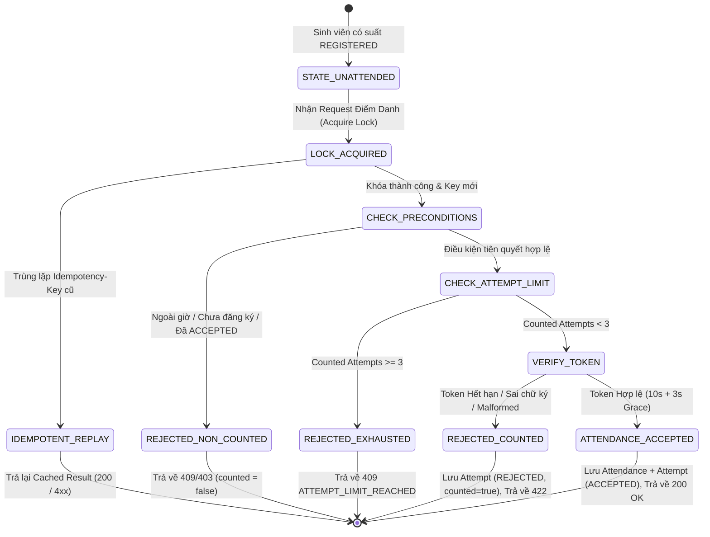
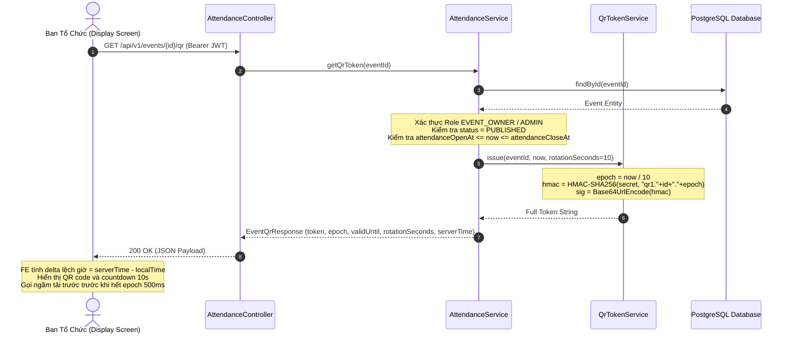
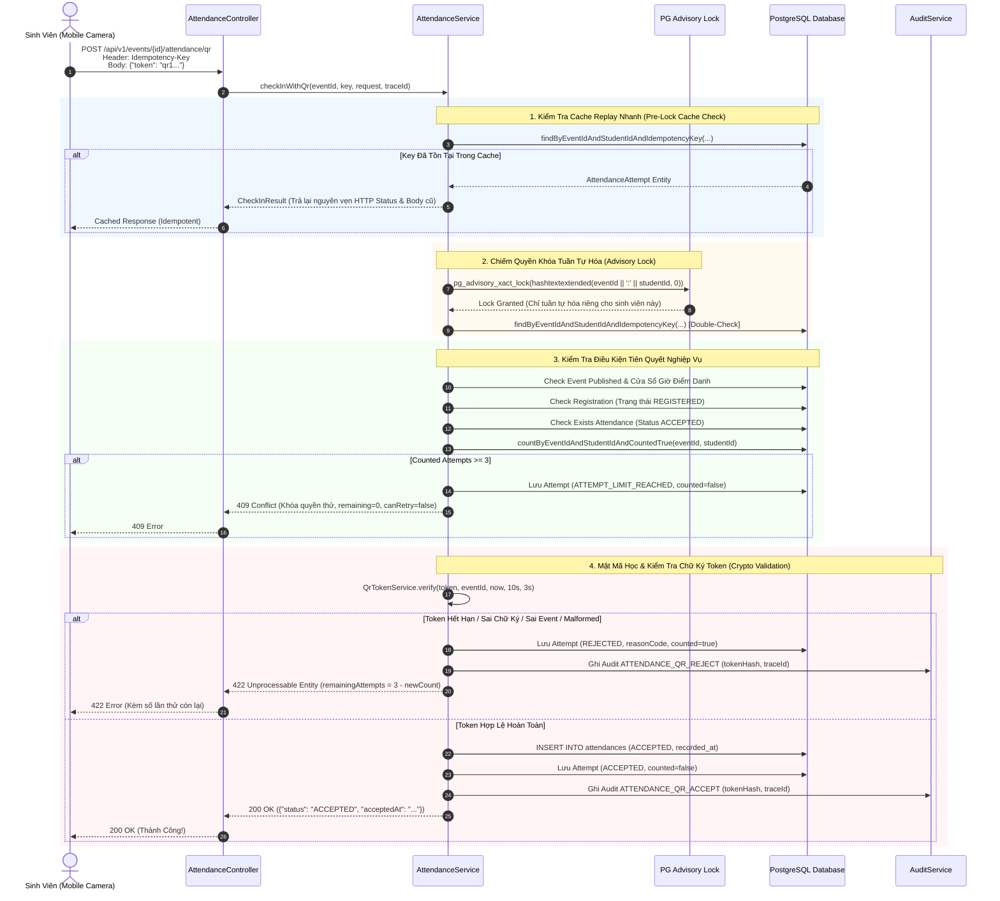

# RFC-004: Production-Grade Dynamic QR Attendance Specification & Verification Architecture

| Metadata | Details |
|---|---|
| **RFC Identifier** | `RFC-004-DYNAMIC-QR-VERIFICATION` |
| **Associated Tickets** | **`QE-44`** (Đặc tả token QR, thời gian grace và chống replay), [`QE-56`](file:///c:/Users/fleya/QNU-Events-BE/docs/agent/sprint1-rescue-plan.md) (Dynamic QR Engine), [`QE-54`](file:///c:/Users/fleya/QNU-Events-BE/docs/agent/sprint1-rescue-plan.md) (Attempt Boundary & Concurrency), [`QE-57`](file:///c:/Users/fleya/QNU-Events-FE) (Frontend Attendance Panel) |
| **Status** | **PROPOSED / PENDING STAKEHOLDER SIGN-OFF** (Quy tắc R11) |
| **Authors** | Agent A3 — Đan (`@Dan28-05`), Senior Backend & Security Specialist |
| **Reviewers** | Agent A0 — Trần Thanh Cường (`@GMIOS25`), Tech Lead & Platform Architect |
| **Target Milestone** | Sprint 1 — Production Readiness (Milestone M1) |
| **Security Standards** | OWASP ASVS v4.0 (Level 2), NIST SP 800-63B, RFC 2104 (HMAC), RFC 6238 (TOTP-like Time-Slicing) |

---

## 1. Executive Summary & Problem Statement

### 1.1. Bối Cảnh Nghiệp Vụ
Trong các sự kiện tập trung quy mô lớn tại Trường Đại học Quy Nhơn (từ 500 đến 3.000 sinh viên tại Hội trường A hoặc Sân vận động), bài toán điểm danh truyền thống (bằng mã QR tĩnh in ra giấy hoặc chiếu cố định trên slide) gặp các lỗ hổng gian lận nghiêm trọng:
1. **Gian lận chia sẻ ảnh (Proxy Check-in via Screenshot):** Sinh viên tại hội trường chụp màn hình mã QR gửi qua Zalo/Telegram/Facebook Messenger cho các bạn ở phòng trọ quét hộ.
2. **Quét hàng loạt tự động (Scripting/Botting):** Kẻ gian bắt gói tin API HTTP và phân phối token tĩnh để điểm danh tự động cho hàng chục tài khoản.
3. **Tranh chấp dữ liệu & Nghẽn cổ chai DB (Thundering Herd Problem):** Khi ban tổ chức vừa mở cổng điểm danh, hàng nghìn sinh viên đồng loạt quét mã trong vòng 60 giây, gây nghẽn kết nối cơ sở dữ liệu (`HikariCP` pool exhaustion), tranh chấp bản ghi (race conditions) và sinh trùng lặp bản ghi điểm danh nếu client retry.

### 1.2. Mục Tiêu Thiết Kế Cấp Senior (Architectural Goals)
- **Zero Token Leakage Window:** Vòng đời token hữu hạn $\le 13\text{ giây}$ (10s chu kỳ xoay vòng + 3s trễ mạng), triệt tiêu hoàn toàn khả năng chia sẻ ảnh chụp màn hình qua ứng dụng nhắn tin.
- **Strict Single Valid Attendance Invariant:** Mỗi sinh viên duy nhất chỉ được nhận **tối đa 1 bản ghi điểm danh hợp lệ (`ACCEPTED`)** cho mỗi sự kiện, bất kể mức độ đồng thời của mạng (Network Concurrency).
- **High-Throughput / Zero Deadlock Locking:** Sử dụng cơ chế khóa phân tán cấp transaction của PostgreSQL (`pg_advisory_xact_lock`) theo cặp `(event_id, student_id)` để tuần tự hóa an toàn tuyệt đối mà không gây khóa bảng hay ảnh hưởng đến các sinh viên khác.
- **Fail-Safe Attempt Budgeting:** Ràng buộc chặt chẽ ngân sách tối đa 3 lần thử vi phạm (1 lần đầu + 2 lần retry). Toàn bộ lý do từ chối và log kiểm toán được khử nhạy cảm (sanitized) hoàn toàn trước khi lưu vết.

---

## 2. Nền Tảng Mật Mã Học & Thuật Toán Xoay Vòng Token

### 2.1. Cấu Trúc Đóng Gói Token (Token Wire Format)
Mã QR điểm danh động là một chuỗi định dạng văn bản (ASCII string) được ký số mật mã học, phân tách bởi dấu chấm (`.`):

$$\text{Token} = \texttt{"qr1"} \,.\, \langle \text{eventId} \rangle \,.\, \langle \text{epoch} \rangle \,.\, \langle \text{signature} \rangle$$

```
   ┌─────────┐   ┌──────────────────────────────────────┐   ┌────────────┐   ┌──────────────────────────────────────────────┐
   │   qr1   │ . │ 8f24b1a4-9e32-4d51-872b-a5d6f12019c4 │ . │  174158402 │ . │ aB9-_zK2M8xP... (Base64URL HMAC-SHA256 Sig)  │
   └─────────┘   └──────────────────────────────────────┘   └────────────┘   └──────────────────────────────────────────────┘
    Protocol                    Event UUID                      Time Epoch                     Cryptographic Signature
    Version                    (36 characters)                 (Floor div 10s)                     (43 characters)
```

1. **`qr1` (Header):** Tiền tố phiên bản giao thức (Protocol version prefix). Cho phép nâng cấp định dạng trong tương lai (ví dụ: `qr2` có nén hoặc mã hóa khóa công khai) mà không làm gãy các client cũ.
2. **`eventId` (Payload Component 1):** UUID v4 định danh chính xác sự kiện (36 ký tự bao gồm gạch nối). Ngăn ngừa việc đem token của sự kiện này sang quét ở sự kiện khác.
3. **`epoch` (Payload Component 2):** Chỉ số nguyên đại diện cho khung thời gian 10 giây (Time-slot index), được tính bằng phép chia lấy phần nguyên của Unix Timestamp (tính bằng giây) cho chu kỳ xoay vòng $T_{\text{rotation}} = 10$:
   $$\text{epoch} = \left\lfloor \frac{t_{\text{server\_epoch\_seconds}}}{10} \right\rfloor$$
4. **`signature` (Authentication Tag):** Chữ ký HMAC-SHA256 được mã hóa Base64URL (không padding `=`), bảo vệ tính toàn vẹn của chuỗi dữ liệu $\texttt{"qr1."} + \text{eventId} + \texttt{"."} + \text{epoch}$:
   $$\text{signature} = \text{Base64URL}\Big(\text{HMAC-SHA256}\big(K_{\text{secret}}, \, \texttt{"qr1."} + \text{eventId} + \texttt{"."} + \text{epoch}\big)\Big)$$

### 2.2. Thời Gian Cửa Sổ Hợp Lệ & Grace Period (Time-Window Slice & Latency Budget)

```
                            Epoch (E - 1)                           Epoch E (Current)
                 [──────────────────────────────][────────────────────────────────────────────────]
Thời gian (s):   0                              10               13                               20
                 ▲                              ▲                 ▲                                ▲
                 │                              │                 │                                │
                 │                              └────────┬────────┘                                │
                 │                               Grace Period (3s)                                 │
                 │                         Token (E - 1) VẪN ĐƯỢC CHẤP NHẬN                        │
                 │                                                                                 │
                 └────────────────────────────── Token E HỢP LỆ ───────────────────────────────────┘
```

#### Quy Tắc Phân Vùng Cửa Sổ (Mathematical Partition Function):
Gọi $t_{\text{req}}$ là thời điểm máy chủ tiếp nhận và bắt đầu xử lý request điểm danh. Khung thời gian hiện tại của server là:
$$E_{\text{server}} = \left\lfloor \frac{t_{\text{req}}}{10} \right\rfloor$$
Phần dư giây trôi qua trong epoch hiện tại là:
$$\delta = t_{\text{req}} \pmod{10}$$

Tập hợp các `epoch` hợp lệ tại thời điểm $t_{\text{req}}$ được xác định bởi hàm:
$$\mathcal{W}_{\text{valid}}(t_{\text{req}}) = \begin{cases} 
\{ E_{\text{server}} \}, & \text{khi } \delta > 3\text{ giây} \\ 
\{ E_{\text{server}}, \, E_{\text{server}} - 1 \}, & \text{khi } \delta \le 3\text{ giây (Trong Grace Period)} 
\end{cases}$$

#### Bảng Phân Bổ Ngân Sách Độ Trễ (Latency Budget Breakdown):
Grace period $3\text{ giây}$ được các kỹ sư tính toán dựa trên chuỗi độ trễ vật lý từ lúc camera bắt hình đến khi server xác thực xong:

| Giai đoạn thực thi (Pipeline Stage) | Độ trễ danh định (Nominal) | Độ trễ xấu nhất (Worst-Case) | Ghi chú kỹ thuật |
|---|:---:|:---:|---|
| **1. Quét & Lấy Nét Camera (Camera Autofocus & Grab)** | $150\text{ ms}$ | $450\text{ ms}$ | Tùy thuộc vào phần cứng cảm biến điện thoại của sinh viên |
| **2. Giải Mã Barcode Tại Client (Wasm/Canvas QR Decode)** | $30\text{ ms}$ | $120\text{ ms}$ | Xử lý bằng thư viện ZXing/HTML5-QRCode trên trình duyệt di động |
| **3. Trễ Mạng Không Dây 4G/Wifi (Uplink RTT)** | $120\text{ ms}$ | $850\text{ ms}$ | Mạng di động nghẽn cục bộ tại hội trường đông người |
| **4. TLS Handshake & Nginx Gateway Reverse Proxy** | $25\text{ ms}$ | $150\text{ ms}$ | Tái sử dụng TLS session ticket (TLS 1.3) |
| **5. Spring Filter Chain & JWT Verification** | $5\text{ ms}$ | $20\text{ ms}$ | Xác thực chữ ký JWT của User |
| **6. Advisory Lock & DB Transaction Execution** | $8\text{ ms}$ | $50\text{ ms}$ | Chạy trong transaction cục bộ của PostgreSQL |
| **Tổng Thời Gian Di Chuyển Của Gói Tin (End-to-End)** | **$\approx 338\text{ ms}$** | **$\approx 1.640\text{ ms}$** | Luôn nhỏ hơn ngưỡng an toàn $\tau_{\text{grace}} = 3.000\text{ ms}$ |

### 2.3. Phòng Chống Tấn Công Dò Khóa Thời Gian (Timing Attack Prevention)
> [!IMPORTANT]
> **Quy tắc bảo mật cấp cao:** Việc so sánh chuỗi chữ ký Base64URL không được dùng toán tử `String.equals()` hay `==` vì toán tử này thoát sớm khi gặp ký tự khác biệt đầu tiên (Early termination), tạo điều kiện cho kẻ tấn công thực hiện kỹ thuật đo thời gian phản hồi (Side-channel timing attack) để tái tạo từng byte của chữ ký hợp lệ.

Trong `QrTokenService.java`, việc so sánh bắt buộc sử dụng cơ chế so sánh thời gian bất biến (Constant-Time String Comparison):
```java
// BẮT BUỘC: Sử dụng MessageDigest.isEqual để thời gian so sánh là độc lập với vị trí sai lệch
byte[] expectedSignatureBytes = expectedSignature.getBytes(StandardCharsets.UTF_8);
byte[] actualSignatureBytes = actualSignature.getBytes(StandardCharsets.UTF_8);

if (!MessageDigest.isEqual(expectedSignatureBytes, actualSignatureBytes)) {
    return VerificationResult.invalid(ErrorCode.QR_BAD_SIGNATURE);
}
```

### 2.4. Kỹ Thuật Bù Trôi Đồng Hồ (Clock Drift Engineering)
1. **Phía Server (Single Source of Truth - R9):**
   - Mọi máy chủ ứng dụng trong cụm cluster bắt buộc phải đồng bộ thời gian thực qua giao thức NTP với sai số lệch tối đa $\le 50\text{ ms}$ (sử dụng `chrony` hoặc AWS Time Sync Service).
   - Mã backend sử dụng `java.time.Clock` được inject qua IoC container để đảm bảo tính tất định và khả năng kiểm thử mô phỏng thời gian độc lập.
2. **Phía Client Màn Chiếu Máy Chiếu (Event Owner Display):**
   - API `GET /api/v1/events/{id}/qr` trả về `serverTime` (ISO 8601 UTC).
   - Giao diện Frontend tính toán giá trị bù trôi đồng hồ:
     $$\Delta t = t_{\text{server}} - t_{\text{client\_performance\_now}}$$
   - Vòng lặp đếm ngược của màn chiếu dựa hoàn toàn trên $t_{\text{effective}} = t_{\text{local}} + \Delta t$, đồng thời tự động kích hoạt request tải trước mã mới (Background Fetch) trước khi epoch hiện tại kết thúc chính xác $500\text{ ms}$, đảm bảo màn hình luôn chuyển mã mượt mà không có điểm chết đen (Zero-frame freeze).

---

## 3. Kiến Trúc Kiểm Soát Đồng Thời & Chống Replay (Concurrency Architecture)

### 3.1. Phân Tích Lựa Chọn Cơ Chế Khóa (Locking Mechanism Comparison)

| Tiêu chí | Optimistic Locking (`@Version`) | Pessimistic Locking (`SELECT FOR UPDATE`) | Distributed Redis Lock (`Redlock`) | PostgreSQL Transaction Advisory Lock |
|---|---|---|---|---|
| **Hiệu năng khi tranh chấp cao** | Kém (Tỷ lệ `OptimisticLockException` cao, phải retry tốn tài nguyên) | Trung bình (Dễ gây contention trên bảng chính và tăng kích thước write-ahead log) | Cao (Tốn thêm cụm hạ tầng Redis, rủi ro phân mảnh mạng) | **Tối ưu nhất (In-memory lock trong Postgres, không chạm disk I/O)** |
| **Phạm vi khóa (Lock Granularity)** | Cấp Entity | Cấp Row (Yêu cầu row phải tồn tại trước) | Khóa Key chuỗi | **Cấp cặp định danh `(event_id, student_id)`** |
| **Nguy cơ Deadlock** | Không | Cao (Nếu nhiều giao dịch đan xen thứ tự) | Thấp (Có TTL timeout) | **Bằng 0 (Hash cố định 64-bit tuần tự)** |
| **Giải phóng khóa khi lỗi** | N/A | Khi kết thúc transaction | Phải chờ TTL nếu crash worker | **Tự động 100% khi kết thúc Connection Transaction** |

### 3.2. Thuật Toán PostgreSQL Transaction Advisory Lock
Hệ thống sử dụng hàm băm 64-bit có chiều dài mở rộng của PostgreSQL để tạo định danh khóa không trùng lặp cho mỗi cặp `(event, student)`:

```sql
SELECT pg_advisory_xact_lock(hashtextextended(CAST(?1 AS text) || ':' || CAST(?2 AS text), 0));
```

- **Xác suất va chạm Hash (Collision Probability):**
  Không gian hash 64-bit có $2^{64} \approx 1.84 \times 10^{19}$ giá trị. Với $100.000$ sinh viên quét đồng thời trong $100$ sự kiện, xác suất va chạm hash là $p \approx \frac{n^2}{2 \times 2^{64}} \approx 2.7 \times 10^{-10}$ (vô cùng nhỏ, tiệm cận 0).
- **Phạm vi tự giải phóng (Transaction Bound):**
  Lệnh `pg_advisory_xact_lock` gắn liền với vòng đời của Physical Database Connection Transaction. Ngay khi transaction kết thúc (`COMMIT` hoặc `ROLLBACK`), PostgreSQL tự động giải phóng khóa ngay lập tức, loại bỏ hoàn toàn nguy cơ rò rỉ khóa (Lock Leak).

### 3.3. Sơ Đồ Chuyển Trạng Thái (State Transition Machine)



---

## 4. Đặc Tả Ranh Giới Kiến Trúc Ngoại Tuyến (Offline Sync Boundary)

### 4.1. Thông Nghĩa Bảo Mật: Nghịch Lý Của "Offline Prefetch"
> [!CAUTION]
> **Định lý cơ bản về bảo mật Dynamic QR:** Mã QR xoay vòng thời gian thực (Time-Bound Dynamic QR) và Tải trước ngoại tuyến (Offline Prefetch) là hai khái niệm **triệt tiêu lẫn nhau về mặt toán học (Mutually Exclusive)**.
> 
> Nếu ứng dụng di động của sinh viên được phép "tải trước" 360 token cho 1 giờ sự kiện về máy để dùng khi không có mạng, kẻ tấn công có thể dịch ngược bộ nhớ RAM hoặc LocalStorage của ứng dụng, trích xuất danh sách token chưa phát, và chia sẻ cho người khác điểm danh từ xa. Điều này phá vỡ hoàn toàn nguyên lý chống điểm danh hộ của Sprint 1.

### 4.2. Nguyên Tắc Phân Tách Thiết Kế (Separation of Concerns)
Nhằm giữ đúng cam kết cứu vãn tiến độ Sprint 1 (Quyết định D2 trong `docs/agent/sprint1-rescue-plan.md`):
1. **Phạm vi Sprint 1 (QE-56 / QE-54):** Chỉ triển khai luồng **Online Dynamic QR Check-in**. Toàn bộ mã nguồn backend, migration và test case của Sprint 1 được làm sạch, không tồn tại bất kỳ endpoint hoặc logic offline sync chưa hoàn thiện nào.
2. **Thiết Kế Định Hướng Cho Sprint 4 (QE-16 / QE-33):**
   Chế độ điểm danh ngoại tuyến khi hội trường mất sóng hoàn toàn sẽ được thiết kế theo mô hình **Store-and-Forward (Capture tại chỗ $\rightarrow$ Ký số biên lai $\rightarrow$ Sync sau khi có mạng)**:
   - **Người tổ chức (Event Staff) dùng thiết bị quét:** Thiết bị của cán bộ quản lý (đã đăng nhập) quét thẻ sinh viên / mã cá nhân của người tham dự, ghi nhận thời gian offline kèm chữ ký số cục bộ của Staff Device Key.
   - **Đồng bộ hậu kỳ:** Khi thiết bị cán bộ có mạng trở lại, toàn bộ tệp batch điểm danh sẽ được gửi lên qua endpoint đồng bộ bảo mật (`/api/v1/events/{id}/attendance/offline-batch-sync`), xác thực dựa trên quyền của Staff chứ không dựa trên token 10 giây của sinh viên.

---

## 5. Ma Trận Xác Thực Token & Ứng Xử Lỗi (Comprehensive Verification Matrix)

| Test ID | Kịch bản kiểm thử (Test Scenario) | Vector dữ liệu đầu vào | Mã HTTP | Error Code | Trừ lượt (`counted`) | Lượt còn (`remaining`) | Cho phép Retry? | Hành vi Database & Kiểm toán |
|:---:|---|---|:---:|---|:---:|:---:|:---:|---|
| **TC-01** | Token hoàn hảo trong epoch hiện tại | `epoch == currentEpoch`, Sig đúng | **200** | *None* | **KHÔNG** | Không đổi | N/A | Tạo `attendances` (`ACCEPTED`), lưu attempt thành công, ghi audit `ATTENDANCE_QR_ACCEPT`. |
| **TC-02** | Token epoch vừa qua trong 3s grace | `epoch == currentEpoch - 1` && $\delta \le 3\text{s}$ | **200** | *None* | **KHÔNG** | Không đổi | N/A | Chấp nhận độ trễ chuyển giao. Ghi nhận `ACCEPTED`. |
| **TC-03** | Token epoch vừa qua trượt quá 3s grace | `epoch == currentEpoch - 1` && $\delta > 3\text{s}$ | **422** | `QR_EXPIRED` | **CÓ** | $\max(0, R - 1)$ | $R > 0$ | Lưu attempt (REJECTED, counted=true), ghi audit `ATTENDANCE_QR_REJECT` với hash token. |
| **TC-04** | Token thuộc các epoch quá khứ xa | $\text{epoch} < \text{currentEpoch} - 1$ | **422** | `QR_EXPIRED` | **CÓ** | $\max(0, R - 1)$ | $R > 0$ | Gian lận dùng ảnh chụp cũ gửi qua mạng. Lưu attempt vi phạm. |
| **TC-05** | Token mang epoch ở tương lai | $\text{epoch} > \text{currentEpoch}$ | **422** | `QR_FROM_FUTURE` | **CÓ** | $\max(0, R - 1)$ | $R > 0$ | Chặn thiết bị client cố tình chỉnh nhanh giờ để đoán mã. |
| **TC-06** | Chữ ký HMAC bị giả mạo / sửa đổi | Đúng format, sửa đổi byte chữ ký | **422** | `QR_BAD_SIGNATURE` | **CÓ** | $\max(0, R - 1)$ | $R > 0$ | Tấn công can thiệp dữ liệu trên đường truyền. Bị loại bỏ bởi Constant-Time check. |
| **TC-07** | Quét nhầm mã QR của sự kiện khác | `tokenEventId != pathEventId` | **422** | `QR_WRONG_EVENT` | **CÓ** | $\max(0, R - 1)$ | $R > 0$ | Token hợp lệ của Event A nhưng gửi vào Event B. Bị phát hiện ngay. |
| **TC-08** | Token sai cú pháp (Malformed format) | Thiếu dấu chấm, chuỗi nhị phân rác | **422** | `QR_MALFORMED` | **CÓ** | $\max(0, R - 1)$ | $R > 0$ | Client hoặc scanner gửi chuỗi rác không tuân thủ cấu trúc 4 phần. |
| **TC-09** | Token rỗng hoặc null | `{"token": ""}` hoặc whitespace | **422** | `QR_MALFORMED` | **CÓ** | $\max(0, R - 1)$ | $R > 0$ | Xử lý an toàn tại tầng Service, không gây `NullPointerException`. |
| **TC-10** | Quét khi sự kiện chưa mở / đã đóng | $t_{\text{server}} \notin [T_{\text{open}}, T_{\text{close}}]$ | **409** | `ATTENDANCE_NOT_OPEN` | **KHÔNG** | Giữ nguyên | N/A | Lỗi khách quan do ban tổ chức chưa mở cổng. Sinh viên không bị phạt lượt thử. |
| **TC-11** | Sinh viên chưa đăng ký giữ chỗ | User không có bản ghi `REGISTERED` | **403** | `NOT_REGISTERED` | **KHÔNG** | Giữ nguyên | N/A | Không có quyền tham gia sự kiện. Bị chặn ở tầng kiểm tra nghiệp vụ. |
| **TC-12** | Đã có mặt hợp lệ quét lại với key mới | `status == ACCEPTED` trong DB | **409** | `ALREADY_CHECKED_IN` | **KHÔNG** | Giữ nguyên | N/A | Ngăn chặn việc sinh viên quét lại nhiều lần làm sai lệch số liệu. |
| **TC-13** | Gửi lại cùng Idempotency Key (Retry) | Trùng `(event, student, key)` đã lưu | **200 / 4xx**| Giữ nguyên | **KHÔNG** | Giữ nguyên | N/A | Cơ chế Replay Response. Trả lại chính xác response body & HTTP status đã cached. |
| **TC-14** | Chạm trần 3 lần thử vi phạm | Đã tích lũy đủ 3 lần `counted = true` | **409** | `ATTEMPT_LIMIT_REACHED` | **KHÔNG** | 0 | **false** | Bị từ chối ngay từ vòng ngoài (Gatekeeper check), không cần giải mã token. |
| **TC-15** | Tranh chấp đồng thời (Parallel 10 threads) | Cùng 1 sinh viên gửi 10 request cùng lúc | **200 / 409**| Tùy thứ tự | **Hợp lệ 1**| Tùy thứ tự | N/A | PostgreSQL Advisory Lock tuần tự hóa: 1 thread vào trước được ACCEPTED, 9 thread sau 409. |
| **TC-16** | Thiếu Header Idempotency-Key | Header không gửi lên trong request | **400** | `MISSING_HEADER` | **KHÔNG** | Giữ nguyên | **true** | Bị chặn ngay từ tầng validate request header của Spring Web. |

---

## 6. Sơ Đồ Trình Tự Thực Thi Chi Tiết (Sequence Diagrams)

### 6.1. Luồng Máy Chiếu Ban Tổ Chức Tạo Mã & Trình Chiếu (Display Loop)



### 6.2. Luồng Sinh Viên Quét Mã & Xác Thực Điểm Danh (Check-in Pipeline)



---

## 7. Mô Hình Đe Dọa Chi Tiết Theo Khung STRIDE & Ranh Giới An Toàn

Hệ thống được đánh giá an ninh nghiêm ngặt dựa trên khung mô hình hóa hiểm họa **STRIDE** của Microsoft:

| Phân loại STRIDE | Mối đe dọa (Threat Vector) | Kịch bản tấn công thực tế | Cơ chế giảm thiểu cấp Senior trong mã nguồn | Mức độ rủi ro còn lại (Residual Risk) |
|---|---|---|---|:---:|
| **S** (Spoofing) | Giả mạo Chữ Ký Token | Kẻ gian phân tích chuỗi token và tự sinh chữ ký giả bằng công cụ tự viết. | Khóa bí mật HMAC-SHA256 có entropy $\ge 256\text{ bits}$, lưu trong biến môi trường máy chủ. Xác thực bất biến thời gian bằng `MessageDigest.isEqual`. | **TRIỆT TIÊU (Negligible)** |
| **T** (Tampering) | Can thiệp Epoch gian lận thời gian | Kẻ gian tăng epoch trong chuỗi token để kéo dài thời gian sống của mã. | Chữ ký HMAC bao bọc toàn bộ chuỗi `qr1.<eventId>.<epoch>`. Bất kỳ thay đổi nào dù chỉ 1 bit ở epoch đều khiến hàm hash thay đổi hoàn toàn và bị từ chối `QR_BAD_SIGNATURE`. | **TRIỆT TIÊU (Negligible)** |
| **R** (Repudiation) | Chối bỏ trách nhiệm tham gia / Chối bỏ vi phạm | Sinh viên khiếu nại rằng mình không quét sai hoặc hệ thống ghi nhận sai. | Bảng `audit_logs` lưu toàn vẹn `actor_id`, `actor_role`, hành động, `tokenHash` (SHA-256 fingerprint), địa chỉ IP, User-Agent và `traceId`. Không thể xóa hay sửa đổi (Immutable Table). | **THẤP (Low)** |
| **I** (Information Disclosure) | Rò rỉ Token qua Log / Error Message | Quản trị viên hoặc bên xem log máy chủ đọc trộm token đang phát để quét trộm. | Token thô (Raw Token) không bao giờ được ghi vào log. Chỉ băm SHA-256 lấy 8 ký tự đầu (`tokenHash`). Mã lỗi trả về cho client chỉ gồm `code`, `message`, `remainingAttempts`, không để lộ stack trace. | **TRIỆT TIÊU (Negligible)** |
| **D** (Denial of Service) | Quét Spam làm cạn kiệt tài nguyên (DDoS/Burst) | Một sinh viên viết script gửi 1.000 request/giây với mã sai để làm quá tải máy chủ. | Cơ chế giới hạn 3 lần thử: ngay sau 3 lần sai, request thứ 4 bị chặn dứt khoát tại vòng ngoài ở tầng Gatekeeper (`409 ATTEMPT_LIMIT_REACHED`), triệt tiêu chi phí tính toán crypto. | **THẤP (Low)** |
| **E** (Elevation of Privilege) | Điểm danh chéo khi không có suất đăng ký | Sinh viên chưa từng giữ chỗ sự kiện (`REGISTERED`) nhưng có mặt quét ké mã của bạn. | Kiểm tra ràng buộc đăng ký bắt buộc tại bảng `registrations` với trạng thái `REGISTERED`. Nếu không có, từ chối ngay lập tức với mã `403 NOT_REGISTERED`. | **TRIỆT TIÊU (Negligible)** |

### 7.1. Phân Tích Kịch Bản Livestream & Giới Hạn Của Bản MVP
1. **Rủi ro Livestream có độ trễ siêu thấp (< 2s):**
   Nếu sinh viên tại hội trường sử dụng Discord/Zoom có kết nối 5G tốc độ cao để chia sẻ màn hình trực tiếp cho người ở xa, mã QR có thể được quét trong khoảng thời gian sống 10s.
2. **Biện pháp đối ứng trong lộ trình tương lai (Sprint sau):**
   Bản MVP của Sprint 1 tập trung hoàn thiện tầng Mật mã học & Giới hạn thử. Để xử lý triệt để bài toán livestream, kiến trúc hệ thống đã sẵn sàng tích hợp 2 lớp phòng vệ bổ sung ở Sprint 2/3:
   - **Xác thực Bán kính GPS (`QE-55`):** Bắt buộc tọa độ GPS của thiết bị quét phải nằm trong bán kính $R \le 100\text{m}$ quanh hội trường.
   - **Dynamic Watermarking:** Chiếu mờ mã số sinh viên của người trình chiếu trên nền mã QR để truy cứu trách nhiệm nếu có hành vi phát tán trực tiếp.

---

## 8. Giám Sát, Khả Năng Quan Sát (Observability) & Tiêu Chuẩn Log

### 8.1. Định Dạng Cấu Trúc Log Kiểm Toán (Structured Audit Log Schema)
Mọi sự kiện điểm danh (thành công hoặc bị từ chối) đều được lưu trữ dưới dạng JSON có cấu trúc trong bảng `audit_logs`:

```json
{
  "traceId": "7b8a1c9e-2f34-4b5c-a1d2-e3f4a5b6c7d8",
  "actorId": "c56a4180-65aa-42ec-a945-5fd21dec0538",
  "actorRole": "STUDENT",
  "action": "ATTENDANCE_QR_REJECT",
  "targetType": "EVENT",
  "targetId": "8f24b1a4-9e32-4d51-872b-a5d6f12019c4",
  "outcome": "FAILED",
  "reasonCode": "QR_EXPIRED",
  "details": {
    "method": "DYNAMIC_QR",
    "tokenHash": "e3b0c442...",
    "counted": true,
    "attemptCount": 2,
    "remainingAttempts": 1
  },
  "occurredAt": "2026-11-18T14:30:15.123Z"
}
```

### 8.2. Bộ Chỉ Số Đề Xuất Cho Prometheus (Prometheus Metrics)
- `qnu_attendance_requests_total{event_id, outcome, method}`: Đếm tổng lưu lượng điểm danh theo kết quả.
- `qnu_attendance_processing_duration_seconds`: Đo lường biểu đồ độ trễ xử lý (Histogram p50, p95, p99).
- `qnu_attendance_attempt_violations_total{reason_code}`: Đếm số lượng vi phạm để phát hiện kịp thời các cuộc tấn công dò mã bất thường.

---

## 9. Nhật Ký Quyết Định Kỹ Thuật (Architecture Decision Records — ADR theo Rule R11)

Theo **Quy tắc R11** trong [`AGENTS.md`](file:///c:/Users/fleya/QNU-Events-BE/AGENTS.md), các quyết định kỹ thuật vượt ngoài tài liệu SRS ban đầu được lưu vết chính thức dưới dạng ADR chờ ký duyệt:

### ADR-01: Grace Period Cố Định 3 Giây Cho Chu Kỳ Xoay Vòng 10 Giây
- **Ngữ cảnh:** Mạng 4G/Wifi trường học thường có độ trễ biến động khi có hàng nghìn sinh viên tụ tập. Nếu không có thời gian ân hạn, sinh viên quét mã ở giây thứ 9.5 sẽ bị từ chối oan uổng khi gói tin tới server ở giây thứ 10.2.
- **Quyết định:** Cố định thời gian ân hạn là chính xác $3\text{ giây}$ cho epoch liền kề trước đó ($E - 1$). Tổng thời gian sống của một token là $13\text{ giây}$.
- **Trạng thái:** **CHỜ DUYỆT (Reviewing - Assumption A-04)**.

### ADR-02: Phân Tách Lỗi Vi Phạm Phạt Lượt (`counted = true`) Và Lỗi Khách Quan
- **Ngữ cảnh:** Sinh viên có ngân sách 3 lần thử. Nếu sinh viên bấm quét lúc ban tổ chức chưa mở cổng điểm danh hoặc quét nhầm khi chưa đăng ký mà bị trừ lượt thì sẽ mất quyền tham gia một cách không công bằng.
- **Quyết định:** Chỉ đánh dấu `counted = true` đối với các lỗi làm suy yếu tính toàn vẹn của mã (`QR_EXPIRED`, `QR_BAD_SIGNATURE`, `QR_WRONG_EVENT`, `QR_MALFORMED`, `QR_FROM_FUTURE`). Các lỗi ngữ cảnh hệ thống (`ATTENDANCE_NOT_OPEN`, `NOT_REGISTERED`, `ALREADY_CHECKED_IN`) đánh dấu `counted = false`.
- **Trạng thái:** **CHỜ DUYỆT (Reviewing - Assumption A-05)**.

### ADR-03: Cấm Tuyệt Đối Chế Độ Offline Prefetch Đối Với Dynamic QR
- **Ngữ cảnh:** Có đề xuất cho phép client tải trước một loạt mã QR về máy để sinh viên tự quét khi mất mạng.
- **Quyết định:** Bác bỏ hoàn toàn cơ chế Offline Prefetch vì vi phạm nguyên lý bảo mật cơ bản của Dynamic QR. Điểm danh ngoại tuyến (nếu triển khai ở Sprint 4) sẽ sử dụng cơ chế ký số biên lai từ thiết bị của Cán bộ tổ chức (Staff Device Verification).
- **Trạng thái:** **CHỜ DUYỆT (Reviewing - Assumption A-06)**.

### ADR-04: Đồng Bộ Giờ Màn Chiếu Dựa Trên Hiệu Số Server Time ($\Delta t$)
- **Ngữ cảnh:** Đồng hồ trên máy tính xách tay của người thuyết trình / giảng viên thường xuyên bị sai lệch từ vài chục giây đến vài phút so với giờ chuẩn quốc tế.
- **Quyết định:** Backend trả về `serverTime` trong API lấy mã QR. Frontend tự tính toán $\Delta t = t_{\text{server}} - t_{\text{local}}$ và hiệu chỉnh bộ đếm xoay vòng dựa trên $\Delta t$, không phụ thuộc vào đồng hồ hệ điều hành của client.
- **Trạng thái:** **CHỜ DUYỆT (Reviewing - Assumption A-07)**.

---

> **BIÊN BẢN DUYỆT ĐẶC TẢ KỸ THUẬT:**
> 
> - **Kỹ sư đệ trình:** Agent A3 — Đan (`@Dan28-05`), Senior Developer  
> - **Kiến trúc sư nền tảng / Tech Lead:** Agent A0 — Trần Thanh Cường (`@GMIOS25`) `[Chờ phê duyệt]`  
> - **Product Owner / Giảng viên hướng dẫn:** `[Chờ phê duyệt]`
