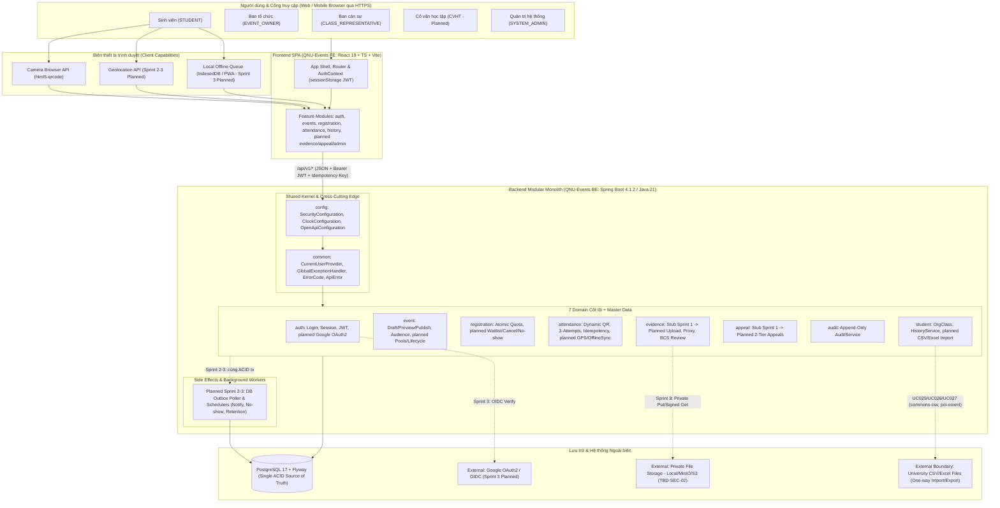
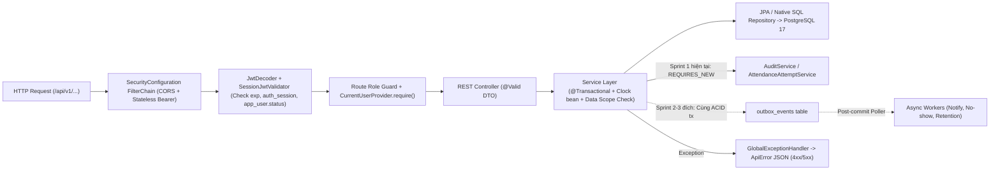
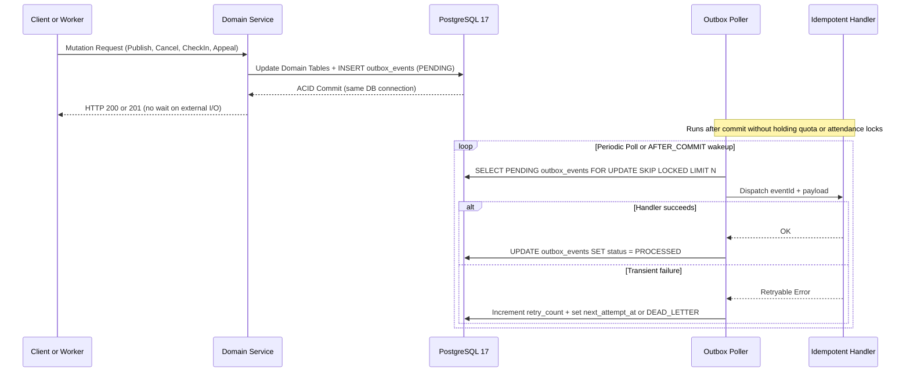

# Thiết kế Kiến trúc MVP & Phân ranh giới Module (Architecture & Boundaries) — QNU-Events

> **Jira Key:** `QE-6` (*Thiết kế kiến trúc MVP & boundaries*, 8 SP)  
> **Trạng thái tài liệu:** Bản thiết kế kiến trúc chuẩn hóa dựa trên hiện trạng Sprint 1 và đặc tả MVP (Sprint 2–3). Các quyết định kỹ thuật chưa có trong SRS được đánh dấu rõ **`ASSUMPTION (chưa duyệt)`** theo quy tắc **R11** (`AGENTS.md`) để nhóm duyệt trước khi đưa vào `docs/decisions.md`.

---

## Nguồn tham chiếu & Bằng chứng kiểm chứng (R1)

| Nguồn | Nội dung đối chiếu |
|---|---|
| **SRS v1.0 & Proposal v2.0** | `docs/QNU_Event_SRS.docx` (05/11/2026), `docs/QNU_Event_Participation_Management_Project_Proposal_v2.docx` (02/10/2026) — trích xuất xác minh qua `@srs-reader` (`#9`) |
| **Repo Rules & Plans** | `AGENTS.md`, `docs/backend-foundation.md`, `docs/agent/sprint1-rescue-plan.md`, `docs/decisions.md`, `docs/backlog_solutions.md` |
| **Schema & API Contract** | `src/main/resources/db/migration/V1__sprint1_core_schema.sql`, `docs/Design/erd.md`, `docs/api/sprint1-contract.md` |
| **Figma Design Spec** | [`HX4313AoLQX4zNidDz2Ixo`](https://www.figma.com/design/HX4313AoLQX4zNidDz2Ixo/QNU-Event---Attendance-MVP?node-id=0-1&p=f&t=bTVrQcyZXxPCWjyh-0) (`QNU Event - Attendance MVP`: pages `QNU EVENT UI` + `phones`) |
| **Codebase BE & FE thực tế** | `QNU-Events BE` (`pom.xml`, `src/main/java/vn/edu/qnu/events/**`, `application*.yml`) & `QNU-Events FE` (`package.json`, `src/**`) + đối chiếu kiểm chứng bởi `@tech-audit` (`#8`) |

---

## 1. Kiến trúc Hệ thống & Kiến trúc Logic (System & Logical Architecture)

### 1.1 Định hướng Kiến trúc: Modular Monolith + SPA + PostgreSQL 17

Theo `docs/backend-foundation.md`, `README.md` và đặc tả quy mô thí điểm (`#9` §1.D, §1.E), phạm vi triển khai MVP là **01 khoa (~3.000 sinh viên, dữ liệu kiểm thử ≥ 30.000 bản ghi đăng ký/điểm danh)**. Do đó, hệ thống áp dụng kiến trúc **Modular Monolith** thay vì microservices/Redis/Kafka nhằm:

1. **Giữ ranh giới giao dịch ACID đơn giản và chặt chẽ:** Các nghiệp vụ nhạy cảm về tính nhất quán (giữ suất nguyên tử trên `events.registered_count`, kiểm tra 1 bản ghi `ACCEPTED` duy nhất, đếm tối đa 3 lượt thử) thực thi trong một giao dịch PostgreSQL 17 duy nhất, tránh giao dịch phân tán.
2. **Đơn giản hóa triển khai & vận hành (MVP):** Một tiến trình backend (`qnu-events` trên Java 21 / Spring Boot 4.1.2), một SPA frontend (`qnu-events-fe` trên React 19 / TypeScript / Vite), và một cơ sở dữ liệu quan hệ PostgreSQL 17 do Flyway quản lý lược đồ (`ddl-auto: validate`).
3. **Cô lập nghiệp vụ theo package tính năng:** Mã nguồn BE chia thành các package module rõ ràng dưới `vn.edu.qnu.events.*`, kết hợp bảng phân quyền tệp tin của `AGENTS.md` (R8) và `.github/CODEOWNERS` để các thành viên phát triển song song không xung đột.

### 1.2 Sơ đồ Kiến trúc Tổng thể & Biên Hệ thống (System & Container Boundaries)

### 1.3 Kiến trúc Logic nội bộ & Nguyên tắc Tách biệt Trạng thái (`OTH-DATA-002`)

Mọi request đi vào backend tuân theo luồng logic chuẩn hóa sau:

Theo yêu cầu `OTH-DATA-002` và `Proposal §15.1–§15.2` (`#9` §1.B), kiến trúc logic **tách biệt tuyệt đối** các trục trạng thái để tránh trộn lẫn ngữ nghĩa giữa các module:

| Trục trạng thái | Domain sở hữu | Giá trị / Trạng thái | Ràng buộc tách biệt (`OTH-DATA-002`) |
|---|---|---|---|
| **Event Status** | `event` | `DRAFT` \| `PUBLISHED` \| `CANCELLED` | Tách biệt với cổng mở/đóng đăng ký (`registration_deadline`) và cổng điểm danh (`attendance_open_at`..`attendance_close_at`) |
| **Registration Status** | `registration` | `REGISTERED` \| `WAITING_LIST` \| `CANCELLED` \| `NO_SHOW` | `REGISTERED` ≠ đã điểm danh (`ACCEPTED`). Chờ danh sách (`WAITING_LIST`) không chiếm quota thực tế |
| **Attendance Status** | `attendance` | `PENDING` \| `ACCEPTED` \| `REJECTED` (và ngữ nghĩa `APPEALED` ở lớp xử lý/lịch sử) | Tối đa 01 bản ghi `ACCEPTED` / `(event_id, student_id)`. `PENDING` (evidence) ≠ `PENDING_SYNC` (offline queue của client) |
| **Check-in Attempt** | `attendance` | `attendance_attempts`: `ACCEPTED` \| `REJECTED` (`counted = true/false`) | Tách khỏi `attendances` để lưu kết quả `Idempotency-Key` và đếm giới hạn 3 lần thử sai mà không làm nhiễu bảng điểm danh hợp lệ |
| **Appeal Status** | `appeal` | Planned Sprint 3: Round 1 / Round 2 (Pending / Approved / Rejected) | `Appealed` ≠ `Accepted`; khiếu nại được duyệt mới cập nhật kết quả điểm danh hoặc gỡ hạn chế no-show kèm audit |
| **Offline Queue Status** | Client + `attendance` sync | `PENDING_SYNC` \| `SYNCED` (hoặc server reject khi đồng bộ) | Chỉ là hàng đợi cục bộ trên thiết bị (`UC019`), không có hiệu lực cho đến khi server xác thực lại |

---

## 2. Ma trận Biên Module & Quyền sở hữu (Bounded Module Matrix)

### 2.1 Ma trận 7 Domain Cốt lõi + Master Data (`student`) + Shared Kernel (`common`/`config`)

> Lưu ý kiểm chứng thực tế (`AGENTS.md` R1): Bảng dưới đây phân tách rạch ròi giữa **code thực sự đã có trên nhánh `develop`** (đã đọc trực tiếp từng class/SQL) và **phần dự kiến Sprint 2–3** theo SRS/Proposal/Jira.

| # | Domain / Module | BE Package & Artifact Thực tế | FE Feature & Routes | DB Tables Sở hữu (`V1` vs Planned `V2+`) | SRS (`UC` / `REQ`) & Jira | Sprint 1 Implemented | Sprint 2–3 Planned |
|---|---|---|---|---|---|---|---|
| **1** | **Auth & RBAC** | `vn.edu.qnu.events.auth`: `AppUser`, `AppUserRepository`, `AuthController`, `AuthService`, `AuthSession`, `AuthSessionRepository`, `JwtService`, `SessionJwtValidator`, `LoginRequest`, `LoginResponse`, `UserInfo`, `UserStatus`, `DemoDataSeeder` + `config.SecurityConfiguration` | `src/features/auth/`: `AuthContext.tsx`, `LoginPage.tsx`, `types.ts` Routes: `/login`, `RequireRole` | **V1:** `app_user`, `user_role`, `auth_session` **V2+ Planned:** `login_attempt_tracker` (hoặc cột lock tạm thời), `admin_role_audit`, `oauth_identity_link` | `UC001–UC003` `REQ-AUTH-001..015` Jira: `QE-64` (S1), `QE-30`, `QE-35`, `QE-36`, `QE-73`, `QE-74`, `QE-7` | Login `loginId + password` (`POST /api/v1/auth/login`), BCrypt(12), `DUMMY_HASH`, JWT HS256 (8h) + DB `auth_session`, `logout` (`204`), `GET /api/v1/auth/me`, kiểm tra `LOCKED` (`403`), `DemoDataSeeder` | Google OAuth2 QNU allowlist (`QE-74`), khóa 5 lần sai/15 phút (`REQ-AUTH-015`), cấp/gỡ role `EVENT_OWNER`/`BCS`/`CVHT` kèm `unit_id` (`QE-35`), reset mật khẩu (`TBD-AUTH-01`), bổ sung role `CVHT` |
| **2** | **Event** | `vn.edu.qnu.events.event`: `Event`, `EventStatus`, `AttendanceMethod`, `EventController`, `EventService`, `EventRepository`, `EventValidator`, `EventUpsert`, `EventSummary`, `EventDetail`, `PreviewResponse`, `PublishRequest` | `src/features/events/`: `EventsPage.tsx`, `EventDetailPage.tsx`, `EventFormPage.tsx`, `EventQrPage.tsx`, `types.ts` Routes: `/events`, `/events/new`, `/events/:id`, `/events/:id/edit` | **V1:** `events`, `event_audience` **V2+ Planned:** `event_quota_pool` (hoặc tier quotas), `event_gps_config`, `activity_category` | `UC004–UC008`, `UC013` `REQ-EVT-001..024` Jira: `QE-65`, `QE-66`, `QE-31` (S1), `QE-12`, `QE-15`, `QE-32`, `QE-37`, `QE-38` | Create `DRAFT`, update `DRAFT` (`@Version` bắt buộc — `A-001`), `GET /preview`, `POST /publish` (yêu cầu `confirm` + khớp `previewed_version`), `GET /events` (tìm `q`, lọc `activityType` từ `QE-31`), `GET /events/{id}` (lọc lớp ở server, ngoài lớp/nháp → `404`) | Hủy/sửa event đã publish kèm lý do 10–500 ký tự (`UC008`, `QE-15`, `QE-32`), quota nhiều tầng (`QE-12`, `QE-38`), cấu hình GPS center/radius (`QE-55`), lịch tuần/tháng (`UC007`), wizard 5 bước & trường tùy chọn (`banner`, đơn vị) |
| **3** | **Registration** | `vn.edu.qnu.events.registration`: `Registration`, `RegistrationStatus`, `RegistrationController`, `RegistrationService`, `RegistrationRepository`, `RegistrationResponse`, `MyRegistrationResponse` | `src/features/registration/index.tsx` (`RegistrationSlot` nhúng trong `EventDetailPage`) | **V1:** `registrations` (`uq_registrations_active`) Cập nhật nguyên tử `events.registered_count` **V2+ Planned:** `student_restrictions` (no-show 7 ngày), `waitlist_promotion_log` | `UC009–UC012`, `UC014` `REQ-REG-001..019` Jira: `QE-71` (S1), `QE-8`, `QE-39`, `QE-40`, `QE-14` | `POST /api/v1/events/{id}/registrations` (giữ suất nguyên tử bằng `ON CONFLICT DO NOTHING` + conditional `UPDATE events WHERE registered_count < quota_total`), `GET /registrations/me`, idempotent trả lại suất đã có | Quota nhiều tầng khi đăng ký (`QE-38`), Waiting List FIFO (`QE-39`), hủy đăng ký trước `start_at - 12h` + auto-promote + skip head không hợp lệ (`QE-40`), đánh dấu `NO_SHOW` + chặn đăng ký 7 ngày (`QE-14`) |
| **4** | **Attendance** | `vn.edu.qnu.events.attendance`: `Attendance`, `AttendanceAttempt`, `AttendanceController`, `AttendanceService`, `AttendanceAttemptService`, `AttendanceRepository`, `AttendanceAttemptRepository`, `QrTokenService`, `EventQrResponse`, `CheckInRequest`, `CheckInResponse` | `src/features/attendance/index.tsx` (`AttendanceSlot`), `src/features/events/EventQrPage.tsx` (`/events/:id/qr`), `src/lib/idempotency.ts` | **V1:** `attendances` (`uq_attendances_valid`), `attendance_attempts` (`UNIQUE (event_id, student_id, idempotency_key)`) **V2+ Planned:** cột GPS (`lat`, `lon`, `accuracy`, `suspicious_flag`), bảng/log `offline_sync_batches` | `UC015–UC019` `REQ-ATT-001..024`, `BR-ATT-01..09` Jira: `QE-56`, `QE-57` (S1), `QE-54`, `QE-44`, `QE-55`, `QE-33`, `QE-76`, `QE-77`, `QE-78` | `GET /api/v1/events/{id}/qr` (HMAC-SHA256 `qr1.<eventId>.<epoch>.<sig>`, default 10s + grace 3s), `POST /api/v1/events/{id}/attendance/qr` (`Idempotency-Key` bắt buộc, replay kết quả cũ, tối đa 3 lần thử `counted=true`, 1 `ACCEPTED`/event), FE camera `html5-qrcode` + dán token dự phòng | Chuẩn hóa 3-attempt & concurrent check-in (`QE-54`), GPS Haversine + flag `suspicious_flag=TRUE` không tự reject (`QE-55`), Offline Queue (`IndexedDB`/SQLite `PENDING_SYNC`) + sync batch revalidation (`QE-33`, `QE-76`, `QE-77`, `QE-78`), đếm live `checkedIn/registered` trên màn chiếu QR |
| **5** | **Evidence** | `vn.edu.qnu.events.evidence`: **chỉ có `package-info.java`** (rỗng) | **Chưa có** trong `src/features/` | **V1:** Chưa có bảng riêng (chỉ có enum `EVIDENCE`, `PROXY_EVIDENCE` trong `attendances.method` và `PENDING` trong `attendances.status`) **V2+ Planned:** `attendance_evidences`, `proxy_attendance_items`, `bcs_class_assignment`, `retention_archive_log` | `UC017`, `UC020`, `UC029` `REQ-ATT-011..014`, `REQ-REV-001..007`, `REQ-DATA-019..021` Jira: `QE-18`, `QE-19`, `QE-42`, `QE-43`, `QE-47`, `QE-48`, `QE-78` | Không triển khai trong Sprint 1 (chỉ giữ package placeholder) | Upload ảnh minh chứng JPEG/PNG `< 5 MB` vào private storage (`QE-42`), sinh `Attendance` trạng thái `PENDING`, điểm danh thay nhiều người `PROXY_EVIDENCE` (`QE-19`), BCS duyệt/từ chối theo lớp được phân công (`QE-43`), sao lưu & dọn dẹp theo học kỳ (`QE-47`, `QE-48`) |
| **6** | **Appeal** | `vn.edu.qnu.events.appeal`: **chỉ có `package-info.java`** (rỗng) | **Chưa có** trong `src/features/` | **V1:** Chưa có bảng **V2+ Planned:** `appeals`, `appeal_histories` (hoặc `appeal_attachments`), liên kết `attendances` & `student_restrictions` | `UC022–UC024` `REQ-REV-010..021` Jira: `QE-22`, `QE-41`, `QE-59`, `QE-60` | Không triển khai trong Sprint 1 (chỉ giữ package placeholder) | Khiếu nại Vòng 1 & Vòng 2 (`QE-59`) cho kết quả điểm danh, lỗi sync offline hoặc gỡ hạn chế No-show; CVHT/Admin có thẩm quyền xem xét, cập nhật trạng thái attendance/penalty và ghi audit (`QE-60`) |
| **7** | **Audit** | `vn.edu.qnu.events.audit`: `AuditLog`, `AuditLogRepository`, `AuditService` | **Chưa có** màn hình tra cứu (chỉ có trong Figma US1.1) | **V1:** `audit_logs` + trigger bất biến `trg_audit_logs_immutable` (`audit_logs_immutable()`) | `UC028` `REQ-EVT-023`, `REQ-ATT-024`, `REQ-DATA-016..017`, `NFR-SEC-012` Jira: `QE-61` (S1), `QE-23` | `AuditService.record(...)` (`REQUIRES_NEW`) gắn vào `EventService` (`EVENT_PUBLISH`, `EVENT_PUBLISH_DENIED`), `SecurityConfiguration` (`EVENT_PUBLISH_DENIED`), `RegistrationService` (`REGISTRATION_CREATE`), `AttendanceService` (`ATTENDANCE_CHECKIN`, `ATTENDANCE_DENIED`); trigger chặn `UPDATE`/`DELETE` | API & UI tra cứu `audit_logs` cho `SYSTEM_ADMIN` (`UC028`, `REQ-DATA-017`), log đầy đủ thay đổi `before/after` cho khóa/gỡ role, duyệt evidence, xử lý appeal, hủy event, retention |
| **8** | **Student & Master Data** | `vn.edu.qnu.events.student`: `OrgClass`, `OrgClassRepository`, `ClassController`, `ClassResponse`, `HistoryController`, `HistoryService`, `HistoryFilter`, `HistoryItem` | `src/features/history/index.tsx` (`HistoryPage` tại `/history`), `fetchClasses()` trong `src/api/events.ts` (Chưa có UI Master Data) | **V1:** `org_class` (và đọc `registrations` + `attendances` + `events` qua `JdbcTemplate` trong `HistoryService`) **V2+ Planned:** `org_faculty`, `org_major`, `academic_term`, `import_jobs` | `UC021`, `UC025–UC027` `REQ-REV-008..009`, `REQ-DATA-001..015` Jira: `QE-72` (S1), `QE-26`, `QE-45`, `QE-58`, `QE-62`, `QE-63`, `QE-73`, `QE-75` | `GET /api/v1/classes` (`EVENT_OWNER`), `GET /api/v1/me/history` (hỗ trợ phân trang `Page<HistoryItem>` & lọc `academicYear`, `semester`, `attendanceStatus`, `upcoming`, `activityType`), trang `/history` trên FE | Import Khoa/Ngành/Lớp & Sinh viên qua CSV/Excel với preview/validate (`QE-26`, `QE-45`, `QE-62`, `QE-73` dùng `commons-csv` & `poi-ooxml` đã có trong `pom.xml`), Export báo cáo điểm danh (`QE-63`), lịch sử đầy đủ kèm trạng thái Evidence/Appeal (`QE-58`) |
| **9** | **Shared Kernel & Config** | `vn.edu.qnu.events.common`: `ApiError`, `ApiException`, `CurrentUser`, `CurrentUserProvider`, `ErrorCode`, `GlobalExceptionHandler` `vn.edu.qnu.events.config`: `SecurityConfiguration`, `ClockConfiguration`, `OpenApiConfiguration` | `src/api/client.ts`, `src/app/` (`App.tsx`, `Layout.tsx`, `router.tsx`), `src/components/`, `src/lib/time.ts` | Không sở hữu bảng nghiệp vụ; chỉ cung cấp `Clock`, JSON error envelope, Swagger/OpenAPI Bearer auth, CORS, security filter | Hạ tầng xuyên suốt (`OTH-OPS-001`, `NFR-PERF-008`, `NFR-SEC-*`) Jira: `QE-70`, `QE-64` (S1) | Error envelope thống nhất `ApiError`, `Clock.systemUTC()`, `CurrentUserProvider`, CORS allowlist, fail-closed `anyRequest().denyAll()` | Hạ tầng `outbox_events` + scheduler poller, cấu hình tham số hệ thống (chu kỳ QR, grace, bán kính GPS, hạn appeal/evidence), fail-fast kiểm tra secret ở profile `prod`, hardening rate limiting |

### 2.2 Quy tắc Giao tiếp & Phụ thuộc giữa các Module

- **Không gọi vòng (Acyclic Dependencies):**
  - `common/` và `config/` là tầng nền dùng chung; không import ngược service nghiệp vụ trừ `SecurityConfiguration` đọc `SessionJwtValidator` (`auth`) và `AuditService` (`audit`) ở security edge.
  - `audit/` là module độc lập chỉ nhận metadata sự kiện nghiệp vụ để ghi bảng `audit_logs`, không phụ thuộc ngược vào `event/`, `registration/`, `attendance/`.
  - `registration/` được phép đọc `Event` (`event`) và `AppUser` (`auth`), đồng thời thực hiện `reserveSeat` nguyên tử trên bảng `events` (nếu tách hàm ở Sprint 2–3 cho multi-tier quota, giữ một điểm khóa thống nhất giữa `registration` và `event`).
  - `attendance/` đọc trạng thái `Event` (`event`) và `Registration` (`registration`) để xác thực quyền check-in, không sửa trạng thái `registrations`.
  - `student/HistoryService` chỉ **đọc tổng hợp (read-only projection)** từ `registrations`, `attendances`, `events` qua `JdbcTemplate`, không ghi đè dữ liệu của các domain khác.
  - `evidence/` và `appeal/` khi triển khai ở Sprint 2–3 sẽ gọi vào cổng service có kiểm soát của `attendance/` và `registration/` để cập nhật kết quả sau duyệt/khiếu nại — **không tự ý bỏ qua ràng buộc `uq_attendances_valid` hay ghi đè audit**.

### 2.3 Quyền sở hữu Mã nguồn theo Agent & Thành viên (`AGENTS.md` R8 & `.github/CODEOWNERS`)

| Agent | Thành viên | Phạm vi BE được phép sửa (`AGENTS.md` + `CODEOWNERS`) | Phạm vi FE & Docs | Quyền hạn đặc biệt & Khoảng trống cần chốt |
|---|---|---|---|---|
| **A0** | **Trần Thanh Cường** (`@GMIOS25`) | `config/`, `auth/`, `common/`, `db/migration/V1*`, `*` mặc định trong `CODEOWNERS` | Root FE scaffold, `src/api/client.ts`, `src/app/`, `src/features/auth/`, `.github/`, `docs/agent/` | **R6:** Duy nhất `A0` tạo Flyway migration `V2__...`, `V3__...`. *(Lưu ý thực tế `#8`: các PR mở `#10`, `#11`, `#12` đang tự thêm `V2__event_pools.sql` ngoài `A0` — cần điều phối hợp nhất qua `A0`.)* |
| **A1** | **Hoàng** (`@hoangkq157`) | `event/` | `src/features/events/` | Chịu trách nhiệm `QE-65`, `QE-66`, và các mở rộng `event` (`QE-12`, `QE-15`, `QE-32`, `QE-37`, `QE-38`) |
| **A2** | **Dương** (`@YangKlee`) | `registration/`, `src/test/**/e2e/` | `src/features/registration/`, `docs/test/` | Phụ trách giữ suất (`QE-71`), Waitlist/Cancel (`QE-39`, `QE-40`) và QA (`QE-28`) |
| **A3** | **Đan** (`@Dan28-05`) | `attendance/` | `src/features/attendance/` | Phụ trách Dynamic QR (`QE-56`, `QE-57`), 3-attempt/idempotency (`QE-54`), GPS (`QE-55`), Offline sync (`QE-33`, `QE-76..78`) |
| **A4** | **Khánh** (`@KHANHSKY0808`) | `audit/`, `student/` (history) | `src/features/history/`, `docs/design/` | Phụ trách lịch sử (`QE-72`, `QE-58`), Audit (`QE-61`), và tài liệu thiết kế/báo cáo (`QE-80`) |

> **Khoảng trống Ownership cần nhóm phân công bổ sung cho Sprint 2–3:**  
> Bảng phạm vi trong `AGENTS.md` và `.github/CODEOWNERS` được thiết kế cho lát cắt Sprint 1 nên **chưa gán CODEOWNERS tường minh** cho:
> 1. Package `vn.edu.qnu.events.evidence` (`QE-42`, `QE-43`, `QE-19`, `QE-47`) và `FE src/features/evidence/` (BCS & Student).
> 2. Package `vn.edu.qnu.events.appeal` (`QE-59`, `QE-60`) và `FE src/features/appeal/` (Student & CVHT/Admin).
> 3. Các màn hình & API quản trị của `SYSTEM_ADMIN` (9 màn `US1.1`, `QE-35`), `student` CSV/Excel import (`QE-26`, `QE-62`, `QE-73`), và hạ tầng `Outbox/Scheduler` (`QE-14`, `QE-47`).

---

## 3. Phạm vi Ngoài biên (Explicit Out-of-Scope Boundaries)

### 3.1 Ngoài phạm vi toàn bộ MVP (Strictly Out-of-Scope)

Căn cứ Proposal v2 (`§0`, `§3.2`, `§11.2`, `§17`), SRS v1.0 (`#9` §1.D) và `docs/backend-foundation.md`, các hạng mục sau **không xây dựng trong MVP**:

1. **Tính tổng điểm rèn luyện (ĐRL) & quy trình xét duyệt ĐRL cuối kỳ:** MVP chỉ lưu metadata `activity_type` và `activity_points` cho từng sự kiện để phục vụ đối chiếu/xuất dữ liệu sau này; không xây dựng bộ máy tính công thức ĐRL toàn trường hay luồng chốt điểm cuối kỳ của CVHT / Phòng CTSV.
2. **Tích hợp API 2 chiều trực tiếp với Hệ thống Quản lý Đào tạo / CTSV của trường:** Đẩy sang Phase 2+. MVP chỉ dùng nhập liệu CSV/Excel một chiều (`UC025`, `UC026`) và xuất file có cấu trúc (`UC027`).
3. **Chữ ký số (`Chữ ký số`), Nhận diện khuôn mặt tự động (`Face Recognition`) & AI Agent:** Đẩy sang Phase 2+ / Phase 3.
4. **Quản lý chuyển lớp / chuyển khoa sau nhập học:** Hệ thống coi cấu trúc `Khoa → Ngành → Lớp → Sinh viên` là ổn định trong phạm vi MVP (`Proposal §11.2`).
5. **Quy trình khen thưởng / kỷ luật ngoài điểm danh** và **phê duyệt cấp 2 trước khi công bố sự kiện (`Proposal §4.1`, `REQ-EVT-013`)**.
6. **Hạ tầng phân tán nặng & mở rộng toàn trường tức thì:** Không dùng microservices, Redis, Kafka hay Map rendering SDK trong MVP (`README.md`); phạm vi thí điểm giới hạn tại **01 khoa (~3.000 sinh viên)**, chỉ mở rộng toàn trường sau khi hoàn thành kiểm thử chịu tải (`QE-46`).

### 3.2 Ngoài phạm vi Sprint 1 (Đã có trong MVP Sprint 2–3, chưa hiện diện ở baseline Sprint 1)

- **Đăng ký nâng cao:** Quota nhiều tầng (`QE-12`, `QE-38`), Waiting List FIFO (`QE-39`), hủy đăng ký trước 12 giờ & auto-promote (`QE-40`), phạt No-show 7 ngày (`QE-14`).
- **Điểm danh nâng cao:** Chuẩn hóa sâu `QE-54` (hiện đang ở open PR `#9`), GPS & gắn cờ đáng ngờ (`QE-55`), nộp & duyệt Evidence (`QE-42`, `QE-43`), điểm danh hộ theo lô `PROXY_EVIDENCE` (`QE-19`), hàng đợi & đồng bộ Offline (`QE-33`, `QE-76`, `QE-77`, `QE-78`).
- **Khiếu nại & Kiểm toán UI:** Nộp/xử lý khiếu nại 2 vòng (`QE-59`, `QE-60`), giao diện tra cứu `audit_logs` (`UC028` / `REQ-DATA-017`).
- **Tài khoản & Dữ liệu nền:** Google OAuth2 (`QE-74`), khóa 5 lần nhập sai/15 phút (`REQ-AUTH-015`), cấp/khóa/thu hồi quyền `System Admin` (`QE-35`), import CSV/Excel Khoa-Ngành-Lớp-SV (`QE-26`, `QE-45`, `QE-62`, `QE-73`), export báo cáo (`QE-63`), sao lưu & dọn dẹp Evidence theo học kỳ (`QE-47`, `QE-48`).

### 3.3 Khoảng trống Phạm vi trong Thiết kế Figma (`HX4313AoLQX4zNidDz2Ixo`)

Đối chiếu kiểm chứng Figma trong brief `#3` và `#8`:
- **Mục điều hướng không có frame thiết kế:** `Hồ sơ của tôi`, `Xuất dữ liệu` (tương ứng nghiệp vụ `UC027` / `QE-63` trong SRS), và `Cấu hình hệ thống` (tương ứng cấu hình tham số hệ thống đề xuất ở `docs/backlog_solutions.md §3.1`) xuất hiện ở thanh điều hướng Figma nhưng chưa có màn hình chi tiết.
- **Thiếu luồng Auth trên màn hình `01 · login`:** Figma chỉ thiết kế `Tài khoản`, `Mật khẩu`, `Lưu đăng nhập`, nút `Đăng nhập` — **thiếu** nút Google SSO (`QE-74`), Quên/Đặt lại mật khẩu (`TBD-AUTH-01`), màn hình Logout / Session Timeout (`UC003`), và giao diện chuyển vai trò (`Role Switching`) cho user có nhiều hơn 1 role trong `user_role`.

---

## 4. Xác thực Quyền lực từ Server & Biên Bảo mật (Server-Authoritative Validation & Security)

### 4.1 Nguyên tắc "Server là nguồn sự thật" (`AGENTS.md` R9 & `NFR-PERF-008`)

1. **Đồng hồ chuẩn duy nhất tại Server (`ClockConfiguration`):** Bean `Clock.systemUTC()` được inject vào toàn bộ service (`AuthService`, `SessionJwtValidator`, `EventService`, `RegistrationService`, `AttendanceService`, `AuditService`, `HistoryService`, `GlobalExceptionHandler`). Mọi kiểm tra hạn đăng ký, mốc cắt hủy 12 giờ (`server_time < start_at - 12h`), cửa sổ điểm danh, epoch/grace của QR, thời điểm `recorded_at`/`occurred_at` chỉ dùng `Instant.now(clock)`. Timestamp do client gửi lên (kể cả khi sync offline) chỉ là dữ liệu tham khảo và phải được server kiểm chứng lại (`#9` §2).
2. **Định danh & Quyền lấy từ Token + Session tại Server (`CurrentUserProvider.require()`):** Endpoint nghiệp vụ lấy `userId` (`sub`), `sessionId` (`sid`), `roles`, `classId` từ JWT đã xác thực. Tuyệt đối không nhận `studentId`, `role` hay `ownerId` từ request body/query do client truyền lên (`GET /api/v1/me/history`, `POST /api/v1/events/{id}/registrations`, `POST /api/v1/events/{id}/attendance/qr`).
3. **Tính toán trạng thái dẫn xuất tại Server:** Các trường hiển thị như `remainingQuota`, `registrationOpen`, `attendanceOpen`, `myRegistrationStatus` trong `EventSummary` / `EventDetail` do `EventService` tính trực tiếp trên server theo `Clock`, tránh sai lệch đồng hồ thiết bị sinh viên.

### 4.2 Kiến trúc Xác thực & Vòng đời Phiên (`Auth` + `SecurityConfiguration`)

- **Hiện trạng Sprint 1:**
  - `SecurityConfiguration` cấu hình `SessionCreationPolicy.STATELESS`, tắt `csrf`/`httpBasic`/`formLogin`/`logout` mặc định, bật `oauth2ResourceServer().jwt(...)`, và kết thúc chuỗi rule bằng **`requests.anyRequest().denyAll()`** (fail-closed).
  - Mật khẩu băm bằng `BCryptPasswordEncoder(12)`. Khi không tìm thấy `loginId`, `AuthService` vẫn chạy `passwordEncoder.matches(request.password(), DUMMY_HASH)` để chống timing attack / user enumeration, trả đồng nhất `401 INVALID_CREDENTIALS` (`REQ-AUTH-004`).
  - Mỗi lần đăng nhập thành công tạo bản ghi trong `auth_session` (hiện tại TTL cố định 8 giờ trong `AuthService`, *(Assumption A-01)*) và phát JWT HS256 (`JwtService` via Nimbus JOSE).
  - Mọi request có Bearer token đều qua `JwtDecoder` gồm `JwtTimestampValidator` + `SessionJwtValidator`: kiểm tra chữ ký, `exp`, bản ghi `auth_session` tồn tại (`revoked_at IS NULL`, `expires_at >= now`), và `app_user.status == ACTIVE`. Nhờ vậy `POST /api/v1/auth/logout` thu hồi phiên tức thì (`401 SESSION_REVOKED`) và khóa tài khoản có hiệu lực ở mọi request kế tiếp (`REQ-AUTH-010`).
  - Lỗi 401/403 tại tầng filter được `AuthenticationEntryPoint` và `AccessDeniedHandler` chuẩn hóa thành JSON `ApiError`; riêng truy cập trái phép `POST /api/v1/events/{id}/publish` được `AccessDeniedHandler` ghi audit `EVENT_PUBLISH_DENIED`.
- **Lỗ hổng & Hardening bắt buộc trước Production (R7, `#8`, `#9`):**
  1. `JwtService`, `SecurityConfiguration` và `QrTokenService` hiện có **chuỗi fallback secret hardcode** khi `JWT_SECRET` hoặc `QR_SIGNING_SECRET` rỗng/`< 32` ký tự. Với môi trường `prod`/staging, phải cấu hình **fail-fast** từ chối khởi động nếu thiếu biến môi trường secret.
  2. Chưa cài đặt cơ chế **tạm khóa 15 phút sau 5 lần nhập sai liên tiếp (`REQ-AUTH-015`)** trong `AuthService`. *(Lưu ý: `docs/test/sprint1-test-execution-report.md` §2.2 có mô tả nhầm rằng đã có 423 `ACCOUNT_LOCKED` — kiểm chứng code cho thấy chưa triển khai và `ErrorCode` chưa có mã này.)*

### 4.3 Ma trận RBAC & Kiểm tra Phạm vi Dữ liệu (Role ≠ Data Scope)

Theo `docs/backend-foundation.md` và `REQ-AUTH-005..006`, **Role chỉ xác định loại hành vi được phép gọi, không thay thế kiểm tra phạm vi dữ liệu (object/class/unit scope)**:

| Vai trò (`Proposal` / `SRS` / `V1 DB`) | Biên Endpoint & Chức năng | Kiểm tra Phạm vi Dữ liệu Bắt buộc (Server-Side) | Hành vi khi vi phạm Scope |
|---|---|---|---|
| **Sinh viên** (`STUDENT` trong `V1`) | List/Detail event; Đăng ký/Hủy/Waitlist; Điểm danh QR/GPS/Evidence/Proxy/Offline; Xem lịch sử; Gửi Appeal 2 vòng | • `GET /events`, `GET /events/{id}`: chỉ thấy `PUBLISHED` ∧ `student.classId ∈ event_audience` • Mọi hành động đăng ký, điểm danh, lịch sử, appeal gắn cứng với `currentUser.userId()`, không bao giờ đọc được dữ liệu/evidence của SV khác | • Ngoài lớp hoặc `DRAFT` trên `GET /events/{id}`: **`404 NOT_FOUND`** (không lộ sự tồn tại) • Đăng ký ngoài lớp: **`403 NOT_IN_AUDIENCE`** • Điểm danh khi chưa `REGISTERED`: **`403 NOT_REGISTERED`** |
| **Ban tổ chức** (`EVENT_OWNER` trong `V1`, SRS/Figma: `Admin / Event Owner`) | Tạo/Sửa/Preview/Publish/Hủy event; Xem danh sách lớp (`/api/v1/classes`); Chiếu QR động; Cấu hình GPS & xem flag đáng ngờ; Thúc đẩy Waitlist/Xử lý Appeal (theo phân quyền) | • Chỉ CRUD/Preview/Publish/QR đối với event có `event.owner_id == currentUser.userId()` (Sprint 2–3 mở rộng theo `unit_id` của Admin) • **Không mặc định xem toàn bộ ảnh Evidence** ngoài phạm vi xử lý nghiệp vụ (`Proposal §2`) | • Truy cập detail event của owner khác: **`404 NOT_FOUND`** • Sửa/Preview/Publish/QR event của owner khác: **`403 FORBIDDEN`** |
| **Ban cán sự** (`CLASS_REPRESENTATIVE` trong `V1`, SRS/Figma: `BCS`) | Duyệt/từ chối Evidence, Proxy Attendance và các ca bán tự động (`QE-43`, `QE-19`) | • Chỉ xem/duyệt sinh viên và minh chứng thuộc **các lớp được phân công** (`bcs_class_assignment`) • Tuyệt đối **không có quyền cộng/trừ điểm** sự kiện hay sửa cấu hình event (`Proposal §2`) | • Truy cập lớp ngoài phân công hoặc gọi endpoint quản trị/sự kiện: **`403 FORBIDDEN`** |
| **Cố vấn học tập** (`CVHT` trong SRS/Figma — **chưa có trong `V1` CHECK constraint**) | Xem lịch sự kiện theo tuần/tháng (`UC007`); Xem Evidence được ủy quyền (`REQ-DATA-018`); Xem xét/quyết định Appeal (`UC024`, `REQ-REV-014`) | • Chỉ xem/xử lý sinh viên, lớp và appeal trong phạm vi lớp/đơn vị phụ trách (`advisor_class_assignment`); cần migration `V2+` bổ sung role `CVHT` | • Ngoài phạm vi lớp phụ trách: **`403 FORBIDDEN`** (hoặc `404` với chi tiết riêng tư) |
| **Quản trị hệ thống** (`SYSTEM_ADMIN` trong `V1`) | Quản lý tài khoản, cấp/gỡ role (`UC002`, `QE-35`), Import CSV/Excel (`UC025–026`), Cấu hình hệ thống, Tra cứu Audit (`UC028`), Backup/Retention (`UC029`) | • **Không phải business actor trong luồng điểm danh thông thường (`REQ-DATA-018`)** • Bị từ chối ở endpoint nghiệp vụ của `STUDENT`/`EVENT_OWNER` (đã có `SecurityConfigurationTest` kiểm chứng `SYSTEM_ADMIN` gọi `GET /api/v1/events` → `403`) | • Gọi endpoint nghiệp vụ event/attendance: **`403 FORBIDDEN`** |

### 4.4 Biên Kiểm soát Concurrency, Crypto & File/Import

- **Chống oversell & duplicate (Sprint 1 hiện có):** `RegistrationService` thực thi trong `@Transactional(rollbackFor = Exception.class)`: `tryInsertRegistration` (`INSERT ... ON CONFLICT ... DO NOTHING` dựa trên partial unique index `uq_registrations_active`) trước, rồi `reserveSeat` (`UPDATE events SET registered_count = registered_count + 1 WHERE id = :eventId AND registered_count < quota_total`). Nếu `reserveSeat` trả `0`, ném `ApiException(CAPACITY_FULL)` để rollback cả bản ghi `registrations`. Khi mở rộng multi-tier quota (`QE-38`), cần quy ước thứ tự khóa nhất quán (Total → Cohort/Faculty → Class) để tránh deadlock *(chi tiết tại `QE-8`)*.
- **Toàn vẹn QR & Idempotency (Sprint 1 hiện có):** `QrTokenService` ký HMAC-SHA256 trên `qr1.<eventId>.<epoch>` và so sánh hằng thời gian `MessageDigest.isEqual`; không bao giờ lưu hoặc log token QR đầy đủ vào `attendance_attempts.response_body` hay `audit_logs.details` (`AttendanceService` che thành `tokenMasked`). Mọi check-in bắt buộc header `Idempotency-Key` với khóa duy nhất `UNIQUE (event_id, student_id, idempotency_key)`.
- **Biên bảo mật Sprint 2–3 (Google SSO, Evidence, GPS, CSV):**
  - *Google OAuth2 (`QE-74`, `NFR-SEC-001`):* Chỉ xác thực token phía server, kiểm tra `email_verified = true` và đối chiếu **explicit allowlist miền QNU** (`TBD-AUTH-03`, cấm khớp hậu tố tùy tiện cho subdomain lạ), liên kết tới `app_user` đã được `System Admin` cấp trước — **không tự tạo tài khoản mới và không tự cấp quyền Admin từ domain email**.
  - *Evidence Upload (`QE-42`, `NFR-SEC-*`):* Kiểm tra định dạng bằng nội dung tệp thực tế (magic bytes JPEG/PNG, `< 5 MB`), không tin `Content-Type`/tên file, lưu tại storage riêng tư với khóa UUID ngẫu nhiên (chống path traversal), truy xuất qua URL có chữ ký ngắn hạn hoặc endpoint backend có kiểm tra RBAC + scope lớp.
  - *CSV/Excel Import & Export (`UC025–027`):* Chặn CSV/Excel formula injection (`=`, `+`, `-`, `@` ở đầu ô) khi export và validate strict schema khi import.
  - *GPS (`QE-55`, `BR-ATT-07`):* Kiểm tra tọa độ hữu hạn (`lat ∈ [-90, 90]`, `lon ∈ [-180, 180]`, `accuracy >= 0`), tính khoảng cách Haversine trên server; `isMocked` hoặc vượt bán kính/độ chính xác bất thường chỉ gắn cờ `suspicious_flag = TRUE` để Organizer rà soát, không tự động từ chối trong MVP.

---

## 5. Xử lý Side Effects Bất đồng bộ & Độ tin cậy (Async Side Effects & Reliability)

### 5.1 Đánh giá Hiện trạng Sprint 1 & Rủi ro Tải cao (`P1`)

Trong mã nguồn Sprint 1 hiện tại:
- `AuditService.record(...)` và `AttendanceAttemptService.recordAttempt(...)` đều dùng `@Transactional(propagation = Propagation.REQUIRES_NEW)` và chạy **đồng bộ ngay trong request thread** (`EventService`, `RegistrationService`, `AttendanceService`, `SecurityConfiguration`).
- **Ưu điểm ở Sprint 1:** Khi `RegistrationService` hoặc `AttendanceService` ném `ApiException` (ví dụ `CAPACITY_FULL`, `QR_EXPIRED`, `ATTEMPT_LIMIT_REACHED`), transaction ngoài rollback nhưng bản ghi `attendance_attempts` (để đếm 3 lần thử sai & lưu replay `Idempotency-Key`) và `audit_logs` vẫn được commit bền vững.
- **Rủi ro khi lên MVP (`NFR-PERF-001/002`, tải burst `P1 = 100 req/s`):** Khi transaction ngoài vẫn đang giữ **1 connection DB** (và có thể giữ khóa hàng `events`), việc mở thêm transaction `REQUIRES_NEW` yêu cầu **connection DB thứ 2 cùng lúc** trong pool HikariCP (`maximum-pool-size: 30` ở `application.yml`). Dưới burst 100 req/s khi nhiều luồng bị từ chối đồng thời, mô hình giữ 2 connection song song dễ gây cạn kiệt pool / deadlock connection pool (`connection-timeout: 10000`). Ngoài ra, việc gọi I/O chậm (gửi thông báo, sao lưu/xóa file Evidence, tính phạt hàng loạt) tuyệt đối không được nằm trong giao dịch giữ khóa quota/điểm danh (`#9` §1.E `NFR-PERF-007`, `NFR-SAFE-004`).

### 5.2 Kiến trúc Đích Sprint 2–3: Transactional Outbox + Post-Commit Poller

Theo `docs/backend-foundation.md`, `docs/backlog_solutions.md §3.2`, `NFR-QUAL-002` và `NFR-SAFE-004`, hệ thống áp dụng mẫu **Transactional Outbox trên PostgreSQL 17** cho toàn bộ side effects không cần commit độc lập khi rollback *(mẫu này là `ASSUMPTION (chưa duyệt)` về mặt cấu trúc cài đặt cụ thể — §7)*:

### 5.3 Phân loại các Luồng Side Effects trong MVP

| Luồng Side Effect | Thời điểm chạy | Cơ chế thực thi & Độ bền | Yêu cầu & Quy tắc nghiệp vụ |
|---|---|---|---|
| **1. Audit Logs & Rejected Check-in Attempts** | Sprint 1–3 | • Các ca **từ chối cần tồn tại bất kể rollback** (`QR_*`, `EVENT_PUBLISH_DENIED`, `CAPACITY_FULL`): giữ ghi nhận tách giao dịch nhưng **không giữ khóa quota/row lâu** (ghi nhận sau khi giải phóng hoặc tách trước/sau transaction nghiệp vụ để tránh giữ 2 connection lồng nhau ở tải `P1`) • Các ca **thành công** (`EVENT_PUBLISH`, duyệt Evidence, xử lý Appeal): có thể ghi cùng ACID transaction với domain hoặc qua `outbox_events` | `audit_logs` bất biến nhờ trigger `trg_audit_logs_immutable`; không bao giờ ghi mật khẩu, JWT hay token QR đầy đủ |
| **2. In-App Notifications** *(Hủy event, thăng hạng Waiting List, kết quả Appeal, thông báo No-show)* | Sprint 2–3 | Ghi `outbox_events` trong cùng ACID transaction → Outbox Poller tạo bản ghi thông báo cho người dùng (`NFR-PERF-007` `[Đề xuất]`: ≥ 95% khả dụng trong `≤ 60s`) | Không gửi thông báo nếu transaction nghiệp vụ rollback; consumer idempotent theo `event_id` của outbox |
| **3. Đánh giá No-Show & Chặn đăng ký 7 ngày (`UC014`, `QE-14`)** | Sprint 3 | `@Scheduled` batch job chạy theo chu kỳ kiểm tra các sự kiện đã **kết thúc hoàn toàn quy trình xác minh** (không chỉ dựa vào `attendance_close_at` vì còn chờ duyệt `Pending` Evidence và cửa sổ đồng bộ Offline — `TBD-REG-03`) | Chỉ áp dụng cho `status = 'REGISTERED'` chưa có attendance `ACCEPTED`/`PENDING`; bỏ qua `CANCELLED`, `WAITING_LIST`, event `CANCELLED`; ghi audit `before/after` |
| **4. Sao lưu & Dọn dẹp Evidence theo Học kỳ (`UC029`, `QE-47`, `QE-48`)** | Sprint 3 | `@Scheduled` batch job định kỳ (mốc tham chiếu ~1 học kỳ = 4–5 tháng, `TBD-DATA-03`) | **Loại trừ** các bản ghi đang có khiếu nại (`Appeal`) chưa đóng; **bắt buộc sao lưu sang kho tách biệt và xác minh đọc lại thành công trước khi xóa file online** (`NFR-SAFE-005`); giữ nguyên kết quả attendance & `audit_logs` |
| **5. Đồng bộ Hàng đợi Offline (`UC019`, `QE-33`, `QE-76..78`)** | Sprint 3 | Client lưu cục bộ (`PENDING_SYNC`), tự gửi khi có mạng với `Idempotency-Key` ổn định; Server xử lý bất đồng bộ/từng mục qua endpoint sync mà không giữ khóa toàn lô | Server xác thực lại toàn bộ điều kiện (QR/GPS/Evidence/window/cửa sổ offline `TBD-ATT-01`), không mặc định `REJECTED` thành thành công khi replay |

---

## 6. Tóm tắt Đối chiếu Figma (`HX4313AoLQX4zNidDz2Ixo`) ↔ Codebase Hiện tại

### 6.1 Đối chiếu Design Tokens & Hệ thống Giao diện

| Thuộc tính | Figma `QNU / Admin CRUD` (`HX4313AoLQX4zNidDz2Ixo`) | Codebase FE Hiện tại (`QNU-Events FE` `develop` @ `0fe4a3c`, `#8`) | Trạng thái Alignment |
|---|---|---|---|
| **Surface** | `#FFFFFF` | `bg-white` (`#FFFFFF`) | Khớp |
| **Canvas / Background** | `#F3F8FC` | `#f8fafc` (`bg-slate-50` trong `src/index.css`, `Layout.tsx`) | Lệch token |
| **Text Primary / Muted** | `#25435E` / `#73899B` | `#0f172a` (`slate-900`) / `slate-500` | Lệch token |
| **Border** | `#DCE5EE` | `slate-200` | Lệch token |
| **Primary / Soft / Danger** | `#0789B7` / `#E5F4FC` / `#B64D40` | `blue-600` (`teal-*` ở QR) / `blue-50` / `red-600` | Lệch token |
| **Typography** | Font `Inter` | `system-ui, -apple-system, ...` (`src/index.css`) | Chưa cấu hình `Inter` |

### 6.2 Đối chiếu Màn hình theo Vai trò & Sai lệch Codebase Quan sát được

| Vai trò / Module | Màn hình trong Figma (`QNU EVENT UI` + `phones`) | Hiện trạng Codebase (`BE` + `FE`) | Sai lệch / Việc cần làm ở Sprint 2–3 |
|---|---|---|---|
| **Login (`01 · login`)** | `Tài khoản`, `Mật khẩu`, checkbox `Lưu đăng nhập`, nút `Đăng nhập` | `LoginPage.tsx` có `loginId`, `password`, `Đăng nhập` + 2 nút nạp nhanh mẫu (`owner01`, `sv001`) | Thiếu checkbox `Lưu đăng nhập` (FE chỉ lưu `sessionStorage`); cả Figma lẫn code hiện chưa có Google SSO / Quên mật khẩu |
| **SINH VIÊN** | Event list/register/cancel, Calendar, Dynamic QR scan + `Lượt gửi xác nhận: x/3` + Offline Queue modal, GPS, Waiting List (`#03`), Evidence submit, Batch proxy (`Điểm danh thay nhiều người`), History, 2-tier Appeals | Có `EventsPage`, `EventDetailPage` + `RegistrationSlot` (đăng ký) + `AttendanceSlot` (`html5-qrcode` + dán token dự phòng), `HistoryPage` | Thiếu Calendar, Cancel `< 12h`, Waiting List UI, đếm `x/3` attempts, Offline Queue modal, GPS, Evidence, Batch proxy, Appeals. **Lỗi breaking ở `/history` (`#8`):** BE `HistoryController` trả `Page<HistoryItem>`, FE `fetchHistory()` đang đọc `HistoryItem[]` |
| **ADMIN / EVENT OWNER** | 5-step wizard + preview + publish, Participant management, QR display (có live count `234/312`), GPS config + suspicious review, Waiting List promotion, Appeal handling, Master data CRUD (Khoa/Ngành/Lớp/SV CSV/Học kỳ) | Có `EventFormPage` (form 1 trang 4 phần, hardcode `attendanceMethod: 'DYNAMIC_QR'`), Preview modal, Publish confirm, `EventQrPage` | Thiếu wizard 5 bước, lọc `activityType` trên UI (`BE QE-31` đã có), màn quản lý người tham gia, đếm live `checkedIn/registered` trên `EventQrPage` (và đang hardcode `10s`/`9500ms` thay vì `qrData.rotationSeconds`), GPS/Waitlist/Appeal/Master Data CRUD |
| **SYSTEM ADMIN** | US1.1: 9 màn hình (DS tài khoản, gán role, mời admin mới `email/role/scope/reason`, chi tiết + audit role, khóa/mở khóa, thu hồi role, thành công, audit log gán/thu hồi) | Chưa có route/UI trên FE; BE chưa có API quản trị user/role | Cần bổ sung API trong `auth/` + `student/` và trang `/admin/**` trên FE |
| **CVHT & BCS** | `CVHT`: Lịch sự kiện, xử lý appeal; `BCS`: Điểm danh lớp & duyệt evidence | Chưa có BE/FE; `V1` DB có `CLASS_REPRESENTATIVE` nhưng **chưa có `CVHT` trong CHECK constraint `user_role`** | Cần `V2+` schema cho `CVHT`, phân công lớp `BCS`/`CVHT`, và portal riêng trên FE |
| **Contract & Config Drift khác** | — | `application.yml` & `.env.example` đặt `QR_EPOCH_SECONDS=15` (không được `Event`/`AttendanceService` đọc; entity mặc định `10s`); `RegistrationResponse` BE trả `alreadyRegistered` nhưng FE `types.ts` khai báo `cached` | Đồng bộ lại `application.yml`/`.env.example` về `10s` và sửa type FE (`alreadyRegistered`, `Page<HistoryItem>`) |

---

## 7. Giả định Kiến trúc (`ASSUMPTION (chưa duyệt)`) & Các Quyết định Chờ Stakeholder (R11, R12)

### 7.1 Các Giả định Đã Ghi nhận từ Trước (Tham chiếu `docs/decisions.md` & `sprint1-rescue-plan.md`)

| ID | Nội dung giả định | Nguồn gốc | Trạng thái |
|---|---|---|---|
| **A-001** | `PUT /api/v1/events/{id}` bắt buộc truyền `version` (`null` → `400 VALIDATION_FAILED`, lệch → `409 VERSION_CONFLICT`) | `docs/decisions.md` (`QE-65`) | `ASSUMPTION (chưa duyệt)` |
| **A-01** | TTL phiên đăng nhập 8 giờ (`28800s`), chưa kích hoạt "Lưu đăng nhập" | `sprint1-rescue-plan.md §6.9` (`TBD-AUTH-01`) | `ASSUMPTION (chưa duyệt)` |
| **A-02** | Sprint 1 hết chỗ trả `409 CAPACITY_FULL`, chưa bật Waiting List | `sprint1-rescue-plan.md §6.9` (`QE-39`) | `ASSUMPTION (chưa duyệt)` |
| **A-03** | `registrationDeadline ≤ attendanceCloseAt`; cửa sổ điểm danh cấu hình tự do ở Sprint 1 | `sprint1-rescue-plan.md §6.9` (`TBD-EVT-03`) | `ASSUMPTION (chưa duyệt)` |
| **A-04** | Chỉ các lỗi `QR_*` mới tính `counted = true` vào giới hạn 3 attempts | `sprint1-rescue-plan.md §6.9` (`TBD-ATT-02`) | `ASSUMPTION (chưa duyệt)` |
| **A-05** | Grace period QR mặc định = 3 giây theo proposal | `sprint1-rescue-plan.md §6.9` (`TBD-ATT-01`) | `ASSUMPTION (chưa duyệt)` |
| **A-06** | Ánh xạ role tạm thời Sprint 1: `CLASS_REPRESENTATIVE` = BCS; `EVENT_OWNER` = Admin/Event Owner; `CVHT` chưa có ở Sprint 1 | `sprint1-rescue-plan.md §6.9` (`C5`) | `ASSUMPTION (chưa duyệt)` |
| **FE-A01** | Lưu JWT access token ở bộ nhớ + `sessionStorage` trên FE ở MVP (chấp nhận rủi ro XSS thay vì cookie `HttpOnly` do chưa triển khai CSRF/BFF) | `sprint1-rescue-plan.md §7 T-05`, `AuthContext.tsx` | `ASSUMPTION (chưa duyệt)` |

### 7.2 Các Giả định Kiến trúc Mới từ `QE-6` (Cần đưa vào `docs/decisions.md` để nhóm duyệt — R11)

| ID | Đề xuất Kiến trúc (`ASSUMPTION (chưa duyệt)`) | Tác động & Lý do |
|---|---|---|
| **ARCH-A01** | Duy trì **Modular Monolith (Spring Boot 4.1.2 + PostgreSQL 17)** làm kiến trúc triển khai duy nhất cho toàn bộ MVP (không tách microservices, không thêm Redis/Kafka) | `ASSUMPTION (chưa duyệt)` — Phù hợp quy mô thí điểm 01 khoa (~3.000 SV); mọi giao dịch atomic quota/attendance thực hiện trực tiếp trên PostgreSQL |
| **ARCH-A02** | Sử dụng mô hình **Transactional Outbox (`outbox_events` trong PostgreSQL) + `@Scheduled` Worker (`FOR UPDATE SKIP LOCKED`)** cho notifications, no-show evaluation và retention cleanup ở Sprint 2–3 | `ASSUMPTION (chưa duyệt)` — Đảm bảo `NFR-QUAL-002` / `NFR-SAFE-004` (sống sót qua restart, không giữ khóa quota trong external I/O) mà không cần thêm message broker ngoài |
| **ARCH-A03** | Trừu tượng hóa lưu trữ Evidence qua port nội bộ (`EvidenceStoragePort`), hỗ trợ chuyển đổi Local/MinIO/S3 với bucket riêng tư và URL có thời hạn ngắn | `ASSUMPTION (chưa duyệt)` — Tránh khóa chặt vào một nhà cung cấp trong khi `TBD-SEC-02` chưa chốt |
| **ARCH-A04** | Bổ sung role `CVHT` vào `user_role` CHECK constraint ở migration `V2+` cùng các bảng phạm vi lớp (`bcs_class_assignment`, `advisor_class_assignment`, `unit`) | `ASSUMPTION (chưa duyệt)` — Cần thiết để hợp nhất `V1` (4 roles) với SRS/Figma (5 roles có `CVHT`) và scoped Admin (`REQ-AUTH-009`) |
| **ARCH-A05** | Chuẩn hóa 2 sai lệch Sprint 1 theo `docs/api/sprint1-contract.md`: giữ `GET /api/v1/me/history` trả `Page<HistoryItem>` (cập nhật FE `fetchHistory()` & `HistoryPage.tsx`), thống nhất cấu hình QR mặc định về `10s` (thay `QR_EPOCH_SECONDS=15` ở `.env.example`/`application.yml`), và sửa type `alreadyRegistered` trên FE | `ASSUMPTION (chưa duyệt)` — Khắc phục lỗi runtime `/history` trên `develop` (`#8`) |
| **ARCH-A06** | Tách kết nối / không giữ outer DB connection lồng `REQUIRES_NEW` trên luồng tải cao `P1` (100 req/s); cấu hình lại kích thước HikariCP pool & đo kiểm chứng tại `QE-46` | `ASSUMPTION (chưa duyệt)` — Phòng ngừa cạn kiệt pool `maximum-pool-size: 30` khi nhiều request bị reject đồng thời |
| **ARCH-A07** | Bắt buộc fail-fast khi thiếu `JWT_SECRET` / `QR_SIGNING_SECRET` ở mọi profile khác `dev`/`test` (loại bỏ fallback dev secret trong `JwtService`, `SecurityConfiguration`, `QrTokenService`) | `ASSUMPTION (chưa duyệt)` — Tuân thủ `AGENTS.md` R7 trước khi đưa lên staging/production |

### 7.3 Danh sách Quyết định Còn Mở Chờ Stakeholder (`SRS Appendix C`, R12)

Các mục dưới đây **chưa được phép tự chốt thành quy tắc chính thức** trong code mà phải lấy xác nhận từ Stakeholder / PO (liên kết tới các ticket `decision-needed`):

1. **Auth & Security (`TBD-AUTH-01..03`, `TBD-SEC-01..04`, `Proposal §18 #4`, `QE-36`):**
   - Miền email QNU chính thức (`@st.qnu.edu.vn` vs `@qnu.edu.vn`) và quy tắc ánh xạ Google OAuth2 về `app_user` (`TBD-AUTH-03`).
   - Cách cấp mật khẩu ban đầu, luồng quên/đặt lại mật khẩu, ngữ nghĩa `"Lưu đăng nhập"`, TTL phiên/refresh token (`TBD-AUTH-01`), quy trình mở khóa tài khoản & phân quyền quản trị (`TBD-AUTH-02`), cấu hình MFA cho Admin (`TBD-SEC-04`), và thuật toán/giới hạn rate limit phân tán (`TBD-SEC-01`).
2. **Event & Registration (`TBD-EVT-01..03`, `TBD-REG-01..03`, `QE-15`, `QE-38`):**
   - Quy tắc quota `0`, kết hợp multi-tier/overlapping quotas và reserved slots (`TBD-EVT-01`).
   - Ma trận cho phép sửa/xóa/hủy event sau khi `PUBLISHED` hoặc đã có người đăng ký (`TBD-EVT-02`, `QE-15`).
   - Quan hệ chặt giữa `registration_deadline`, `start_at`, `end_at`, `attendance_open_at`, `attendance_close_at` và hạn nộp Evidence (`TBD-EVT-03`).
   - Tie-breaker khi trùng timestamp Waiting List (`TBD-REG-01`), điều kiện thúc đẩy sau khi đóng đăng ký / qua mốc 12 giờ (`TBD-REG-02`), điều kiện đóng quy trình verification để chạy No-show khi còn `Pending`/offline sync và cách cộng dồn nhiều lệnh phạt 7 ngày (`TBD-REG-03`).
3. **Attendance, Evidence, Appeals & Data (`TBD-ATT-01..03`, `TBD-REV-01..03`, `TBD-DATA-01..03`, `TBD-NFR-01..03`, `QE-41`, `QE-44`, `QE-45`, `QE-53`):**
   - **Cửa sổ đồng bộ Offline tối đa (`TBD-ATT-01`)** và chính sách xử lý token QR hết hạn khi quay lại online / sync sau khi `att_status = CLOSED`.
   - Phạm vi áp dụng giới hạn 3 lần thử giữa QR/GPS/Evidence (`TBD-ATT-02`), tiêu chí gắn cờ GPS đáng ngờ & quản lý key bảo vệ payload offline (`TBD-ATT-03`).
   - Thời hạn nộp Appeal Vòng 1 & Vòng 2, quyền quyết định cuối cùng giữa `CVHT` vs `Admin` (`TBD-REV-01..03`, `QE-41`).
   - Định dạng/quy tắc validation CSV/Excel chính thức (`TBD-DATA-01..02`, `QE-45`), thời hạn retention & vị trí lưu trữ/sao lưu Evidence (`TBD-DATA-03`, `TBD-SEC-02`), ngưỡng SLA/load test chính thức (`TBD-NFR-01..03`).
