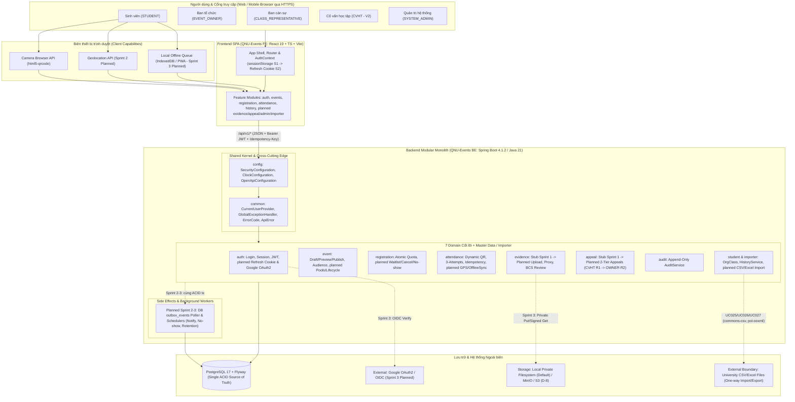
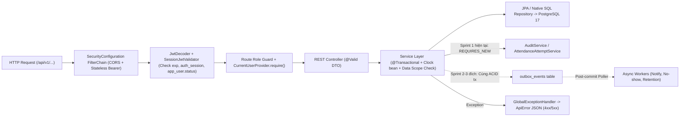
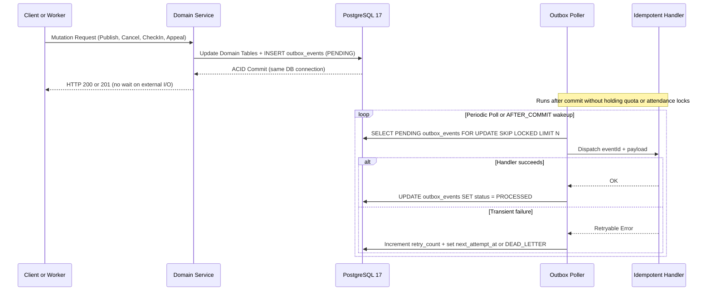

# Thiết kế Kiến trúc MVP & Phân ranh giới Module (Architecture & Boundaries) — QNU-Events

> **Jira Key:** `QE-6` (*Thiết kế kiến trúc MVP & boundaries*, 8 SP)  
> **Trạng thái tài liệu:** ✅ **APPROVED Baseline (`28/11/2026` — Quyết định `D-1` → `D-10`, đồng bộ [`v2-schema-blueprint.md`](../Design/v2-schema-blueprint.md), [`error-codes.md`](../api/error-codes.md) và `SRS v1.1`)**. Chỉ các thông số đo tải/bảo mật hạ tầng bên ngoài (`TBD-ATT-03`, `TBD-NFR-01..05`, `TBD-SEC-01/03/04`, `Q-AUTH-03`) giữ trạng thái `Open` theo `R11`/`R12`.

---

## Nguồn tham chiếu & Bằng chứng kiểm chứng (R1)

| Nguồn | Nội dung đối chiếu |
|---|---|
| **SRS v1.1 & Proposal v2** | [`docs/spec/QNU_Event_SRS.docx`](../spec/QNU_Event_SRS.docx) (`v1.1`, `28/11/2026`), [`docs/spec/QNU_Event_Participation_Management_Project_Proposal_v2.docx`](../spec/QNU_Event_Participation_Management_Project_Proposal_v2.docx) |
| **Repo Rules, Decisions & Contracts** | [`AGENTS.md`](../../AGENTS.md), [`docs/backend-foundation.md`](../backend-foundation.md), [`docs/decisions.md`](../decisions.md), [`docs/Design/v2-schema-blueprint.md`](../Design/v2-schema-blueprint.md), [`docs/Design/quota-rules.md`](../Design/quota-rules.md), [`docs/api/error-codes.md`](../api/error-codes.md) |
| **Schema & API Contract** | `src/main/resources/db/migration/V1__sprint1_core_schema.sql`, `docs/Design/erd.md`, `docs/api/sprint1-contract.md` |
| **Figma Design Spec** | [`HX4313AoLQX4zNidDz2Ixo`](https://www.figma.com/design/HX4313AoLQX4zNidDz2Ixo/QNU-Event---Attendance-MVP?node-id=0-1&p=f&t=bTVrQcyZXxPCWjyh-0) (`QNU Event - Attendance MVP`: pages `QNU EVENT UI` + `phones`) |
| **Codebase BE & FE thực tế** | `QNU-Events BE` (`pom.xml`, `src/main/java/vn/edu/qnu/events/**`, `application*.yml`) & `QNU-Events FE` (`package.json`, `src/**`) + đối chiếu kiểm chứng bởi `@tech-audit` (`#8`) |

---

## 1. Kiến trúc Hệ thống & Kiến trúc Logic (System & Logical Architecture)

### 1.1 Định hướng Kiến trúc: Modular Monolith + SPA + PostgreSQL 17

Theo `docs/backend-foundation.md`, `README.md` và đặc tả quy mô thí điểm (`#9` §1.D, §1.E), phạm vi triển khai MVP là **01 khoa (~3.000 sinh viên, dữ liệu kiểm thử ≥ 30.000 bản ghi đăng ký/điểm danh)**. Do đó, hệ thống áp dụng kiến trúc **Modular Monolith** thay vì microservices/Redis/Kafka nhằm:

1. **Giữ ranh giới giao dịch ACID đơn giản và chặt chẽ:** Các nghiệp vụ nhạy cảm về tính nhất quán (giữ suất nguyên tử trên `events.registered_count`, kiểm tra 1 bản ghi `ACCEPTED` duy nhất, đếm tối đa 3 lượt thử) thực thi trong một giao dịch PostgreSQL 17 duy nhất, tránh giao dịch phân tán.
2. **Đơn giản hóa triển khai & vận hành (MVP):** Một tiến trình backend (`qnu-events` trên Java 21 / Spring Boot 4.1.2), một SPA frontend (`qnu-events-fe` trên React 19 / TypeScript / Vite), và một cơ sở dữ liệu quan hệ PostgreSQL 17 do Flyway quản lý lược đồ (`ddl-auto: validate`).
3. **Cô lập nghiệp vụ theo package tính năng:** Mã nguồn BE chia thành các package module rõ ràng dưới `vn.edu.qnu.events.*`, kết hợp bảng phân quyền tệp tin của `AGENTS.md` (R8) và `.github/CODEOWNERS` để các thành viên phát triển song song không xung đột.

### 1.2 Sơ đồ Kiến trúc Tổng thể & Biên Hệ thống (System & Container Boundaries)

### 1.3 Kiến trúc Logic nội bộ & Nguyên tắc Tách biệt Trạng thái (`OTH-DATA-002`)

Mọi request đi vào backend tuân theo luồng logic chuẩn hóa sau:

Theo yêu cầu `OTH-DATA-002` và `Proposal §15.1–§15.2` (`#9` §1.B), kiến trúc logic **tách biệt tuyệt đối** các trục trạng thái để tránh trộn lẫn ngữ nghĩa giữa các module:

| Trục trạng thái | Domain sở hữu | Giá trị / Trạng thái | Ràng buộc tách biệt (`OTH-DATA-002`) |
|---|---|---|---|
| **Event Status** | `event` | `DRAFT` \| `PUBLISHED` \| `CANCELLED` | Tách biệt với cổng mở/đóng đăng ký (`registration_deadline`) và cổng điểm danh (`attendance_open_at`..`attendance_close_at`) |
| **Registration Status** | `registration` | `REGISTERED` \| `WAITING_LIST` \| `CANCELLED` \| `NO_SHOW` | `REGISTERED` ≠ đã điểm danh (`ACCEPTED`). Chờ danh sách (`WAITING_LIST`) không chiếm quota thực tế |
| **Attendance Status** | `attendance` | `PENDING` \| `ACCEPTED` \| `REJECTED` (và ngữ nghĩa `APPEALED` ở lớp xử lý/lịch sử) | Tối đa 01 bản ghi `ACCEPTED` / `(event_id, student_id)`. `PENDING` (evidence) ≠ `PENDING_SYNC` (offline queue của client) |
| **Check-in Attempt** | `attendance` | `attendance_attempts`: `ACCEPTED` \| `REJECTED` (`counted = true/false`) | Tách khỏi `attendances` để lưu kết quả `Idempotency-Key` và đếm giới hạn 3 lần thử sai mà không làm nhiễu bảng điểm danh hợp lệ |
| **Appeal Status** | `appeal` | Planned Sprint 3: Round 1 / Round 2 (Pending / Approved / Rejected) | `Appealed` ≠ `Accepted`; khiếu nại được duyệt mới cập nhật kết quả điểm danh hoặc gỡ hạn chế no-show kèm audit |
| **Offline Queue Status** | Client + `attendance` sync | `PENDING_SYNC` \| `SYNCED` (hoặc server reject khi đồng bộ) | Chỉ là hàng đợi cục bộ trên thiết bị (`UC019`), không có hiệu lực cho đến khi server xác thực lại |

---

## 2. Ma trận Biên Module & Quyền sở hữu (Bounded Module Matrix)

### 2.1 Ma trận 7 Domain Cốt lõi + Master Data (`student`) + Shared Kernel (`common`/`config`)

> Lưu ý kiểm chứng thực tế (`AGENTS.md` R1): Bảng dưới đây phân tách rạch ròi giữa **code thực sự đã có trên nhánh `develop`** (đã đọc trực tiếp từng class/SQL) và **phần dự kiến Sprint 2–3** theo SRS/Proposal/Jira.

| # | Domain / Module | BE Package & Artifact Thực tế | FE Feature & Routes | DB Tables Sở hữu (`V1` vs `V2` Blueprint) | SRS (`UC` / `REQ`) & Jira | Sprint 1 Implemented (`main`) | Sprint 2–3 Planned |
|---|---|---|---|---|---|---|---|
| **1** | **Auth & RBAC** | `vn.edu.qnu.events.auth`: `AppUser`, `AppUserRepository`, `AuthController`, `AuthService`, `AuthSession`, `AuthSessionRepository`, `JwtService`, `SessionJwtValidator`, `LoginRequest`, `LoginResponse`, `UserInfo`, `UserStatus`, `DemoDataSeeder` + `config.SecurityConfiguration` | `src/features/auth/`: `AuthContext.tsx`, `LoginPage.tsx`, `types.ts` Routes: `/login`, `RequireRole` | **V1:** `app_user`, `user_role`, `auth_session` **V2 Blueprint:** `user_role` thêm `'CVHT'`; `app_user` thêm `email` (`uq_app_user_email_lower`), `google_sub`, `must_change_password`, `failed_login_attempts`, `locked_until`, `auth_version`, `unit_id`; `auth_session` thêm `refresh_token_hash`, `remember_me` | `UC001–UC003` `REQ-AUTH-001..015` Jira: `QE-64` (S1), `QE-30`, `QE-35`, `QE-36`, `QE-73`, `QE-74` | Login `loginId + password`, BCrypt(12), `DUMMY_HASH`, JWT HS256 (TTL đọc config `28800s`), `auth_session`, `logout` (`204`), `GET /auth/me`, fail-fast secret ngoài `dev`/`demo`/`test`, kiểm tra `LOCKED` (`403`) | Refresh Cookie `HttpOnly` 7 ngày (`QE-30`), Google OAuth2 QNU allowlist (`QE-74`), khóa 5 lần sai/15 phút (`REQ-AUTH-015`), cấp/gỡ role kèm `unit_id` (`QE-35`), reset mật khẩu, check `LOCKED` sau BCrypt, bổ sung `CVHT` |
| **2** | **Event** | `vn.edu.qnu.events.event`: `Event`, `EventStatus`, `AttendanceMethod`, `EventController`, `EventService`, `EventRepository`, `EventValidator`, `EventUpsert`, `EventSummary`, `EventDetail`, `PreviewResponse`, `PublishRequest` | `src/features/events/`: `EventsPage.tsx`, `EventDetailPage.tsx`, `EventFormPage.tsx`, `EventQrPage.tsx`, `types.ts` Routes: `/events`, `/events/new`, `/events/:id`, `/events/:id/edit` | **V1:** `events`, `event_audience` **V2 Blueprint:** `events` thêm `next_wait_order`, `registration_closed_early`, `allow_offline_sync`, `gps_lat`, `gps_lng`, `allowed_radius_meters` (default `50`), `evidence_deadline`, `cancel_reason`; bảng **`event_pools`** | `UC004–UC008`, `UC013` `REQ-EVT-001..024` Jira: `QE-65`, `QE-66`, `QE-31` (S1), `QE-12`, `QE-15`, `QE-32`, `QE-37`, `QE-38` | Create/Update `DRAFT` (`@Version` bắt buộc — `A-001`), `GET /preview`, `POST /publish`, `GET /events` (tìm `q`, lọc `activityType`), `GET /events/{id}` (lọc lớp ở server, ngoài lớp/nháp → `404`), trả `audienceClasses` & `eligible` (`QE-37`) | Hủy/sửa event đã publish (điều chỉnh `quotaTotal`/`capacity >= used` theo `A-EVT-01` & hủy kèm lý do 10–500 ký tự — `QE-32`), quota nhiều tầng `event_pools` (`QE-12`, `QE-38`), cấu hình GPS center/radius (`QE-55`), lịch `UC007` theo vai trò |
| **3** | **Registration** | `vn.edu.qnu.events.registration`: `Registration`, `RegistrationStatus`, `RegistrationController`, `RegistrationService`, `RegistrationRepository`, `RegistrationResponse`, `MyRegistrationResponse` | `src/features/registration/index.tsx` (`RegistrationSlot` nhúng trong `EventDetailPage`) | **V1:** `registrations` (`uq_registrations_active`) Cập nhật nguyên tử `events.registered_count` **V2 Blueprint:** `registrations` thêm `pool_id`, `waiting_at`, `wait_order` (`ix_registrations_waitlist`); bảng **`student_restrictions`** | `UC009–UC012`, `UC014` `REQ-REG-001..019` Jira: `QE-71` (S1), `QE-8`, `QE-39`, `QE-40`, `QE-14` | `POST /api/v1/events/{id}/registrations` (`ON CONFLICT DO NOTHING` + `TransactionTemplate` + `UPDATE events WHERE registered_count < quota_total`), `GET /registrations/me`, idempotent `alreadyRegistered: true` | Quota nhiều tầng `event_pools` (`QE-38`), `WAITING_LIST` FIFO theo `wait_order` (`QE-39`), hủy `REGISTERED` trước `start_at - 12h` (`409 CANCELLATION_CUTOFF_PASSED`, miễn `WAITING_LIST`) + auto-promote + tái đăng ký (`QE-40`), job `NO_SHOW` (`QE-14`) |
| **4** | **Attendance** | `vn.edu.qnu.events.attendance`: `Attendance`, `AttendanceAttempt`, `AttendanceController`, `AttendanceService`, `AttendanceAttemptService`, `AttendanceRepository`, `AttendanceAttemptRepository`, `QrTokenService`, `EventQrResponse`, `CheckInRequest`, `CheckInResponse` | `src/features/attendance/index.tsx` (`AttendanceSlot`), `src/features/events/EventQrPage.tsx` (`/events/:id/qr`), `src/lib/idempotency.ts` | **V1:** `attendances` (`uq_attendances_valid`), `attendance_attempts` (`UNIQUE (event_id, student_id, idempotency_key)`) **V2 Blueprint:** `attendances` thêm `gps_lat`, `gps_lng`, `gps_accuracy`, `suspicious_flag`, `suspicious_reason`, `is_offline_late_sync`; `attendance_attempts` thêm `payload_hash` | `UC015–UC019` `REQ-ATT-001..024`, `BR-ATT-01..09` Jira: `QE-56`, `QE-57` (S1), `QE-54`, `QE-44`, `QE-55`, `QE-33`, `QE-76`, `QE-77`, `QE-78` | `GET /qr` (`qr1`, 10s + grace 3s), `POST /attendance/qr` (`Idempotency-Key`, 3 attempts, 1 `ACCEPTED`), `GET /attendance/me` khôi phục lượt thử khi reload (`QE-98`), FE camera `html5-qrcode` + đếm `x/3` | Chuẩn hóa 1-TX `CheckInResult` & `payload_hash` (`QE-54`), GPS Haversine (`50m` default, `422 GPS_OUT_OF_RANGE`, flag `suspicious_flag=true` khi trong bán kính — `QE-55`), Student Offline Store-and-Forward 24h (`QE-33`, `QE-76..78`), đếm live trên màn chiếu QR |
| **5** | **Evidence** | `vn.edu.qnu.events.evidence`: **chỉ có `package-info.java`** (rỗng) | **Chưa có** trong `src/features/` | **V1:** enum `EVIDENCE`, `PROXY_EVIDENCE` trong `attendances.method` và `PENDING` trong `attendances.status` **V2 Blueprint:** **`attendance_evidences`**, **`bcs_class_assignment`** | `UC017`, `UC020`, `UC029` `REQ-ATT-011..014`, `REQ-REV-001..007`, `REQ-DATA-019..021` Jira: `QE-18`, `QE-19`, `QE-42`, `QE-43`, `QE-47`, `QE-48`, `QE-78` | Không triển khai trong Sprint 1 | Upload ảnh JPEG/PNG `< 5 MB` qua `EvidenceStoragePort` (Local Private FS mặc định — `QE-42`), `PENDING` bị QR/GPS `ACCEPTED` ghi đè thành `REJECTED`, điểm danh thay `PROXY_EVIDENCE` (`QE-19`), BCS duyệt theo lớp (`QE-43`), retention **`150 ngày`** (`QE-24`/`QE-47`) |
| **6** | **Appeal** | `vn.edu.qnu.events.appeal`: **chỉ có `package-info.java`** (rỗng) | **Chưa có** trong `src/features/` | **V1:** Chưa có bảng **V2 Blueprint:** **`appeals`** (`round IN (1, 2)`, `t0_anchor_at`, `deadline_at`), **`advisor_class_assignment`**, liên kết `attendances` & `student_restrictions` | `UC022–UC024` `REQ-REV-010..021` Jira: `QE-22`, `QE-41`, `QE-59`, `QE-60` | Không triển khai trong Sprint 1 | Khiếu nại 2 vòng (5 ngày Vòng 1 tại **CVHT** → 3 ngày Phúc khảo Vòng 2 tại **EVENT_OWNER**, trần 30 ngày từ `T0` — `D-2`, `D-9`, `QE-59`, `QE-60`) |
| **7** | **Audit** | `vn.edu.qnu.events.audit`: `AuditLog`, `AuditLogRepository`, `AuditService` | **Chưa có** màn hình tra cứu (có trong Figma US1.1) | **V1:** `audit_logs` + trigger bất biến `trg_audit_logs_immutable` | `UC028`, `QE-61` (S1), `QE-23` | `AuditService.record(...)` (`EVENT_PUBLISH`, `EVENT_PUBLISH_DENIED`, `REGISTRATION_CREATE`, `ATTENDANCE_*`); trigger chặn `UPDATE`/`DELETE` | API & UI tra cứu `audit_logs` cho `SYSTEM_ADMIN` (`UC028`), log đủ `before/after` cho khóa/gỡ role, duyệt Evidence, Appeal, hủy event, retention, class transfer |
| **8** | **Student, Master Data & Importer** | `vn.edu.qnu.events.student`: `OrgClass`, `ClassController`, `HistoryController`, `HistoryService` (+ package Sprint 2 **`importer/`**) | `src/features/history/index.tsx` (`HistoryPage`), `fetchClasses()` | **V1:** `org_class` **V2 Blueprint:** **`org_department`**, **`org_specialization`**, **`intake_program`**, **`student_profile`** | `UC021`, `UC025–UC027` Jira: `QE-72` (S1), `QE-26`, `QE-45`, `QE-58`, `QE-62`, `QE-63`, `QE-73`, `QE-75` | `GET /api/v1/classes`, `GET /api/v1/me/history` (`Page<HistoryItem>` lọc nâng cao & khử trùng lặp), trang `/history` trên FE | Chỉ `SYSTEM_ADMIN` import Khoa/Ngành/CTĐT/Lớp/SV CSV (`QE-26`, `QE-45`, `QE-62`, `QE-73`), Export báo cáo (`QE-63`), lịch sử kèm Evidence/Appeal (`QE-58`) |
| **9** | **Shared Kernel, Outbox & Config** | `vn.edu.qnu.events.common` + `vn.edu.qnu.events.config` (+ package Sprint 2 **`outbox/`**) | `src/api/client.ts`, `src/app/`, `src/components/`, `src/lib/time.ts` | **V2 Blueprint:** **`outbox_events`** (`PENDING`, `PROCESSED`, `DEAD_LETTER`) | `QE-70`, `QE-64`, `QE-14`, `QE-47` | Error envelope `ApiError`, `Clock.systemUTC()`, `CurrentUserProvider`, fail-fast secret ngoài `dev`/`demo`/`test`, `anyRequest().denyAll()` | `outbox_events` + `@Scheduled` poller, cấu hình tham số hệ thống, hardening rate limiting |

### 2.2 Quy tắc Giao tiếp & Phụ thuộc giữa các Module

- **Không gọi vòng (Acyclic Dependencies):**
  - `common/` và `config/` là tầng nền dùng chung; không import ngược service nghiệp vụ trừ `SecurityConfiguration` đọc `SessionJwtValidator` (`auth`) và `AuditService` (`audit`) ở security edge.
  - `audit/` là module độc lập chỉ nhận metadata sự kiện nghiệp vụ để ghi bảng `audit_logs`, không phụ thuộc ngược vào `event/`, `registration/`, `attendance/`.
  - `registration/` được phép đọc `Event` (`event`) và `AppUser` (`auth`), đồng thời thực hiện `reserveSeat` nguyên tử trên bảng `events` (nếu tách hàm ở Sprint 2–3 cho multi-tier quota, giữ một điểm khóa thống nhất giữa `registration` và `event`).
  - `attendance/` đọc trạng thái `Event` (`event`) và `Registration` (`registration`) để xác thực quyền check-in, không sửa trạng thái `registrations`.
  - `student/HistoryService` chỉ **đọc tổng hợp (read-only projection)** từ `registrations`, `attendances`, `events` qua `JdbcTemplate`, không ghi đè dữ liệu của các domain khác.
  - `evidence/` và `appeal/` khi triển khai ở Sprint 2–3 sẽ gọi vào cổng service có kiểm soát của `attendance/` và `registration/` để cập nhật kết quả sau duyệt/khiếu nại — **không tự ý bỏ qua ràng buộc `uq_attendances_valid` hay ghi đè audit**.

### 2.3 Quyền sở hữu Mã nguồn từ Sprint 2 theo Agent & Thành viên (`AGENTS.md` R8 & `.github/CODEOWNERS`)

| Agent | Thành viên | Phạm vi BE được phép sửa (`AGENTS.md` + `CODEOWNERS`) | Phạm vi FE & Docs | Vai trò & Nhiệm vụ Sprint 2+ |
|---|---|---|---|---|
| **A0** | **Trần Thanh Cường** (`@GMIOS25`) | Duy nhất tạo migration `V2__sprint2_core_extensions.sql` (`R6`), `config/`, `common/`, `auth/` (`QE-30`, `QE-74`), `outbox/`, hạ tầng `admin/` & `EvidenceStoragePort`, `*` mặc định trong `CODEOWNERS` | Root FE scaffold, `src/api/client.ts`, `src/app/`, `src/features/auth/`, `.github/`, `docs/agent/` | Nền tảng, Outbox, Auth hardening (`QE-30`), Google OAuth (`QE-74`), `V2` migration |
| **A1** | **Nguyễn Huy Hoàng** (`@hoangkq157`) | `event/` (`QE-12`, `QE-32`), quản trị tài khoản & cấp TK SV (`QE-35`, `QE-73`, phối hợp A0), phối hợp A2 trên `registration/` (`QE-39`, `QE-40`) | `src/features/events/` | Quản lý sự kiện (`QE-12`, `QE-32`), tài khoản & phân quyền (`QE-35`, `QE-73`) |
| **A2** | **Khánh Dương Nguyễn** (`@YangKlee`) | `registration/`, `importer/` (`QE-26`, `QE-62` — package tên `importer` do `import` là từ khóa Java), `src/test/**/e2e/` | `src/features/registration/`, FE import, `docs/test/` | Quota/Waitlist/Cancel/No-show (`QE-39`, `QE-40`, `QE-14`), CSV Import (`QE-26`, `QE-62`), QA (`QE-28`) |
| **A3** | **Huỳnh Hữu Đan** (`@Dan28-05`) | `attendance/` (`QE-55`, `QE-33`, `QE-76`, `QE-77`), `evidence/` (upload, proxy, BCS review `QE-19`, `QE-42`, `QE-43`) | `src/features/attendance/`, `src/features/evidence/` | GPS (`QE-55`), Offline Sync (`QE-33`, `QE-76..78`), Evidence & BCS review (`QE-19`, `QE-42`, `QE-43`) |
| **A4** | **Nguyễn Nhật Khánh** (`@KHANHSKY0808`) | `audit/`, `student/` (history `QE-58`), `appeal/` (`QE-59`, `QE-60`), `evidence/` (visibility & retention `QE-24`, `QE-47` — đồng sở hữu `CODEOWNERS` cùng `@Dan28-05`) | `src/features/history/`, `src/features/appeal/`, `docs/` | Lịch sử (`QE-58`), Khiếu nại 2 vòng (`QE-59`, `QE-60`), Retention (`QE-24`, `QE-47`), Tài liệu (`QE-80`) |

> **Ghi chú đồng bộ (`28/11/2026`):** `AGENTS.md` và `.github/CODEOWNERS` đã được cập nhật khớp 100% phạm vi Sprint 2 bên trên (bao gồm đồng sở hữu `/evidence/` cho `@Dan28-05 @KHANHSKY0808`, `/importer/` cho `@YangKlee`, `/appeal/` cho `@KHANHSKY0808`, và `/outbox/` cho `@GMIOS25`).

---

## 3. Phạm vi Ngoài biên (Explicit Out-of-Scope Boundaries)

### 3.1 Ngoài phạm vi toàn bộ MVP (Strictly Out-of-Scope)

Căn cứ Proposal v2 (`§0`, `§3.2`, `§11.2`, `§17`), `SRS v1.1` (`#9` §1.D) và `docs/backend-foundation.md` (baseline Sprint 0), các hạng mục sau **không xây dựng trong MVP**:

1. **Tính tổng điểm rèn luyện (ĐRL) & quy trình xét duyệt ĐRL cuối kỳ:** MVP chỉ lưu metadata `activity_type` và `activity_points` cho từng sự kiện để phục vụ đối chiếu/xuất dữ liệu sau này; không xây dựng bộ máy tính công thức ĐRL toàn trường hay luồng chốt điểm cuối kỳ của CVHT / Phòng CTSV.
2. **Tích hợp API 2 chiều trực tiếp với Hệ thống Quản lý Đào tạo / CTSV của trường:** Đẩy sang Phase 2+. MVP chỉ dùng nhập liệu CSV/Excel một chiều (`UC025`, `UC026`) và xuất file có cấu trúc (`UC027`).
3. **Chữ ký số (`Chữ ký số`), Nhận diện khuôn mặt tự động (`Face Recognition`) & AI Agent:** Đẩy sang Phase 2+ / Phase 3.
4. **Quản lý chuyển lớp / chuyển khoa sau nhập học:** Hệ thống coi cấu trúc `Khoa → Ngành → Lớp → Sinh viên` là ổn định trong phạm vi MVP (`Proposal §11.2`).
5. **Quy trình khen thưởng / kỷ luật ngoài điểm danh** và **phê duyệt cấp 2 trước khi công bố sự kiện (`Proposal §4.1`, `REQ-EVT-013`)**.
6. **Hạ tầng phân tán nặng & mở rộng toàn trường tức thì:** Không dùng microservices, Redis, Kafka hay Map rendering SDK trong MVP (`README.md`); phạm vi thí điểm giới hạn tại **01 khoa (~3.000 sinh viên)**, chỉ mở rộng toàn trường sau khi hoàn thành kiểm thử chịu tải (`QE-46`).

### 3.2 Ngoài phạm vi Sprint 1 (Đã có trong MVP Sprint 2–3, chưa hiện diện ở baseline Sprint 1)

- **Đăng ký nâng cao:** Quota nhiều tầng (`QE-12`, `QE-38`), Waiting List FIFO (`QE-39`), hủy đăng ký trước 12 giờ & auto-promote (`QE-40`), phạt No-show 7 ngày (`QE-14`).
- **Điểm danh nâng cao:** Chuẩn hóa đồng thời `QE-54` (đã hợp nhất advisory lock & `CheckInResult` trên `main`; còn hoàn thiện test đồng thời & bỏ `REQUIRES_NEW` audit trong TX), GPS & gắn cờ đáng ngờ (`QE-55`), nộp & duyệt Evidence (`QE-42`, `QE-43`), điểm danh hộ theo lô `PROXY_EVIDENCE` (`QE-19`), hàng đợi & đồng bộ Offline (`QE-33`, `QE-76`, `QE-77`, `QE-78`).
- **Khiếu nại & Kiểm toán UI:** Nộp/xử lý khiếu nại 2 vòng (`QE-59`, `QE-60`), giao diện tra cứu `audit_logs` (`UC028` / `REQ-DATA-017`).
- **Tài khoản & Dữ liệu nền:** Google OAuth2 (`QE-74`), khóa 5 lần nhập sai/15 phút (`REQ-AUTH-015`), cấp/khóa/thu hồi quyền `System Admin` (`QE-35`), import CSV/Excel Khoa-Ngành-Lớp-SV (`QE-26`, `QE-45`, `QE-62`, `QE-73`), export báo cáo (`QE-63`), sao lưu & dọn dẹp Evidence theo học kỳ (`QE-47`, `QE-48`).

### 3.3 Khoảng trống Phạm vi trong Thiết kế Figma (`HX4313AoLQX4zNidDz2Ixo`)

Đối chiếu kiểm chứng Figma trong brief `#3` và `#8`:
- **Mục điều hướng không có frame thiết kế:** `Hồ sơ của tôi`, `Xuất dữ liệu` (tương ứng nghiệp vụ `UC027` / `QE-63` trong SRS), và `Cấu hình hệ thống` (tương ứng cấu hình tham số hệ thống đề xuất ở `docs/backlog_solutions.md §3.1`) xuất hiện ở thanh điều hướng Figma nhưng chưa có màn hình chi tiết.
- **Thiếu luồng Auth trên màn hình `01 · login`:** Figma chỉ thiết kế `Tài khoản`, `Mật khẩu`, `Lưu đăng nhập`, nút `Đăng nhập` — **thiếu** nút Google SSO (`QE-74`), Quên/Đặt lại mật khẩu (`A-AUTH-08` / `QE-30`), màn hình Logout / Session Timeout (`UC003`), và giao diện chuyển vai trò (`Role Switching`) cho user có nhiều hơn 1 role trong `user_role`.

---

## 4. Xác thực Quyền lực từ Server & Biên Bảo mật (Server-Authoritative Validation & Security)

### 4.1 Nguyên tắc "Server là nguồn sự thật" (`AGENTS.md` R9 & `NFR-PERF-008`)

1. **Đồng hồ chuẩn duy nhất tại Server (`ClockConfiguration`):** Bean `Clock.systemUTC()` được inject vào toàn bộ service (`AuthService`, `SessionJwtValidator`, `EventService`, `RegistrationService`, `AttendanceService`, `AuditService`, `HistoryService`, `GlobalExceptionHandler`). Mọi kiểm tra hạn đăng ký, mốc cắt hủy 12 giờ (`server_time < start_at - 12h`), cửa sổ điểm danh, epoch/grace của QR, thời điểm `recorded_at`/`occurred_at` chỉ dùng `Instant.now(clock)`. Timestamp do client gửi lên (kể cả khi sync offline) chỉ là dữ liệu tham khảo và phải được server kiểm chứng lại (`#9` §2).
2. **Định danh & Quyền lấy từ Token + Session tại Server (`CurrentUserProvider.require()`):** Endpoint nghiệp vụ lấy `userId` (`sub`), `sessionId` (`sid`), `roles`, `classId` từ JWT đã xác thực. Tuyệt đối không nhận `studentId`, `role` hay `ownerId` từ request body/query do client truyền lên (`GET /api/v1/me/history`, `POST /api/v1/events/{id}/registrations`, `POST /api/v1/events/{id}/attendance/qr`).
3. **Tính toán trạng thái dẫn xuất tại Server:** Các trường hiển thị như `remainingQuota`, `registrationOpen`, `attendanceOpen`, `myRegistrationStatus` trong `EventSummary` / `EventDetail` do `EventService` tính trực tiếp trên server theo `Clock`, tránh sai lệch đồng hồ thiết bị sinh viên.

### 4.2 Kiến trúc Xác thực & Vòng đời Phiên (`Auth` + `SecurityConfiguration`)

- **Hiện trạng Sprint 1:**
  - `SecurityConfiguration` cấu hình `SessionCreationPolicy.STATELESS`, tắt `csrf`/`httpBasic`/`formLogin`/`logout` mặc định, bật `oauth2ResourceServer().jwt(...)`, và kết thúc chuỗi rule bằng **`requests.anyRequest().denyAll()`** (fail-closed).
  - Mật khẩu băm bằng `BCryptPasswordEncoder(12)`. Khi không tìm thấy `loginId`, `AuthService` vẫn chạy `passwordEncoder.matches(request.password(), DUMMY_HASH)` để chống timing attack / user enumeration, trả đồng nhất `401 INVALID_CREDENTIALS` (`REQ-AUTH-004`).
  - Mỗi lần đăng nhập thành công tạo bản ghi trong `auth_session` (TTL `8 giờ` cấu hình qua `app.security.jwt-access-token-validity-seconds`, `A-01` Approved; Sprint 2 `QE-30` mở rộng thêm Refresh Cookie 7 ngày theo `A-AUTH-07`) và phát JWT HS256 (`JwtService` via Nimbus JOSE).
  - Mọi request có Bearer token đều qua `JwtDecoder` gồm `JwtTimestampValidator` + `SessionJwtValidator`: kiểm tra chữ ký, `exp`, bản ghi `auth_session` tồn tại (`revoked_at IS NULL`, `expires_at >= now`), và `app_user.status == ACTIVE`. Nhờ vậy `POST /api/v1/auth/logout` thu hồi phiên tức thì (`401 SESSION_REVOKED`) và khóa tài khoản có hiệu lực ở mọi request kế tiếp (`REQ-AUTH-010`).
  - Lỗi 401/403 tại tầng filter được `AuthenticationEntryPoint` và `AccessDeniedHandler` chuẩn hóa thành JSON `ApiError`; riêng truy cập trái phép `POST /api/v1/events/{id}/publish` được `AccessDeniedHandler` ghi audit `EVENT_PUBLISH_DENIED`.
- **Hardening đã hoàn tất trên `main` (`QE-90`, `ARCH-A07`) & Hạng mục cần bổ sung ở Sprint 2 (`QE-30`):**
  1. **Đã khắc phục trên `main`:** `SecurityConfiguration.resolveJwtSecret(...)` (`JwtService`) và `QrTokenService` đã loại bỏ fallback secret hardcode ngoài profile `dev`/`demo`/`test`, bắt buộc fail-fast nếu thiếu `JWT_SECRET` / `QR_SIGNING_SECRET` hợp lệ (`>= 32` byte), và `AuthService` đọc TTL từ `app.security.jwt-access-token-validity-seconds`.
  2. **Cần bổ sung trong `QE-30` (Sprint 2):** Chưa cài đặt cơ chế **tạm khóa 15 phút sau 5 lần nhập sai liên tiếp (`REQ-AUTH-015`)**, luồng Refresh Token 7 ngày `HttpOnly` (`A-AUTH-07`) và kiểm tra `UserStatus.LOCKED` sau `BCrypt` match (`A-AUTH-03`) trong `AuthService`. *(Lưu ý `R1`: `docs/test/sprint1-test-execution-report.md` §2.2 từng mô tả nhầm rằng đã có `423 ACCOUNT_LOCKED` — kiểm chứng code trên `main` cho thấy chưa triển khai và `ErrorCode` không dùng mã này.)*

### 4.3 Ma trận RBAC & Kiểm tra Phạm vi Dữ liệu (Role ≠ Data Scope)

Theo `docs/backend-foundation.md` và `REQ-AUTH-005..006`, **Role chỉ xác định loại hành vi được phép gọi, không thay thế kiểm tra phạm vi dữ liệu (object/class/unit scope)**:

| Vai trò (`Proposal` / `SRS` / `V1 DB`) | Biên Endpoint & Chức năng | Kiểm tra Phạm vi Dữ liệu Bắt buộc (Server-Side) | Hành vi khi vi phạm Scope |
|---|---|---|---|
| **Sinh viên** (`STUDENT` trong `V1`) | List/Detail event; Đăng ký/Hủy/Waitlist; Điểm danh QR/GPS/Evidence/Proxy/Offline; Xem lịch sử; Gửi Appeal 2 vòng | • `GET /events`, `GET /events/{id}`: chỉ thấy `PUBLISHED` ∧ `student.classId ∈ event_audience` • Mọi hành động đăng ký, điểm danh, lịch sử, appeal gắn cứng với `currentUser.userId()`, không bao giờ đọc được dữ liệu/evidence của SV khác | • Ngoài lớp hoặc `DRAFT` trên `GET /events/{id}`: **`404 NOT_FOUND`** (không lộ sự tồn tại) • Đăng ký ngoài lớp: **`403 NOT_IN_AUDIENCE`** • Điểm danh khi chưa `REGISTERED`: **`403 NOT_REGISTERED`** |
| **Ban tổ chức** (`EVENT_OWNER` trong `V1`, SRS/Figma: `Admin / Event Owner`) | Tạo/Sửa/Preview/Publish/Hủy event; Xem danh sách lớp read-only (`/api/v1/classes`); Chiếu QR động; Cấu hình `event_pools` & GPS (`10–500m`, mặc định `50m`); Xử lý **Phúc khảo Appeal Vòng 2** (quyết định cuối, `UC023–024`) & gỡ chế tài No-show | • Chỉ CRUD/Preview/Publish/QR đối với event có `event.owner_id == currentUser.userId()` (mở rộng theo `unit_id`) • **Không** CRUD/Import dữ liệu nền (Khoa/Ngành/Lớp/SV); **không** mặc định xem toàn bộ ảnh Evidence ngoài phạm vi xử lý Phúc khảo Vòng 2 | • Truy cập detail event của owner khác: **`404 NOT_FOUND`** • Sửa/Preview/Publish/QR event của owner khác hoặc gọi API Import: **`403 FORBIDDEN`** |
| **Ban cán sự** (`CLASS_REPRESENTATIVE` trong `V1`, SRS/Figma: `BCS`) | **Duyệt/từ chối Evidence & Proxy Evidence (`UC020`/`QE-43`)**, theo dõi ca bán tự động của lớp mình | • Chỉ xem/duyệt sinh viên và minh chứng thuộc **các lớp được phân công** (`bcs_class_assignment`) • Tuyệt đối **không có quyền cộng/trừ điểm**, không sửa event, **không** xử lý Appeal quyết định của chính mình | • Truy cập lớp ngoài phân công hoặc gọi endpoint quản trị/sự kiện: **`403 FORBIDDEN`** |
| **Cố vấn học tập** (`CVHT` — chính thức ở `V2`) | Xem lịch sự kiện tuần/tháng theo lớp (`UC007`); Xem Evidence liên quan khi giải quyết khiếu nại; **Tiếp nhận & xử lý Khiếu nại Appeal Vòng 1 (`UC022`/`QE-59`)** | • Chỉ xem/xử lý sinh viên, lớp và hồ sơ khiếu nại thuộc **các lớp được phân công cố vấn** (`advisor_class_assignment` trong `V2`) • Không tạo/sửa event, không quyết định Phúc khảo Vòng 2 | • Ngoài phạm vi lớp phụ trách: **`403 FORBIDDEN`** |
| **Quản trị hệ thống** (`SYSTEM_ADMIN` trong `V1`) | **Duy nhất CRUD & Import CSV/Excel Khoa, Ngành, CTĐT, Lớp, Học kỳ & Sinh viên (`UC025–026`, `QE-26/62/73`)**; quản lý tài khoản/cấp-gỡ role & phân công lớp BCS/CVHT (`QE-35`); cấu hình tham số; tra `audit_logs` (`UC028`); backup/retention (`UC029`) | • **Không phải business reviewer** trong luồng duyệt Evidence/Appeal thường nhật (`Proposal §2`, `D-2`) • Bị từ chối ở endpoint nghiệp vụ của `STUDENT`/`EVENT_OWNER` | • Gọi endpoint nghiệp vụ event/attendance: **`403 FORBIDDEN`** |

### 4.4 Biên Kiểm soát Concurrency, Crypto & File/Import

- **Chống oversell & duplicate (`RegistrationService`):** Sprint 1 dùng `tryInsertRegistration` (`uq_registrations_active`) + atomic `UPDATE events WHERE registered_count < quota_total` và `TransactionTemplate` (đã fix `REQUIRES_NEW` pool starvation). Sprint 2–3 mở rộng sang **`event_pools`** (`1 seat = 1 pool`, `registrations.pool_id`), khóa theo thứ tự `events(id) FOR UPDATE` → `registrations FOR UPDATE` → `event_pools ORDER BY priority ASC, id ASC FOR UPDATE` và `FOR UPDATE SKIP LOCKED` trên `wait_order ASC` (`QE-38..40`).
- **Toàn vẹn QR & Idempotency:** `QrTokenService` ký HMAC-SHA256 trên `qr1.<eventId>.<epoch>` và so sánh hằng thời gian `MessageDigest.isEqual`; không lưu/log token thô (`tokenMasked`). Mọi check-in bắt buộc header `Idempotency-Key` (`UNIQUE (event_id, student_id, idempotency_key)` + `payload_hash` `SHA-256` ở `V2`).
- **Biên bảo mật Sprint 2–3 (Google SSO, Evidence, GPS, CSV):**
  - *Google OAuth2 (`QE-74`, `D-10`):* Xác thực OIDC JWKS phía server, kiểm tra `email_verified = true` và khớp chính xác miền trong **`APP_GOOGLE_ALLOWED_DOMAINS=st.qnu.edu.vn,qnu.edu.vn`** (cấm `endsWith`), liên kết `app_user` đã cấp trước cho mọi vai trò có email QNU — không tự tạo tài khoản mới.
  - *Evidence Upload (`QE-42`, `D-8`):* Kiểm tra magic bytes thực tế (JPEG/PNG, `< 5 MB`), lưu qua `EvidenceStoragePort` (Local Private Filesystem mặc định ngoài public root, tên file UUID, sẵn sàng cắm MinIO/S3), truy xuất qua endpoint backend kiểm tra RBAC + scope lớp (`Cache-Control: private, no-store`).
  - *CSV/Excel Import & Export (`UC025–027`, `D-3`, `D-10`):* Chỉ `SYSTEM_ADMIN` gọi; chặn formula injection (`=`, `+`, `-`, `@` đầu ô); `allowClassTransfer = false` mặc định (Admin chủ động bật cờ mới cho phép kèm audit).
  - *GPS (`QE-55`, `BR-ATT-07`, `D-7`):* Kiểm tra tọa độ hữu hạn (`lat ∈ [-90, 90]`, `lon ∈ [-180, 180]`, `accuracy >= 0`), tính khoảng cách Haversine trên server đối chiếu `events.allowed_radius_meters ∈ [10, 500]` (mặc định **`50m`**): **ngoài bán kính trả `422 GPS_OUT_OF_RANGE` (`counted = true`)**; chỉ khi **trong bán kính** nhưng `isMocked = true` hoặc `accuracy` bất thường (`TBD-ATT-03`) mới ghi `ACCEPTED` kèm `suspicious_flag = TRUE` để Organizer hậu kiểm.

---

## 5. Xử lý Side Effects Bất đồng bộ & Độ tin cậy (Async Side Effects & Reliability)

### 5.1 Đánh giá Hiện trạng Sprint 1 & Rủi ro Tải cao (`P1`)

Trong mã nguồn Sprint 1 hiện tại:
- `AuditService.record(...)` và `AttendanceAttemptService.recordAttempt(...)` đều dùng `@Transactional(propagation = Propagation.REQUIRES_NEW)` và chạy **đồng bộ ngay trong request thread** (`EventService`, `RegistrationService`, `AttendanceService`, `SecurityConfiguration`).
- **Ưu điểm ở Sprint 1:** Khi `RegistrationService` hoặc `AttendanceService` ném `ApiException` (ví dụ `CAPACITY_FULL`, `QR_EXPIRED`, `ATTEMPT_LIMIT_REACHED`), transaction ngoài rollback nhưng bản ghi `attendance_attempts` (để đếm 3 lần thử sai & lưu replay `Idempotency-Key`) và `audit_logs` vẫn được commit bền vững.
- **Rủi ro khi lên MVP (`NFR-PERF-001/002`, tải burst `P1 = 100 req/s`):** Khi transaction ngoài vẫn đang giữ **1 connection DB** (và có thể giữ khóa hàng `events`), việc mở thêm transaction `REQUIRES_NEW` yêu cầu **connection DB thứ 2 cùng lúc** trong pool HikariCP (`maximum-pool-size: 30` ở `application.yml`). Dưới burst 100 req/s khi nhiều luồng bị từ chối đồng thời, mô hình giữ 2 connection song song dễ gây cạn kiệt pool / deadlock connection pool (`connection-timeout: 10000`). Ngoài ra, việc gọi I/O chậm (gửi thông báo, sao lưu/xóa file Evidence, tính phạt hàng loạt) tuyệt đối không được nằm trong giao dịch giữ khóa quota/điểm danh (`#9` §1.E `NFR-PERF-007`, `NFR-SAFE-004`).

### 5.2 Kiến trúc Đích Sprint 2–3: Transactional Outbox + Post-Commit Poller

Theo `docs/backend-foundation.md`, `docs/backlog_solutions.md §3.2`, `NFR-QUAL-002` và `NFR-SAFE-004`, hệ thống áp dụng mẫu **Transactional Outbox trên PostgreSQL 17 (`outbox_events`)** cho toàn bộ side effects không cần commit độc lập khi rollback (`ARCH-A02` — Approved `28/11/2026`):

### 5.3 Phân loại các Luồng Side Effects trong MVP

| Luồng Side Effect | Thời điểm chạy | Cơ chế thực thi & Độ bền | Yêu cầu & Quy tắc nghiệp vụ |
|---|---|---|---|
| **1. Audit Logs & Rejected Check-in Attempts** | Sprint 1–3 | • Các ca **từ chối cần tồn tại bất kể rollback** (`QR_*`, `EVENT_PUBLISH_DENIED`, `CAPACITY_FULL`): giữ ghi nhận tách giao dịch nhưng **không giữ khóa quota/row lâu** (ghi nhận sau khi giải phóng hoặc tách trước/sau transaction nghiệp vụ để tránh giữ 2 connection lồng nhau ở tải `P1`) • Các ca **thành công** (`EVENT_PUBLISH`, duyệt Evidence, xử lý Appeal): có thể ghi cùng ACID transaction với domain hoặc qua `outbox_events` | `audit_logs` bất biến nhờ trigger `trg_audit_logs_immutable`; không bao giờ ghi mật khẩu, JWT hay token QR đầy đủ |
| **2. In-App Notifications** *(Hủy event, thăng hạng Waiting List, kết quả Appeal, thông báo No-show)* | Sprint 2–3 | Ghi `outbox_events` trong cùng ACID transaction → Outbox Poller tạo bản ghi thông báo cho người dùng (`NFR-PERF-007` `[Đề xuất]`: ≥ 95% khả dụng trong `≤ 60s`) | Không gửi thông báo nếu transaction nghiệp vụ rollback; consumer idempotent theo `event_id` của outbox |
| **3. Đánh giá No-Show & Chặn đăng ký 7 ngày (`UC014`, `QE-14`)** | Sprint 3 | `@Scheduled` batch job chạy sau **`MAX(attendance_close_at + 24h, COALESCE(evidence_deadline, attendance_close_at))`** (`D-9`, đóng `TBD-REG-03`) | Chỉ áp dụng cho `status = 'REGISTERED'` chưa có `ACCEPTED` và không có `EVIDENCE` `PENDING`; tạm dừng khi có Appeal Vòng 1; ban chồng nhau lấy `MAX(current_banned_until, now + 7 days)`; ghi vào `student_restrictions` + audit |
| **4. Sao lưu & Dọn dẹp Evidence (`UC029`, `QE-24`, `QE-47`)** | Sprint 3 | `@Scheduled` batch job sau **`150 ngày` (5 tháng)** tính từ `events.end_at` (`D-8`, đóng `TBD-DATA-03`) | Loại trừ bản ghi đang có Appeal chưa đóng; **bắt buộc sao lưu và xác minh đọc lại thành công trước khi xóa bản online** (`NFR-SAFE-005`); giữ nguyên kết quả attendance & `audit_logs` |
| **5. Đồng bộ Hàng đợi Offline (`UC019`, `QE-33`, `QE-76..78`)** | Sprint 3 | Student Store-and-Forward cục bộ (`PENDING_SYNC`) tự đồng bộ trong cửa sổ **`OFFLINE_SYNC_MAX_WINDOW = 24 giờ`** sau `attendance_close_at` (`D-6`) | Server kiểm tra HMAC/Haversine, `events.allow_offline_sync = true`, SV đã `REGISTERED`, gắn cờ `is_offline_late_sync = true` nếu gửi sau `attendance_close_at`; quá 24h trả `422 OFFLINE_SYNC_WINDOW_EXPIRED` |

---

## 6. Tóm tắt Đối chiếu Figma (`HX4313AoLQX4zNidDz2Ixo`) ↔ Codebase & Đầu mục Cần Chỉnh Tay trên Figma

### 6.1 Đối chiếu Design Tokens & Hệ thống Giao diện

| Thuộc tính | Figma `QNU / Admin CRUD` | Codebase FE (`main`) | Trạng thái Alignment |
|---|---|---|---|
| **Surface / Canvas / Border** | `#FFFFFF` / `#F3F8FC` / `#DCE5EE` | Đã đồng bộ shell theo token Figma (`PR #19`) | Khớp |
| **Text Primary / Muted / Primary / Danger** | `#25435E` / `#73899B` / `#0789B7` / `#B64D40` | Đã đồng bộ trong theme Sprint 1 | Khớp |
| **Typography** | Font `Inter` | Bổ sung/khóa font `Inter` ở Sprint 2 | Cần hoàn thiện |

### 6.2 Hiện trạng Hợp đồng Sprint 1 (`main`) & Đầu mục Bổ sung UI / Figma cho Sprint 2–3

- **Đã khắc phục hoàn tất trên `main` (`26/11/2026`):** BE & FE đã đồng bộ `GET /api/v1/me/history` (`Page<HistoryItem>`), `alreadyRegistered`, `QR_EPOCH_SECONDS = 10`, `GET /api/v1/events/{id}/attendance/me` (`QE-98`), `fail-fast` secret ngoài `dev`/`demo`/`test`, và `TransactionTemplate` trong `RegistrationService`.
- **3 đầu mục cần người phụ trách UI cập nhật tay trên Figma (`HX4313AoLQX4zNidDz2Ixo`):**
  1. **Chuyển menu Quản trị Dữ liệu nền & Import SV (`D-3`):** Di chuyển toàn bộ cụm màn CRUD Khoa / Ngành / Lớp / Học kỳ & Import CSV Sinh viên (`UC025–026`) từ nhánh `ADMIN / EVENT OWNER` sang **`SYSTEM_ADMIN`**.
  2. **Hoàn thiện luồng Auth trên `01 · login` & Shell (`D-10`):** Bổ sung nút *"Đăng nhập với Google (Email QNU)"* (`QE-74`), link *"Quên mật khẩu?"* (`A-AUTH-08` / `QE-30`), và nút Đăng xuất trên Mobile nav (`< 640px`).
  3. **Ghi chú bán kính GPS (`D-7`):** Ghi chú `60m` trên màn cấu hình/check-in GPS hiện tại chỉ là ví dụ cấu hình cho một sự kiện cụ thể; mặc định hệ thống là **`50m`** (dải `10–500m`).

---

## 7. Quyết định Kiến trúc Đã Duyệt (`APPROVED 28/11/2026`) & Điểm mở Hạ tầng Còn giữ

### 7.1 Các Quyết định Nền tảng Đã Duyệt (`A-001`, `A-01..A-06`, `FE-A01` — `28/11/2026`)

| ID | Tóm tắt quyết định đã chốt | Tham chiếu | Trạng thái |
|---|---|---|---|
| **A-001** | `PUT /api/v1/events/{id}` bắt buộc truyền `version` (`400 VALIDATION_FAILED` / `409 VERSION_CONFLICT`) | `decisions.md`, `QE-65` | **`APPROVED (28/11/2026)`** |
| **A-01 & FE-A01** | Sprint 1 giữ 8h + `sessionStorage`; Sprint 2 `QE-30` `"Lưu đăng nhập"` dùng Refresh Cookie `HttpOnly; SameSite=Lax` (7d) + CSRF + max 5 sessions | `D-10`, `A-AUTH-04/07` | **`APPROVED (28/11/2026)`** |
| **A-02** | Sprint 1 hết suất `409 CAPACITY_FULL`; Sprint 2 bật `WAITING_LIST` theo `event_pools` + `wait_order` (`SKIP LOCKED`) | `D-4`, `quota-rules.md` | **`APPROVED (28/11/2026)`** |
| **A-03** | `startAt < endAt`, `attendanceOpenAt < attendanceCloseAt`, `registrationDeadline <= attendanceCloseAt`, `evidence_deadline >= attendance_close_at` (`+24h` mặc định), lịch `UC007` theo scope vai trò | `TBD-EVT-03`, `R2` | **`APPROVED (28/11/2026)`** |
| **A-04** | 3-attempt cap dùng chung kênh tự động (`DYNAMIC_QR`, `GPS`, `OFFLINE_QR`, `OFFLINE_GPS`), `EVIDENCE` riêng; QR/GPS `ACCEPTED` ghi đè `PENDING` Evidence (`SUPERSEDED_BY_ACCEPTED`) | `D-7`, `error-codes.md` | **`APPROVED (28/11/2026)`** |
| **A-05** | Grace period QR `3s` / epoch `10s`; cấm Offline Prefetch; hỗ trợ Student Store-and-Forward trong `24h` (`allow_offline_sync`) | `D-6`, `dynamic-qr-specification.md` | **`APPROVED (28/11/2026)`** |
| **A-06** | Chính thức **5 vai trò** (`V2` thêm `CVHT`), phân cấp **BCS → CVHT Vòng 1 → EVENT_OWNER Vòng 2**, chỉ `SYSTEM_ADMIN` CRUD/Import dữ liệu nền | `D-1`, `D-2`, `D-3` | **`APPROVED (28/11/2026)`** |

### 7.2 Các Quyết định Kiến trúc `QE-6` Đã Duyệt (`ARCH-A01..ARCH-A07` — `28/11/2026`)

| ID | Nội dung Kiến trúc Đã Duyệt | Trạng thái |
|---|---|---|
| **ARCH-A01** | Duy trì **Modular Monolith (`Spring Boot 4.1.2` + `PostgreSQL 17`)** cho toàn bộ MVP (không Redis/Kafka/microservices) | **`APPROVED (28/11/2026)`** |
| **ARCH-A02** | Sử dụng **Transactional Outbox (`outbox_events` + `@Scheduled` `FOR UPDATE SKIP LOCKED`)** cho notifications, no-show & retention | **`APPROVED (28/11/2026)`** |
| **ARCH-A03** | `EvidenceStoragePort` dùng **Local Private Filesystem** làm mặc định (pluggable MinIO/S3), retention **`150 ngày`** từ `events.end_at` | **`APPROVED (28/11/2026)`** |
| **ARCH-A04** | Bổ sung role **`CVHT`** và `bcs_class_assignment`, `advisor_class_assignment`, `app_user.unit_id` trong `V2__sprint2_core_extensions.sql` | **`APPROVED (28/11/2026)`** |
| **ARCH-A05** | Chuẩn hóa `/history` (`Page<HistoryItem>`), QR `10s`, `alreadyRegistered` (**đã hoàn tất trên `main`**) | **`APPROVED (28/11/2026)`** |
| **ARCH-A06** | Không giữ 2 connection HikariCP lồng `REQUIRES_NEW` trên luồng nóng `P1` (`TransactionTemplate` / `CheckInResult`) | **`APPROVED (28/11/2026)`** |
| **ARCH-A07** | Bắt buộc fail-fast khi thiếu/yếu `JWT_SECRET` / `QR_SIGNING_SECRET` ngoài `dev`/`demo`/`test` (**đã hoàn tất trên `main`**) | **`APPROVED (28/11/2026)`** |

### 7.3 Điểm mở Hạ tầng & Môi trường Còn giữ (`SRS Appendix C`, `R11`/`R12`)

Các quyết định nghiệp vụ/thiết kế (`TBD-AUTH-01..03`, `TBD-EVT-01..03`, `TBD-REG-01..03`, `TBD-ATT-01..02`, `TBD-REV-01..03`, `TBD-DATA-01`, `TBD-DATA-03`, `TBD-SEC-02`) **đã được chốt xong (`28/11/2026`)**. Chỉ giữ trạng thái **`Open`** cho các mục phụ thuộc hạ tầng triển khai thực tế:
1. **`Q-AUTH-03`:** Thông tin Google Cloud Project, OAuth Consent Screen & `GOOGLE_CLIENT_ID`/`SECRET` cho staging/production.
2. **`TBD-ATT-03` & `TBD-DATA-02`:** Tinh chỉnh ngưỡng `accuracy`/vận tốc của `suspicious_flag` khi chạy thực địa và thứ tự cột chi tiết của Export Excel (`QE-63`).
3. **`TBD-NFR-01..05`, `TBD-SEC-01`, `TBD-SEC-03..04`, `TBD-OTH-01`:** Số liệu đo tải thực tế, rà soát pháp lý/an ninh trường, MFA quản trị và hồ sơ bàn giao dung lượng cuối kỳ.
