# Tổng quan Hợp đồng Import CSV/Excel & Cơ chế Báo cáo Lỗi — QNU-Events (`QE-45` / `QE-26` / `QE-62`)

> **Nguồn sự thật (Single Source of Truth)** cho toàn bộ luồng nhập dữ liệu nền (Khoa, Ngành, Khóa học/CTĐT, Lớp, Sinh viên) của hệ thống **QNU-Events**.
> Xây dựng dựa trên:
> - Lược đồ CSDL [`V1__sprint1_core_schema.sql`](../../src/main/resources/db/migration/V1__sprint1_core_schema.sql) và các Entity Java hiện hành (`AppUser`, `OrgClass`).
> - Bộ dữ liệu thực tế Trường ĐH Quy Nhơn (`khoa.csv`: 52 đơn vị, `nganh.csv`: 116 ngành, `khoahoc.csv`: 202 CTĐT, `lop.csv`: 367 lớp, `student/sv_k46..k49.csv`: 6.435 sinh viên).
> - Đặc tả SRS v1.0: `UC025` (UC6.1), `UC026` (UC6.2), `REQ-DATA-001` → `REQ-DATA-010`, `NFR-PERF-005`, `NFR-SEC-009`, `NFR-QUAL-012`, `OTH-DATA-001` → `OTH-DATA-003`, `OTH-I18N-001`, và đóng mục mở `TBD-DATA-01`.

---

## 1. Danh mục Tài liệu Hợp đồng theo Thực thể (Entity Contracts)

| Thứ tự nạp | Thực thể (Entity) | Bảng DB (V1 / V2) | Tệp dữ liệu gốc QNU | Tài liệu Hợp đồng Chi tiết | File Mẫu Hợp lệ | File Mẫu Lỗi |
|:---:|---|---|---|---|---|---|
| **1** | **Khoa / Đơn vị** (`Department` / `Faculty`) | `org_department` (V2) / `org_class.faculty_name` (V1) | `khoa.csv` (52 dòng) | [`department-import-contact.md`](./department-import-contact.md) | [`department-valid-sample.csv`](./samples/department-valid-sample.csv) | [`department-invalid-sample.csv`](./samples/department-invalid-sample.csv) |
| **2** | **Ngành / Chuyên ngành** (`Specialization`) | `org_specialization` (V2) | `nganh.csv` (116 dòng) | [`specialization-import-contact.md`](./specialization-import-contact.md) | [`specialization-valid-sample.csv`](./samples/specialization-valid-sample.csv) | [`specialization-invalid-sample.csv`](./samples/specialization-invalid-sample.csv) |
| **3** | **Khóa học & CTĐT** (`IntakeProgram`) | `intake_program` (V2) / `org_class.cohort_year` (V1) | `khoahoc.csv` (202 dòng) | [`intake-program-import-contact.md`](./intake-program-import-contact.md) | [`intake-program-valid-sample.csv`](./samples/intake-program-valid-sample.csv) | [`intake-program-invalid-sample.csv`](./samples/intake-program-invalid-sample.csv) |
| **4** | **Lớp Sinh hoạt** (`OrgClass`) | `org_class` (V1) | `lop.csv` (367 dòng) | [`class-import-contact.md`](./class-import-contact.md) | [`class-valid-sample.csv`](./samples/class-valid-sample.csv) | [`class-invalid-sample.csv`](./samples/class-invalid-sample.csv) |
| **5** | **Sinh viên** (`Student` / `AppUser`) | `app_user` + `user_role` (V1) + `student_profile` (V2) | `student/sv_k46..k49.csv` (6.435 dòng) | [`student-import-contact.md`](./student-import-contact.md) | [`student-valid-sample.csv`](./samples/student-valid-sample.csv) | [`student-invalid-sample.csv`](./samples/student-invalid-sample.csv) |

---

## 2. Sơ đồ Phụ thuộc Thực thể & Thứ tự Nạp Chuẩn (Import Pipeline)

```mermaid
erDiagram
    org_department ||--o{ org_department : "Parent / ParentID"
    org_department ||--o{ org_specialization : "DepartmentCode / DepartmentId"
    org_specialization ||--o{ org_specialization : "ParentSpecializationId"
    org_department ||--o{ intake_program : "DepartmentCode"
    org_specialization ||--o{ intake_program : "SpecializationCode"
    org_department ||--o{ org_class : "faculty_name / department_id"
    org_specialization ||--o{ org_class : "SpecializationCode"
    org_class ||--o{ app_user : "class_id (FK)"
    app_user ||--o{ user_role : "role = STUDENT"

    org_department {
        uuid id PK
        varchar code UK "DepartmentCode (105, 201...)"
        varchar name "Khoa Công nghệ thông tin"
        uuid parent_id FK
    }
    org_specialization {
        uuid id PK
        varchar code UK "SpecializationCode (105, 1051...)"
        varchar name "Công nghệ thông tin"
        uuid department_id FK
        uuid parent_id FK
        varchar abbreviation "CNTT"
    }
    intake_program {
        uuid id PK
        varchar code UK "IntakeProgramCode (105DHCQK48)"
        smallint intake_no "46, 47, 48, 49"
        smallint start_year "2023, 2024, 2025, 2026"
        uuid specialization_id FK
        uuid department_id FK
    }
    org_class {
        uuid id PK "ClassId"
        varchar code UK "K46_105_E (<=30 chars)"
        varchar name "Công nghệ thông tin 46E"
        varchar faculty_name "Khoa Công nghệ thông tin"
        smallint cohort_year "2023"
    }
    app_user {
        uuid id PK
        varchar login_id UK "4651050001"
        varchar student_code UK "4651050001"
        varchar full_name "Võ Hoài An"
        uuid class_id FK "org_class.id"
        varchar status "ACTIVE | LOCKED"
    }
```

### Quy tắc Thứ tự Nạp (`UC025`, `UC026`, `REQ-DATA-008`, `REQ-DATA-009`)
1. **Khi nạp từng tệp rời**: Nạp theo thứ tự `1. Khoa → 2. Ngành → 3. Khóa học/CTĐT → 4. Lớp → 5. Sinh viên`.
2. **Khi nạp gộp tổ chức (`UC026`) hoặc có quan hệ cha-con trong cùng một tệp (`REQ-DATA-009`)**:
   - Hệ thống luôn phân tích **2 lượt (Two-Pass Resolution)**: Lượt 1 đọc và lập chỉ mục mọi thực thể cha hợp lệ trong tệp + DB; Lượt 2 kiểm tra khóa ngoại cho thực thể con.
   - Do đó, **thứ tự xuất hiện của các dòng trong cùng một tệp không bao giờ làm một quan hệ hợp lệ bị báo lỗi**.

---
