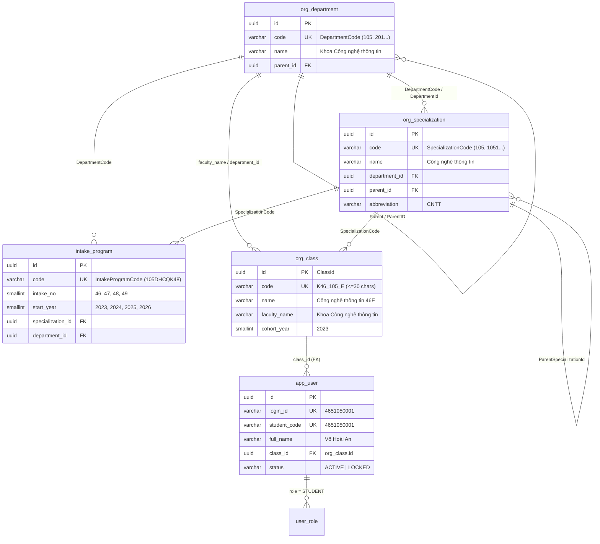

# Tổng quan Hợp đồng Import CSV/Excel & Cơ chế Báo cáo Lỗi — QNU-Events (`QE-45` / `QE-26` / `QE-62` / `QE-73`)

> **Nguồn sự thật (Single Source of Truth)** cho toàn bộ luồng nhập dữ liệu nền (Khoa, Ngành, Khóa học/CTĐT, Lớp, Sinh viên) của hệ thống **QNU-Events**.
> Xây dựng dựa trên:
> - Lược đồ CSDL [`V1__sprint1_core_schema.sql`](../../src/main/resources/db/migration/V1__sprint1_core_schema.sql) và các Entity Java hiện hành (`AppUser`, `OrgClass`).
> - Bộ dữ liệu thực tế Trường ĐH Quy Nhơn (`khoa.csv`: 52 đơn vị, `nganh.csv`: 116 ngành, `khoahoc.csv`: 202 CTĐT, `lop.csv`: 367 lớp, `student/sv_k46..k49.csv`: 6.435 sinh viên).
> - Đặc tả SRS v1.0: `UC025` (UC6.1), `UC026` (UC6.2), `REQ-DATA-001` → `REQ-DATA-010`, `NFR-PERF-005`, `NFR-SEC-009`, `NFR-QUAL-012`, `OTH-DATA-001` → `OTH-DATA-003`, `OTH-I18N-001`, và đề xuất đóng mục mở `TBD-DATA-01`.
> - Đồng bộ kiến trúc xác thực & cấp phát tài khoản (`QE-36` / `QE-73` / `QE-74`): [`auth-and-session-lifecycle.md`](../architecture/auth-and-session-lifecycle.md), [`decisions.md`](../decisions.md), và bộ quy tắc [`AGENTS.md`](../../AGENTS.md) (`R6`, `R7`, `R11`, `R12`).

---

## 1. Danh mục Tài liệu Hợp đồng theo Thực thể (Entity Contracts)

| Thứ tự nạp | Thực thể (Entity) | Bảng DB (V1 / V2 dự kiến) | Tệp dữ liệu gốc QNU | Tài liệu Hợp đồng Chi tiết | File Mẫu Hợp lệ | File Mẫu Lỗi |
|:---:|---|---|---|---|---|---|
| **1** | **Khoa / Đơn vị** (`Department` / `Faculty`) | `org_department` (V2) / `org_class.faculty_name` (V1) | `khoa.csv` (52 dòng) | [`department-import-contract.md`](./department-import-contract.md) | [`department-valid-sample.csv`](./samples/department-valid-sample.csv) | [`department-invalid-sample.csv`](./samples/department-invalid-sample.csv) |
| **2** | **Ngành / Chuyên ngành** (`Specialization`) | `org_specialization` (V2) | `nganh.csv` (116 dòng) | [`specialization-import-contract.md`](./specialization-import-contract.md) | [`specialization-valid-sample.csv`](./samples/specialization-valid-sample.csv) | [`specialization-invalid-sample.csv`](./samples/specialization-invalid-sample.csv) |
| **3** | **Khóa học & CTĐT** (`IntakeProgram`) | `intake_program` (V2) / `org_class.cohort_year` (V1) | `khoahoc.csv` (202 dòng) | [`intake-program-import-contract.md`](./intake-program-import-contract.md) | [`intake-program-valid-sample.csv`](./samples/intake-program-valid-sample.csv) | [`intake-program-invalid-sample.csv`](./samples/intake-program-invalid-sample.csv) |
| **4** | **Lớp Sinh hoạt** (`OrgClass`) | `org_class` (V1) | `lop.csv` (367 dòng) | [`class-import-contract.md`](./class-import-contract.md) | [`class-valid-sample.csv`](./samples/class-valid-sample.csv) | [`class-invalid-sample.csv`](./samples/class-invalid-sample.csv) |
| **5** | **Sinh viên** (`Student` / `AppUser`) | `app_user` + `user_role` (V1) + mở rộng `V2` | `student/sv_k46..k49.csv` (6.435 dòng) | [`student-import-contract.md`](./student-import-contract.md) | [`student-valid-sample.csv`](./samples/student-valid-sample.csv) | [`student-invalid-sample.csv`](./samples/student-invalid-sample.csv) |

> [!NOTE]
> - **Phân tách phạm vi `QE-26` vs `QE-73`:** `QE-26` phụ trách luồng parse, validate và nhập/đồng bộ **hồ sơ sinh viên** cùng danh mục lớp/khoa/ngành; `QE-73` phụ trách việc `SYSTEM_ADMIN` **cấp phát tài khoản đăng nhập** (`app_user` + `user_role = STUDENT`) với credential ngẫu nhiên/token kích hoạt một lần (không dùng mật khẩu mặc định chung, không log plaintext theo `R7`). Chi tiết xem [`student-import-contract.md`](./student-import-contract.md) (§2.1–§2.2).
> - **Quy tắc Flyway Migration (`R6`):** Mọi bảng/cột gắn nhãn `(V2)` trong bộ tài liệu này là đặc tả thiết kế mục tiêu. Theo quy tắc **R6** ([`AGENTS.md`](../../AGENTS.md)), chỉ Agent **A0** tạo migration và sẽ tổng hợp đồng bộ thành migration `V2__...` chung cho Sprint 2 thay vì từng module tự tách file riêng.

---

## 2. Sơ đồ Phụ thuộc Thực thể & Thứ tự Nạp Chuẩn (Import Pipeline)

### Quy tắc Thứ tự Nạp (`UC025`, `UC026`, `REQ-DATA-008`, `REQ-DATA-009`)
1. **Khi nạp từng tệp rời**: Nạp theo thứ tự `1. Khoa → 2. Ngành → 3. Khóa học/CTĐT → 4. Lớp → 5. Sinh viên`.
2. **Khi nạp gộp tổ chức (`UC026`) hoặc có quan hệ cha-con trong cùng một tệp (`REQ-DATA-009`)**:
   - Hệ thống luôn phân tích **2 lượt (Two-Pass Resolution)**: Lượt 1 đọc và lập chỉ mục mọi thực thể cha hợp lệ trong tệp + DB; Lượt 2 kiểm tra khóa ngoại cho thực thể con.
   - Do đó, **thứ tự xuất hiện của các dòng trong cùng một tệp không bao giờ làm một quan hệ hợp lệ bị báo lỗi**.

---

## 3. Tóm tắt Các Đề xuất Chuẩn hóa cho `TBD-DATA-01` *(Chờ Stakeholder phê duyệt)*

| Hạng mục trong `TBD-DATA-01` | Quy định đề xuất trong Hợp đồng này | Căn cứ SRS & Dữ liệu thật QNU |
|---|---|---|
| **Encoding & Định dạng tệp** | CSV (`UTF-8` có hoặc không có BOM, dấu phẩy `,`, quote `"`) và Excel (`.xlsx`). Bảo toàn tiếng Việt có dấu (Unicode NFC) và số `0` ở đầu (`StudentID`, `IDCard`, `DepartmentCode`). | `REQ-DATA-001`, `NFR-QUAL-012`, `OTH-I18N-001` |
| **Giới hạn tệp & Hiệu năng** | Tối đa **10 MB**, tối đa **10.000 dòng/lần**. Thời gian xử lý 3.000 dòng sinh viên + lập báo cáo lỗi **≤ 60 giây**. | `NFR-PERF-005`, `TBD-DATA-01` |
| **Định dạng Mã sinh viên** | Chuỗi đúng **10 chữ số** (`^\d{10}$`): `[Khóa: 2 số][Bậc: 1 số (5)][Mã ngành: 3 số][STT: 4 số]`. Ví dụ: `4651050001`. | 100% của 6.435 SV trong `sv_k46..k49.csv` |
| **Cơ chế Giao dịch (All-or-Nothing vs Partial)** | • **Cấp Tệp (All-or-Nothing)**: Lỗi file/encoding/thiếu cột bắt buộc → Từ chối toàn bộ tệp (HTTP 4xx). • **Cấp Dòng (Partial Import)**: Nhập dòng hợp lệ, bỏ qua dòng lỗi và trả về báo cáo chi tiết từng dòng lỗi (HTTP 200). Hỗ trợ `dryRun=true` cho màn hình Preview (`QE-62`). | `REQ-DATA-003`, `REQ-DATA-004`, `REQ-DATA-005` |
| **Chính sách Trùng mã & Idempotent (`No Silent Overwrite`)** | • **Trùng trong cùng tệp**: Xử lý dòng đầu, từ chối các dòng lặp phía sau (`ROW_DUPLICATE_*_IN_FILE`). • **Trùng với DB**: Mặc định `importMode=UPSERT` (phân biệt rõ `createdCount`, `updatedCount`, `unchangedCount`), hỗ trợ thêm `CREATE_ONLY` và `SKIP_EXISTING`. Không bao giờ tạo 2 hồ sơ cho 1 MSSV; không ghi đè ngầm `password_hash`, trạng thái khóa quản trị `LOCKED`, `roles` bổ sung hay `google_sub` (`QE-73`). | `REQ-DATA-006`, `REQ-DATA-007`, `QE-73` |
| **Bảo vệ Quan hệ Tổ chức** | Đổi lớp của sinh viên đã tồn tại hoặc đổi Khoa/Ngành của Lớp đã có sinh viên/sự kiện bị chặn mặc định (`ROW_CLASS_CHANGE_REQUIRES_CONFIRMATION` / `ROW_CLASS_HIERARCHY_LOCKED`) trừ khi bật cờ xác nhận tường minh và ghi `AuditLog`. | `REQ-DATA-010`, `OTH-DATA-003` |
| **An toàn Bảo mật Bảng tính** | Từ chối các ô văn bản bắt đầu bằng `=`, `+`, `-`, `@` (`ROW_FORMULA_INJECTION_DETECTED`) để chống CSV/Excel Formula Injection khi xuất đối soát. | `NFR-SEC-009` |
