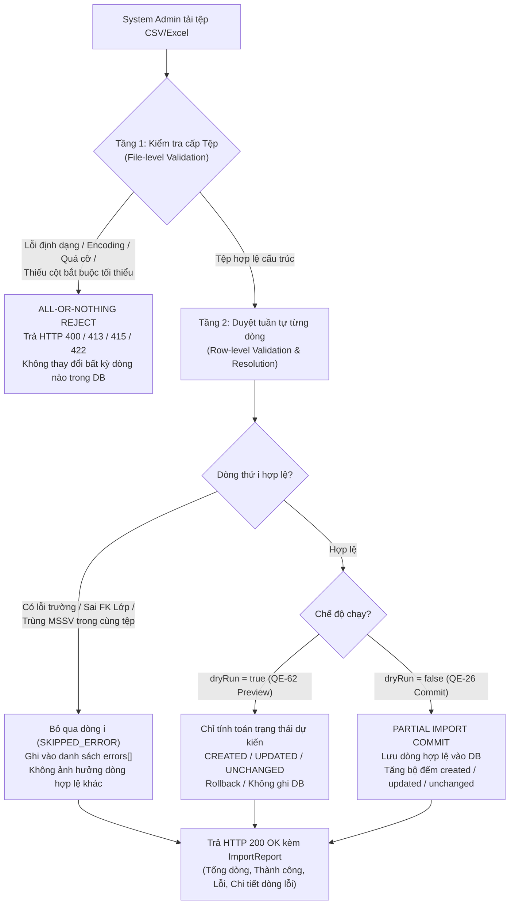

# Hợp đồng Import CSV/Excel: Thực thể Sinh viên (`Student` / `AppUser`) — QE-45, QE-26 & QE-73

> **Mã tài liệu:** `CONTRACT-IMP-STUDENT-v1.0`
> **Liên kết Jira:** `QE-45` (Xác định CSV import contract và báo cáo lỗi), `QE-26` (Backend Import hồ sơ sinh viên), `QE-62` (UI Import Preview), `QE-73` (System Admin cấp tài khoản sinh viên), đồng bộ với `QE-36` (Xác thực & vòng đời phiên) và `QE-74` (Google OAuth2 QNU)
> **Liên kết SRS:** `UC025` (UC6.1), `REQ-DATA-001` → `REQ-DATA-007`, `REQ-DATA-010`, `NFR-PERF-005`, `NFR-SEC-003`, `NFR-SEC-009`, `NFR-SEC-012`, `NFR-QUAL-012`, `OTH-DATA-001` → `OTH-DATA-003`, `OTH-I18N-001`, `TBD-DATA-01`, `TBD-AUTH-01`, `TBD-AUTH-03`
> **Tài liệu đồng bộ:** [`auth-and-session-lifecycle.md`](../architecture/auth-and-session-lifecycle.md) (`QE-36` — PR #15), [`decisions.md`](../decisions.md) (`A-AUTH-05`, `A-AUTH-08`), [`AGENTS.md`](../../AGENTS.md) (`R6`, `R7`, `R11`, `R12`)
> **Trạng thái:** Đề xuất chuẩn hóa cho `QE-45` (`ASSUMPTION` chưa duyệt, chờ Stakeholder phê duyệt để đóng `TBD-DATA-01` và chốt `TBD-AUTH-01` / `TBD-AUTH-03`)

---

## 1. Mục tiêu & Phạm vi

Tài liệu này định nghĩa **Hợp đồng kỹ thuật (Data & API Contract)** cho chức năng nhập (import) danh sách sinh viên từ tệp CSV/Excel vào hệ thống **QNU-Events**, dựa trên:
1. **Lược đồ CSDL hiện hành** ([`V1__sprint1_core_schema.sql`](../../src/main/resources/db/migration/V1__sprint1_core_schema.sql)) và Model Java ([`AppUser.java`](../../src/main/java/vn/edu/qnu/events/auth/AppUser.java), [`OrgClass.java`](../../src/main/java/vn/edu/qnu/events/student/OrgClass.java)).
2. **Tập dữ liệu thực tế của Trường Đại học Quy Nhơn (QNU)** gồm 6.435 bản ghi sinh viên thuộc 4 khóa (`student/sv_k46.csv`, `sv_k47.csv`, `sv_k48.csv`, `sv_k49.csv`) và danh mục tổ chức (`khoa.csv`, `nganh.csv`, `khoahoc.csv`, `lop.csv`).
3. **Đặc tả yêu cầu phần mềm (SRS v1.0)** mục 3.6 (`UC025`, `REQ-DATA-001..007`) và **Đặc tả kiến trúc xác thực `QE-36`** ([`auth-and-session-lifecycle.md`](../architecture/auth-and-session-lifecycle.md)).

Mọi kịch bản kiểm thử tự động của `QE-26`, `QE-62` và `QE-73` phải bám sát cấu trúc cột, mã lỗi, quy tắc bảo mật credential và ngữ nghĩa giao dịch trong tài liệu này — **không tự giả định cấu trúc tệp hay dùng mật khẩu mặc định chung**.

---

## 2. Ánh xạ Mô hình Dữ liệu, Phạm vi `QE-26` / `QE-73` & Cơ sở Dữ liệu

### 2.1. Tách phạm vi `QE-26` vs `QE-73` & Ánh xạ vào Schema V1 (`app_user` & `user_role`)

> [!IMPORTANT]
> **Tách rõ phạm vi nghiệp vụ giữa `QE-26` và `QE-73` (đồng bộ với [`auth-and-session-lifecycle.md` §2.1–§2.5](../architecture/auth-and-session-lifecycle.md)):**
> - **`QE-26` *(Import Hồ sơ Sinh viên — `UC025`)*:** Chịu trách nhiệm đọc, kiểm tra định dạng/encoding, ánh xạ cột, đối chiếu khóa ngoại tổ chức (`org_class`, khoa/ngành), kiểm tra trùng lặp/xung đột định danh, thực thi `dryRun` preview (`QE-62`), nhập/đồng bộ **thông tin hồ sơ sinh viên** (`student_code`, `full_name`, `class_id`, trạng thái học vụ, các trường hồ sơ mở rộng ở `V2`) và xuất báo cáo `ImportReport`.
> - **`QE-73` *(System Admin Cấp Tài khoản Sinh viên từ Import Trường)*:** Chịu trách nhiệm **khởi tạo tài khoản đăng nhập (`app_user` + `user_role = 'STUDENT'`)** do `SYSTEM_ADMIN` thực hiện (cấm tự đăng ký *no self-signup*), tuân thủ 4 nguyên tắc bắt buộc:
>   1. **Bỏ hoàn toàn giả định mật khẩu khởi tạo dùng chung theo cấu hình hệ thống:** Tuyệt đối **không** dùng một mật khẩu mặc định chung (như `Demo@12345` hay ngày sinh dễ đoán) cho hàng loạt sinh viên.
>   2. **Cấp credential ngẫu nhiên / activation token riêng cho từng sinh viên (`ASSUMPTION A-AUTH-08`, chờ chốt `TBD-AUTH-01` / `Q-AUTH-04`):** Khi tạo tài khoản mới, hệ thống sinh **token kích hoạt / đặt mật khẩu một lần** có thời hạn (lưu hash SHA-256 của token trong DB, gửi qua email QNU đã xác nhận ở `TBD-AUTH-03`; trong thời gian chưa kích hoạt khi `V1` đặt `app_user.password_hash NOT NULL`, lưu hash `BCrypt(12)` của chuỗi ngẫu nhiên mật mã không đoán được), **hoặc** sinh **mật khẩu tạm ngẫu nhiên mạnh một lần** (băm `BCrypt(12)` vào `password_hash`, kèm cờ `must_change_password = true` ở `V2__...`).
>   3. **Nguyên tắc Idempotent & *No Silent Overwrite* (`QE-73` AC):** Khi re-import sinh viên đã tồn tại theo `student_code`, **tuyệt đối không** reset/ghi đè `password_hash`, không tự mở khóa tài khoản đang bị `SYSTEM_ADMIN` khóa (`status = LOCKED`), không xóa các vai trò bổ sung (`CLASS_REPRESENTATIVE`), và không ghi đè `google_sub` đã liên kết (`QE-74`).
>   4. **Cấm log / xuất plaintext credential (`R7`, `NFR-SEC-012`):** Tuyệt đối không lưu, không trả trong API response (`ImportReport`, file kết quả lỗi), và không ghi vào `audit_logs.details` hoặc application logs (`Slf4j`) bất kỳ mật khẩu plaintext, mật khẩu tạm, `password_hash`, activation token gốc hay JWT nào. Chỉ ghi sự kiện audit (`USER_IMPORT_BATCH`, `USER_PROVISION`) với `target_id` (UUID), `batchId` và `reasonCode`.

Trong lược đồ [`V1__sprint1_core_schema.sql`](../../src/main/resources/db/migration/V1__sprint1_core_schema.sql), mỗi sinh viên được lưu trữ dưới dạng một tài khoản trong bảng `app_user` đi kèm vai trò `STUDENT` trong bảng `user_role`:

| Cột trong DB (`V1`) | Thuộc tính `AppUser` | Kiểu dữ liệu DB | Ràng buộc DB | Quy tắc sinh / Ánh xạ từ CSV (`QE-26` & `QE-73`) |
|---|---|---|---|---|
| `id` | `id` | `uuid` | `PK DEFAULT gen_random_uuid()` | Giữ nguyên `id` nếu đã tồn tại theo `student_code`; sinh `UUID.randomUUID()` nếu tạo mới. |
| `login_id` | `loginId` | `varchar(50)` | `NOT NULL UNIQUE` | Gán bằng chính `StudentID` (MSSV 10 chữ số, đã `trim()`, khớp `REQ-AUTH-014`). Từ chối dòng lỗi nếu `login_id` đã bị tài khoản khác chiếm dụng. |
| `password_hash` | `passwordHash` | `varchar(100)` | `NOT NULL` | **`[Phạm vi QE-73]`** Khi **tạo mới**: lưu hash `BCrypt(12)` của **mật khẩu ngẫu nhiên mạnh một lần** (kèm `must_change_password = true`) hoặc **chuỗi ngẫu nhiên mật mã không đoán được** trong lúc chờ kích hoạt qua activation token một lần (`ASSUMPTION A-AUTH-08`, chờ chốt `TBD-AUTH-01`). **Không dùng mật khẩu mặc định chung**; **không log/trả plaintext**. Khi **re-import/cập nhật**: giữ nguyên `password_hash` hiện có (*No Silent Overwrite*). |
| `full_name` | `fullName` | `varchar(150)` | `NOT NULL` | **`[Phạm vi QE-26]`** Lấy từ cột `StudentName` (hoặc ghép `LastName.trim() + " " + FirstName.trim()` nếu `StudentName` trống nhưng có họ/tên tách rời). Chuẩn hóa Unicode NFC. |
| `student_code` | `studentCode` | `varchar(30)` | `UNIQUE` | **`[Phạm vi QE-26]`** Lấy từ cột `StudentID` (chuỗi 10 chữ số `^\d{10}$` — khóa đối chiếu nghiệp vụ bất biến). |
| `class_id` | `classId` | `uuid` | `FK REFERENCES org_class(id)` | **`[Phạm vi QE-26]`** Phân giải từ `ClassId` hoặc `ClassCode` / `ClassStudentName` sang `org_class.id` (xem Mục 5). |
| `status` | `status` | `varchar(20)` | `CHECK IN ('ACTIVE','LOCKED')` | Khi **tạo mới (`QE-73`)**: ánh xạ từ `StudyStatusID` / `StudyStatusName` (`1` `Còn học` → `ACTIVE`; `2, 3, 4, 7` `Nghỉ học tạm thời`, `Buộc thôi học`, `Thôi học`, `Chuyển trường` → `LOCKED`; mặc định `ACTIVE` nếu trống). Khi **re-import**: theo *No Silent Overwrite* (`QE-73`), **không tự mở khóa** tài khoản đang ở trạng thái khóa quản trị `LOCKED`. |
| `user_role.role` | `roles` | `varchar(30)` | `PK (user_id, role)` | **`[Phạm vi QE-73]`** Đảm bảo gán `'STUDENT'` khi tạo mới; khi re-import tuyệt đối không xóa các role bổ sung như `'CLASS_REPRESENTATIVE'` nếu sinh viên đã được gán BCS trước đó. |

### 2.2. Đề xuất mở rộng Schema V2 (Tổng hợp bởi A0 theo `R6`) & Quy định Miền Email QNU (`TBD-AUTH-03`)

> [!NOTE]
> **Quy tắc Flyway Migration (`R6` — [`AGENTS.md`](../../AGENTS.md)):**
> Tệp `V1__sprint1_core_schema.sql` đã đóng băng và bất biến. Theo quy tắc **R6**, **chỉ Agent phụ trách nền tảng (`A0`) mới được phép tạo migration Flyway**, và **`A0` sẽ tổng hợp toàn bộ nhu cầu schema Sprint 2 vào một migration `V2__...` chung** (gộp đồng bộ các mở rộng của `QE-36`/`QE-73`/`QE-74`, `QE-26`, pool quota `QE-12`/`QE-39`, `attendance_attempts.payload_hash` của `QE-8`/`QE-54`, danh mục tổ chức...) **thay vì để từng module/ticket tự tách file `V2__...` riêng**. Hợp đồng này không chốt tên file migration riêng, chỉ đặc tả yêu cầu dữ liệu đầu vào để `A0` tổng hợp vào `V2__...`.

Để đồng bộ giữa luồng import hồ sơ (`QE-26`), cấp tài khoản (`QE-73`) và Google OAuth2 (`QE-74` trong [`auth-and-session-lifecycle.md` §5.2](../architecture/auth-and-session-lifecycle.md)), yêu cầu dữ liệu mở rộng ở `V2__...` tách làm 2 nhóm rõ ràng:

1. **Trường định danh Xác thực trên `app_user` *(thuộc phạm vi `QE-36` / `QE-73` / `QE-74`)*:**
   - `email varchar(255)` với unique index không phân biệt hoa thường (`CREATE UNIQUE INDEX uq_app_user_email_lower ON app_user (LOWER(email)) WHERE email IS NOT NULL`) — lưu **email định danh do QNU cấp** phục vụ cấp phát (`QE-73`) và đối chiếu Google OAuth2 (`QE-74`).
   - `google_sub varchar(128) UNIQUE`, `must_change_password boolean` (cùng các cột phiên/brute-force theo đặc tả `QE-36`).
   - **Cảnh báo mục mở `TBD-AUTH-03` (`R11`, `R12`):** Dạng địa chỉ `<student_code>@st.qnu.edu.vn` (cũng như tập miền `@st.qnu.edu.vn` / `@qnu.edu.vn`) hiện **là điểm mở `TBD-AUTH-03` chờ stakeholder chốt** (`Q-AUTH-01` trong [`auth-and-session-lifecycle.md` §7.1](../architecture/auth-and-session-lifecycle.md)), **CHƯA phải giá trị đã duyệt**. Vì vậy:
     * Không được hardcode quy tắc tự suy/tạo địa chỉ `<student_code>@st.qnu.edu.vn` như quy chuẩn chính thức cho đến khi stakeholder phê duyệt `TBD-AUTH-03` (hoặc tệp CSV import do nhà trường xuất có cột email QNU tường minh).
     * Việc kiểm tra miền email hợp lệ khi Google OAuth2 (`QE-74`) bắt buộc đọc từ **allowlist tường minh qua biến môi trường** (ví dụ `APP_GOOGLE_ALLOWED_DOMAINS`); **cấm** dùng kiểm tra chuỗi lỏng như `endsWith("qnu.edu.vn")`.
     * Khi CSV có cung cấp email QNU để đối chiếu `QE-73`, nếu cùng một `email` bị gán cho hai `student_code` khác nhau phải từ chối dòng xung đột (không ghi đè ngầm).
2. **Trường hồ sơ sinh viên từ CSV đào tạo *(lưu ở bảng `student_profile` hoặc cột hồ sơ mở rộng trong `V2__...` — thuộc phạm vi `QE-26`)*:**
   - `personal_email varchar(150)` *(email cá nhân trích từ cột `Email` trong `sv_k46..k49.csv` — **tách biệt hoàn toàn** với `app_user.email` định danh QNU)*: **không đặt `UNIQUE` cứng** vì dữ liệu thật QNU có các trường hợp thí sinh thi lại khóa sau dùng chung email cá nhân; **không** dùng trường này làm định danh đăng nhập Google SSO `QE-74`.
   - `birth_date date`, `gender varchar(10)`, `id_card varchar(20)`, `study_status_code smallint`, `intake_no smallint`, `specialization_code varchar(10)`, `department_code varchar(10)`.

---

## 3. Đặc tả Định dạng Tệp, Encoding & Cấu trúc Cột (Template Specification)

### 3.1. Quy chuẩn Tệp vật lý & Encoding

| Thuộc tính | Quy định bắt buộc | Mã lỗi khi vi phạm |
|---|---|---|
| **Định dạng hỗ trợ** | `.csv` (`text/csv`, `application/csv`, `text/plain`) hoặc `.xlsx` (`application/vnd.openxmlformats-officedocument.spreadsheetml.sheet`) | `FILE_UNSUPPORTED_MEDIA_TYPE` (HTTP 415) |
| **Bảng mã (Encoding)** | **UTF-8** (chấp nhận cả `UTF-8 without BOM` và `UTF-8 with BOM` `\uFEFF` do Excel xuất ra). Tệp chứa byte lỗi UTF-8 (`\uFFFD`) hoặc mã hóa `Windows-1258`/TCVN3/VNI bị từ chối. | `FILE_INVALID_ENCODING` (HTTP 400) |
| **Dấu phân cách (CSV)** | Dấu phẩy `,` (RFC 4180). Trường chứa dấu `,`, dấu `"` hoặc xuống dòng phải bọc trong cặp nháy kép `"..."` (ví dụ: `"Số 08, Huỳnh Thúc Kháng, thôn 3"`). | `FILE_MALFORMED_CSV` (HTTP 400) |
| **Dòng tiêu đề (Header)** | Dòng 1 bắt buộc là dòng Header. Tên cột **không phân biệt hoa thường** (`case-insensitive`), tự động cắt khoảng trắng đầu/cuối và bỏ ký tự BOM `\uFEFF` ở cột đầu tiên. | `FILE_MISSING_REQUIRED_COLUMNS` (HTTP 400) |
| **Excel (`.xlsx`)** | Đọc Sheet đầu tiên (index `0`) hoặc Sheet có tên `Students` / `SinhVien`. Các cột mã (`StudentID`, `IDCard`, `DepartmentCode`, `SpecializationCode`) phải được đọc dưới dạng chuỗi (`DataFormatter` / Text) để **bảo toàn số `0` ở đầu** (`NFR-QUAL-012`). | `FILE_CORRUPTED` (HTTP 400) |
| **Giới hạn dung lượng** | Tối đa **10 MB** / tệp; số dòng dữ liệu từ **1 đến 10.000 dòng** (không tính dòng header và dòng trống hoàn toàn ở cuối tệp). | `FILE_TOO_LARGE` (HTTP 413) / `FILE_ROW_LIMIT_EXCEEDED` (HTTP 422) |
| **Chống Formula Injection** | Mọi giá trị chuỗi bắt đầu bằng `=`, `+`, `-`, `@`, `\t`, `\r` trong các trường văn bản (`StudentName`, `ClassStudentName`, `Email`, ...) bị coi là không hợp lệ hoặc phải bị từ chối ở bước validate (`NFR-SEC-009`). | `ROW_FORMULA_INJECTION_DETECTED` |

### 3.2. Hai Profile Cột Hỗ trợ (Tương thích Dữ liệu Gốc QNU & Template Chuẩn)

Bộ parser của `QE-26` phải hỗ trợ đồng thời **2 profile cột** thông qua cơ chế ánh xạ tên cột (Header Alias Mapping):
- **Profile A (QNU Raw Export — 45 cột)**: Đọc trực tiếp các tệp xuất từ hệ thống đào tạo QNU (`student/sv_k46.csv` → `sv_k49.csv`) mà không bắt Admin phải xóa cột thừa.
- **Profile B (Standard Template — 12 cột chuẩn)**: Mẫu rút gọn dùng để tải xuống từ giao diện Import (`GET /api/v1/admin/imports/students/template`).

#### Bảng đặc tả cột chuẩn (Áp dụng cho cả Profile A & Profile B)

| # | Tên cột chuẩn (Header) | Alias chấp nhận | Bắt buộc? | Kiểu & Độ dài | Định dạng / Quy tắc kiểm tra (Validation Rule) | Ví dụ hợp lệ |
|---:|---|---|:---:|---|---|---|
| 1 | `StudentID` | `student_code`, `mssv` | **Bắt buộc** | Text (10) | Chuỗi đúng **10 chữ số** (`^\d{10}$`). Xem chi tiết cấu trúc MSSV tại Mục 3.3. | `4651050001` |
| 2 | `StudentName` | `full_name`, `ho_ten` | **Bắt buộc*** | Text (2–150) | Tiếng Việt có dấu (Unicode NFC), không chứa chữ số hoặc ký tự điều khiển. *Nếu trống nhưng có cả `LastName` và `FirstName` thì tự ghép `LastName.trim() + " " + FirstName.trim()`. | `Võ Hoài An` |
| 3 | `ClassId` | `class_id` | **Bắt buộc theo ĐK** (1 trong 2: `ClassId` hoặc `ClassStudentName`) | UUID (36) | Định dạng UUID chuẩn (`^[0-9a-fA-F]{8}-[0-9a-fA-F]{4}-[0-9a-fA-F]{4}-[0-9a-fA-F]{4}-[0-9a-fA-F]{12}$`). Phải tồn tại trong bảng `org_class`. | `915d2d89-8562-500a-a0ab-7a4d0bc27601` |
| 4 | `ClassStudentName` | `class_name`, `class_code`, `ten_lop`, `ma_lop` | **Bắt buộc theo ĐK** (nếu không có `ClassId`) | Text (2–150) | Tên lớp hoặc mã lớp sinh hoạt. Phải khớp (sau chuẩn hóa khoảng trắng/NFC) với `org_class.name` hoặc `org_class.code`. | `Công nghệ thông tin 46E` |
| 5 | `DepartmentCode` | `department_code`, `ma_khoa` | Tùy chọn (Khuyến nghị) | Text (2–30) | Mã khoa (`101`..`203`). Nếu có cung cấp, phải khớp với khoa của Lớp được tham chiếu. | `105` |
| 6 | `DepartmentName` | `department_name`, `faculty_name`, `ten_khoa` | Tùy chọn | Text (2–150) | Tên khoa (chấp nhận có hoặc không có tiền tố `[105] `). Nếu có, phải khớp với `org_class.faculty_name`. | `Khoa Công nghệ thông tin` |
| 7 | `SpecializationCode` | `specialization_code`, `ma_nganh` | Tùy chọn (Khuyến nghị) | Text (3–10) | Mã ngành (`^\d{3,4}$`, ví dụ `105`, `119`, `1051`). Nếu có, kiểm tra đối chiếu với ngành của Lớp và 3 chữ số ngành trong MSSV. | `105` |
| 8 | `IntakeNo` | `intake_no`, `cohort`, `khoa_hoc` | Tùy chọn | Integer (2) | Số hiệu khóa học (`40`..`60`). Nếu có, phải khớp với 2 chữ số đầu của `StudentID` và khóa của Lớp. | `46` |
| 9 | `Email` | `email` | Tùy chọn | Text (≤ 150) | Nếu khác rỗng: phải đúng định dạng email RFC 5322. **Lưu ý dữ liệu thực tế QNU**: Cột `Email` trong `sv_k46..k49.csv` chứa **email cá nhân** (`personal_email`), không phải email QNU cho `QE-74` (vốn chờ chốt ở `TBD-AUTH-03`). Giá trị `"0"` hoặc `"N/A"` hoặc `"-"` trong dữ liệu nguồn phải bị từ chối với mã `ROW_INVALID_EMAIL` (hoặc cảnh báo nếu chạy chế độ sanitize). | `anhoaivo101@gmail.com` |
| 10 | `BirthDay` | `birth_day`, `birth_date`, `ngay_sinh` | Tùy chọn | Date (10) | Định dạng `dd/MM/yyyy` (chuẩn xuất của QNU, ví dụ `01/03/2005`) hoặc ISO `yyyy-MM-dd` (`2005-03-01`). Năm sinh hợp lệ trong khoảng `1970`..`2015`. | `01/03/2005` |
| 11 | `Genders` | `gender_text`, `gioi_tinh` | Tùy chọn | Enum Text | Chấp nhận `Nam`, `Nữ`, `Khác` (hoặc cột boolean `Gender`: `true` = Nam, `false` = Nữ). | `Nữ` |
| 12 | `StudyStatusID` | `study_status_id`, `status` | Tùy chọn | Enum / Int | Chấp nhận mã số QNU (`1`=Còn học, `2`=Nghỉ học tạm thời, `3`=Buộc thôi học, `4`=Thôi học, `7`=Chuyển trường) hoặc trạng thái hệ thống (`ACTIVE`, `LOCKED`). Mặc định `1` (`ACTIVE`). | `1` |

> **Các cột phụ trong Profile A (45 cột từ `student/sv_k46..k49.csv`) được phép có mặt và không gây lỗi cấu trúc**:
> `LastName`, `FirstName`, `BirthPlace`, `Gender`, `EthnicName`, `ReligionName`, `PermanentResidence`, `StudentNameWithID`, `IDCard` (`^\d{9}|\d{12}$` bảo toàn số `0` đầu), `GraduateLevelName`, `GraduateLevelID`, `StudyTypeID`, `StudentTypeName`, `StudyStatusName`, `CourseID`, `CourseName`, `CourseTime`, `DepartmentId`, `SpecializationId`, `SpecializationName`, `IntakeId`, `IntakeProgramId`, `IntakeProgramCode`, `ProgramId`, `ProgramLevelCode`, `TrainingModeCode`, `InferredSpecializationCode`, `IntakeMatchMethod`, `SpecializationMatchMethod`, `NeedsReview`, `DataIssues`, `SourceFile`, `SourceFiles`.

### 3.3. Quy định Định dạng Mã Sinh viên (MSSV — `StudentID`)

Dựa trên phân tích toàn bộ **6.435 sinh viên** từ K46 đến K49 của Trường ĐH Quy Nhơn, mã sinh viên (`StudentID` / `student_code`) tuân theo cấu trúc cố định **10 chữ số**:

$$\underbrace{\text{KK}}_{\text{Khóa (2 số)}}\ \underbrace{\text{B}}_{\text{Hệ/Bậc (1 số)}}\ \underbrace{\text{MMM}}_{\text{Mã ngành gốc (3 số)}}\ \underbrace{\text{SSSS}}_{\text{Số thứ tự (4 số)}}$$

- **Biểu thức chính quy (Regex) bắt buộc**: `^[0-9]{10}$` (hoặc chặt hơn cho hệ ĐH chính quy: `^(4[5-9]|5[0-5])[0-9][0-9]{3}[0-9]{4}$`).
- **Giải nghĩa từng phần**:
  - `KK` (Vị trí 1–2): Số hiệu khóa học (`IntakeNo`), ví dụ `46` (K46 - nhập học 2023), `47` (K47 - 2024), `48` (K48 - 2025), `49` (K49 - 2026). Công thức quy đổi năm nhập học (`cohort_year`): `cohort_year = 1977 + KK`.
  - `B` (Vị trí 3): Mã bậc/hệ đào tạo (trong toàn bộ 6.435 SV chính quy K46–K49, chữ số thứ 3 luôn là `5`).
  - `MMM` (Vị trí 4–6): Mã ngành đào tạo 3 chữ số (`InferredSpecializationCode`), ví dụ `101` (Sư phạm Toán học), `105` (Công nghệ thông tin), `119` (Kỹ thuật phần mềm), `410` (Trí tuệ nhân tạo), `752` (Ngôn ngữ Trung Quốc).
  - `SSSS` (Vị trí 7–10): Số thứ tự sinh viên trong khóa-ngành (`0001` đến `9999`, luôn giữ các chữ số `0` ở đầu).
- **Quy tắc xử lý chuỗi**:
  - Tự động `trim()` khoảng trắng hai đầu trước khi kiểm tra regex.
  - Tuyệt đối không ép kiểu sang số nguyên 32-bit hay số thực dấu phẩy động (`4.65105E+09` từ Excel làm hỏng dữ liệu sẽ bị từ chối với lỗi `ROW_INVALID_STUDENT_ID_FORMAT`).

---

## 4. Quy tắc Trùng mã, Dòng lỗi & Ngữ nghĩa Giao dịch (Partial vs All-or-Nothing)

Thực hiện nghiêm ngặt `REQ-DATA-003`, `REQ-DATA-004`, `REQ-DATA-005`, `REQ-DATA-006`, `REQ-DATA-007` và `UC025`:

### 4.1. Cơ chế Giao dịch Hai Tầng (Two-Tier Transaction Semantics)



1. **Cấp Tệp — All-or-Nothing (`REQ-DATA-003`, `UC025-A1`)**:
   - Nếu tệp bị hỏng, không phải CSV/XLSX, sai bảng mã UTF-8, vượt quá 10 MB / 10.000 dòng, không có dòng dữ liệu nào, hoặc thiếu các cột bắt buộc tối thiểu (`StudentID`, `StudentName` / `LastName`+`FirstName`, và ít nhất 1 trong 2 cột `ClassId` / `ClassStudentName`):
   - **Hệ thống từ chối toàn bộ tệp ngay lập tức**, trả về HTTP 4xx (`ApiError` envelope) và giữ nguyên 100% dữ liệu hiện có trong DB.
2. **Cấp Dòng — Partial Import (`REQ-DATA-004`, `REQ-DATA-005`, `UC025-A2`)**:
   - Khi tệp đã qua bước kiểm tra cấu trúc tối thiểu, hệ thống xử lý độc lập từng dòng (tương đương savepoint / giao dịch theo lô hợp lệ).
   - **Dòng hợp lệ được nhập vào DB; dòng lỗi bị bỏ qua và không làm hỏng các dòng hợp lệ khác.**
   - Kết quả trả về HTTP `200 OK` (ngay cả khi có một số dòng lỗi hoặc 100% dòng lỗi ở tầng dữ liệu) kèm đối tượng báo cáo đối soát chi tiết: `totalRows`, `createdCount`, `updatedCount`, `unchangedCount`, `errorCount`, `warningCount`, `errors[]`, `warnings[]`.
   - Hỗ trợ tham số `dryRun=true` (phục vụ `QE-62` — Import Preview): chạy toàn bộ pipeline kiểm tra và trả về báo cáo y hệt lúc thật nhưng không ghi xuống DB.

### 4.2. Quy tắc Xử lý Trùng Mã Sinh viên (`REQ-DATA-006`, `REQ-DATA-007`, `UC025-A3`)

Hệ thống phân biệt rõ **2 loại trùng mã**:

#### A. Trùng lặp nội bộ trong cùng một tệp (`Intra-file Duplicate`)
- Nếu một `StudentID` xuất hiện nhiều hơn 1 lần trong cùng một tệp import:
  - **Dòng xuất hiện đầu tiên** (giả sử hợp lệ) được xử lý bình thường.
  - **Tất cả các dòng xuất hiện sau** có cùng `StudentID` bị đánh dấu lỗi **`ROW_DUPLICATE_STUDENT_ID_IN_FILE`**, bị bỏ qua và báo rõ: `"Trùng mã sinh viên '4651050001' với dòng <số_dòng_đầu_tiên> trong cùng tệp."`
  - Lý do: Tránh tình trạng dòng sau âm thầm ghi đè dòng trước do lỗi copy-paste trong bảng tính của người nhập.

#### B. Trùng với Mã sinh viên đã tồn tại trong CSDL (`Existing Record Policy` — tham số `importMode`)
API nhận tham số `importMode` (mặc định là `UPSERT`):

| Giá trị `importMode` | Hành vi khi `student_code` chưa có trong DB | Hành vi khi `student_code` ĐÃ TỒN TẠI trong DB |
|---|---|---|
| **`UPSERT`** *(Mặc định)* | **`[QE-26 + QE-73]`** Tạo mới `AppUser` + gán role `STUDENT`, sinh credential ngẫu nhiên / activation token một lần (`A-AUTH-08`, không mật khẩu mặc định chung) → Tăng `createdCount`. | So sánh các trường hồ sơ (`fullName`, `classId`, thông tin `student_profile`):<br>• Nếu **không có thay đổi** → Không chạy `UPDATE`, tăng `unchangedCount` (`REQ-DATA-007`).<br>• Nếu **có thay đổi** (và việc đổi `classId` không vi phạm `REQ-DATA-010`) → Cập nhật hồ sơ hành chính (`fullName`, `classId`, `updatedAt`), **tuyệt đối giữ nguyên** `id`, `passwordHash`, các vai trò bổ sung (`CLASS_REPRESENTATIVE`), `google_sub` và **không tự mở khóa tài khoản đang `LOCKED`** (*No Silent Overwrite*, `QE-73`) → Tăng `updatedCount`. |
| **`CREATE_ONLY`** | Tạo mới hồ sơ + `AppUser` (`QE-73`) → Tăng `createdCount`. | Từ chối dòng đó với lỗi `ROW_STUDENT_ALREADY_EXISTS` → Tăng `errorCount`. |
| **`SKIP_EXISTING`** | Tạo mới hồ sơ + `AppUser` (`QE-73`) → Tăng `createdCount`. | Bỏ qua không cập nhật, giữ nguyên toàn bộ dữ liệu cũ → Tăng `unchangedCount`. |

---

## 5. Quy tắc Mapping Khoa / Ngành / Lớp & Xử lý Giá trị Không khớp

Dựa trên đặc thù dữ liệu thật của QNU trong `csv.zip` và yêu cầu `REQ-DATA-004`, `REQ-DATA-008`, `REQ-DATA-010`:

### 5.1. Thứ tự Ưu tiên Phân giải Lớp sinh hoạt (`class_id` Resolution)

Mỗi dòng sinh viên bắt buộc phải ánh xạ được tới một bản ghi `org_class` duy nhất trong CSDL theo thứ tự sau:

1. **Bước 1 — Tra cứu theo `ClassId` (UUID)**:
   - Nếu cột `ClassId` khác rỗng: kiểm tra định dạng UUID và tìm trong `org_class.id`.
   - Nếu không tìm thấy trong `org_class` → Báo lỗi `ROW_CLASS_NOT_FOUND` tại trường `ClassId`.
2. **Bước 2 — Tra cứu theo `ClassStudentName` / `ClassCode`**:
   - Nếu `ClassId` rỗng nhưng `ClassStudentName` (hoặc `ClassCode`) khác rỗng:
     - Chuẩn hóa chuỗi: `trim()`, gộp khoảng trắng thừa liên tiếp thành 1 dấu cách, chuẩn hóa Unicode dựng sẵn (**NFC**).
     - Tra cứu không phân biệt hoa thường (`LOWER`) theo `org_class.code` trước, sau đó theo `org_class.name`.
     - Nếu không tìm thấy → Báo lỗi `ROW_CLASS_NOT_FOUND` tại trường `ClassStudentName`.
   - Nếu **cả `ClassId` và `ClassStudentName` đều có giá trị**: cả hai phải trỏ tới cùng một bản ghi `org_class`. Nếu lệch nhau → Báo lỗi `ROW_CLASS_ID_NAME_MISMATCH`.
3. **Bước 3 — Trường hợp thiếu cả `ClassId` và `ClassStudentName`**:
   - Thực tế trong `student/sv_k46..k49.csv` có **94/6.435 dòng** thiếu tên lớp và `ClassId` (trong đó 48 dòng rỗng cả `StudentName`, và 46 dòng là sinh viên đã `Thôi học` / `Buộc thôi học` mất thông tin lớp).
   - Quy tắc: Vì quyền xem sự kiện (`QE-66`), đăng ký (`QE-71`) và phạm vi BCS (`QE-43`) đều phụ thuộc vào `class_id`, **dòng thiếu thông tin lớp bắt buộc bị từ chối với lỗi `ROW_MISSING_CLASS_REFERENCE`** (`REQ-DATA-004`).

### 5.2. Kiểm tra Chéo Quan hệ Phân cấp `Khoa ↔ Ngành ↔ Lớp ↔ MSSV` (Cross-Field Validation)

Khi đã xác định được lớp đích `targetClass` thuộc bảng `org_class`:

| Trường kiểm tra chéo | Quy tắc đối chiếu | Xử lý khi không khớp |
|---|---|---|
| **Khoa (`DepartmentCode` / `DepartmentName`) vs Lớp (`targetClass`)** | Nếu dòng CSV có cung cấp `DepartmentName` (sau khi bỏ tiền tố `[mã] `, ví dụ `[105] Khoa Công nghệ thông tin` → `Khoa Công nghệ thông tin`) hoặc `DepartmentCode`: phải khớp với khoa của `targetClass` (`org_class.faculty_name` / `department_code`). | **Lỗi dòng (`ERROR`)**: `ROW_DEPARTMENT_CLASS_MISMATCH` — Từ chối nhập dòng này vì lớp thuộc khoa khác với khoa khai báo trên dòng sinh viên. |
| **Ngành (`SpecializationCode`) vs Lớp (`targetClass`)** | Nếu dòng CSV có `SpecializationCode` (ví dụ `105`) và lớp đích đã gắn mã ngành: hai mã ngành phải khớp nhau (hoặc `SpecializationCode` 4 số `1051` là chuyên ngành con của ngành `105` của lớp). | **Lỗi dòng (`ERROR`)**: `ROW_SPECIALIZATION_CLASS_MISMATCH` — Từ chối nhập dòng. |
| **Khóa học (`IntakeNo` / 2 số đầu MSSV) vs Lớp (`targetClass.cohort_year`)** | Khóa suy từ 2 số đầu của `StudentID` (`KK`) quy đổi ra `cohortYear = 1977 + KK` (hoặc `IntakeNo = KK`). Nếu lệch với `targetClass.cohort_year` (ví dụ SV khóa 46 xếp vào lớp K47 do học ghép/lưu ban): | **Cảnh báo (`WARNING`)**: `WARN_COHORT_CLASS_DIFF` — Vẫn cho phép nhập vào lớp chỉ định nếu lớp tồn tại, nhưng gắn cảnh báo để Admin rà soát. |
| **3 chữ số ngành trong MSSV (`StudentID[3..5]`) vs `SpecializationCode` của Lớp** | Thông thường `StudentID.substring(3, 6)` trùng với `SpecializationCode` của lớp. Nếu khác (ví dụ sinh viên chuyển ngành hoặc ngành mới `412`, `502`, `503` ở K49): | **Cảnh báo (`WARNING`)**: `WARN_STUDENT_ID_SPEC_DIFF` — Không chặn import nếu `ClassId`/`ClassStudentName` đã tồn tại hợp lệ trong `org_class`. |
| **Thiếu `IntakeProgramId` trong `khoahoc.csv`** | Trong `sv_k49.csv` có 1.730 dòng có `DataIssues = "Chưa có chương trình theo ngành/khóa tương ứng trong khoahoc.csv"`. | **Bỏ qua / Cảnh báo (`WARNING`)**: `WARN_MISSING_INTAKE_PROGRAM` — Hệ thống QNU-Events không tính điểm học phần nên việc thiếu CTĐT trong `khoahoc.csv` **không chặn** import sinh viên. |
| **Đổi lớp (`class_id`) của sinh viên đã tồn tại (`REQ-DATA-010`)** | Nếu sinh viên đã tồn tại trong DB với `class_id = A`, mà tệp CSV cập nhật sang `class_id = B` (`A ≠ B`):<br>• Nếu cờ `allowClassTransfer=false` (mặc định an toàn): từ chối dòng với lỗi `ROW_CLASS_CHANGE_REQUIRES_CONFIRMATION`.<br>• Nếu Admin bật `allowClassTransfer=true`: cho phép cập nhật `class_id = B` và bắt buộc ghi ` AuditLog` (`STUDENT_CLASS_TRANSFER`). | Bảo đảm tuân thủ `REQ-DATA-010` (không âm thầm làm thay đổi phạm vi BCS hoặc audience của sinh viên). |

---

## 6. Đặc tả Hợp đồng API & Cấu trúc Báo cáo Lỗi (Error Reporting Contract)

### 6.1. Endpoint Import Sinh viên (`QE-26` & `QE-62`)

- **Endpoint**: `POST /api/v1/admin/imports/students`
- **Quyền hạn (RBAC)**: Chỉ `SYSTEM_ADMIN` (`ROLE_SYSTEM_ADMIN`). Nếu role khác (`EVENT_OWNER`, `STUDENT`, `CLASS_REPRESENTATIVE`) gọi → Trả `403 FORBIDDEN`; chưa đăng nhập → `401 UNAUTHENTICATED` (`REQ-DATA-002`).
- **Content-Type**: `multipart/form-data`
- **Form / Query Parameters**:
  - `file` (`MultipartFile`, bắt buộc): Tệp `.csv` hoặc `.xlsx`.
  - `importMode` (`String`, tùy chọn, mặc định `UPSERT`): `UPSERT` | `CREATE_ONLY` | `SKIP_EXISTING`.
  - `dryRun` (` boolean`, tùy chọn, mặc định `false`): `true` = Chỉ kiểm tra và xem trước kết quả (`QE-62`), `false` = Thực thi lưu DB + ghi Audit (`QE-26`).
  - `allowClassTransfer` (`boolean`, tùy chọn, mặc định `false`): Cho phép đổi lớp đối với sinh viên đã tồn tại (`REQ-DATA-010`).

### 6.2. Cấu trúc Phản hồi Thành công & Báo cáo Lỗi Chi tiết (HTTP `200 OK`)

Khi tệp hợp lệ về mặt cấu trúc (dù có dòng lỗi hay không), API trả về HTTP `200 OK` với JSON schema chuẩn sau:

```json
{
  "entityType": "STUDENT",
  "fileName": "student-invalid-sample.csv",
  "dryRun": false,
  "importMode": "UPSERT",
  "processedAt": "2026-11-18T08:30:00Z",
  "durationMs": 145,
  "summary": {
    "totalRows": 12,
    "validRows": 4,
    "createdCount": 3,
    "updatedCount": 1,
    "unchangedCount": 0,
    "errorCount": 8,
    "warningCount": 1
  },
  "errors": [
    {
      "rowNumber": 3,
      "identifier": "465105009A",
      "field": "StudentID",
      "errorCode": "ROW_INVALID_STUDENT_ID_FORMAT",
      "rejectedValue": "465105009A",
      "message": "Mã sinh viên phải gồm đúng 10 chữ số (0-9)."
    },
    {
      "rowNumber": 4,
      "identifier": "4651050347",
      "field": "StudentName",
      "errorCode": "ROW_MISSING_REQUIRED_FIELD",
      "rejectedValue": "",
      "message": "Trường bắt buộc 'StudentName' (Họ và tên) không được để trống."
    },
    {
      "rowNumber": 5,
      "identifier": "4651050001",
      "field": "StudentID",
      "errorCode": "ROW_DUPLICATE_STUDENT_ID_IN_FILE",
      "rejectedValue": "4651050001",
      "message": "Trùng mã sinh viên '4651050001' với dòng 2 trong cùng tệp."
    },
    {
      "rowNumber": 6,
      "identifier": "4651050160",
      "field": "ClassStudentName",
      "errorCode": "ROW_MISSING_CLASS_REFERENCE",
      "rejectedValue": "",
      "message": "Thiếu thông tin lớp sinh hoạt (cần cung cấp ClassId hoặc ClassStudentName)."
    },
    {
      "rowNumber": 7,
      "identifier": "4651050099",
      "field": "ClassStudentName",
      "errorCode": "ROW_CLASS_NOT_FOUND",
      "rejectedValue": "Công nghệ thông tin 46Z",
      "message": "Không tìm thấy lớp 'Công nghệ thông tin 46Z' trong danh mục hệ thống."
    },
    {
      "rowNumber": 8,
      "identifier": "4651050100",
      "field": "DepartmentCode",
      "errorCode": "ROW_DEPARTMENT_CLASS_MISMATCH",
      "rejectedValue": "201",
      "message": "Khoa '201' (Khoa Sư phạm) không khớp với khoa của lớp 'Công nghệ thông tin 46E' ('105' - Khoa Công nghệ thông tin)."
    },
    {
      "rowNumber": 9,
      "identifier": "4651160033",
      "field": "Email",
      "errorCode": "ROW_INVALID_EMAIL",
      "rejectedValue": "0",
      "message": "Địa chỉ email '0' không đúng định dạng chuẩn."
    },
    {
      "rowNumber": 11,
      "identifier": "4651050188",
      "field": "StudentName",
      "errorCode": "ROW_FORMULA_INJECTION_DETECTED",
      "rejectedValue": "=CMD|' /C calc'!A0",
      "message": "Giá trị trường 'StudentName' chứa ký tự công thức bảng tính không an toàn."
    }
  ],
  "warnings": [
    {
      "rowNumber": 12,
      "identifier": "4951010001",
      "field": "IntakeProgramId",
      "warningCode": "WARN_MISSING_INTAKE_PROGRAM",
      "value": "",
      "message": "Chưa có chương trình đào tạo theo ngành/khóa tương ứng; sinh viên vẫn được nhập theo lớp 'Sư phạm Toán học K49B'."
    }
  ]
}
```

> **Quy ước `rowNumber`**: Tính theo **số dòng thực tế trong tệp bảng tính (1-based index)**, trong đó dòng `1` là dòng Header, dòng dữ liệu đầu tiên là dòng `2`. Quy ước này giúp System Admin mở tệp bằng Excel/VS Code và nhảy tới đúng số dòng cần sửa ngay lập tức (`REQ-DATA-004`).
> **Bảo mật báo cáo & Audit (`R7`, `QE-73`)**: JSON phản hồi `ImportReport`, file kết quả lỗi xuất cho Admin và `audit_logs.details` tuyệt đối **không** chứa mật khẩu plaintext, mật khẩu tạm, `password_hash`, hay chuỗi token kích hoạt gốc.

### 6.3. Danh mục Mã Lỗi Cấp Tệp & Cấp Dòng (Error Code Catalog)

#### A. Lỗi cấp Tệp (Từ chối toàn bộ tệp — All-or-Nothing)

| HTTP Status | `code` trong `ApiError` | Điều kiện kích hoạt |
|---:|---|---|
| `400` | `FILE_EMPTY` | Tệp tải lên có kích thước 0 byte hoặc không có dòng dữ liệu nào ngoài header. |
| `400` | `FILE_INVALID_ENCODING` | Tệp CSV không phải bảng mã UTF-8 hợp lệ (chứa chuỗi byte không giải mã được). |
| `400` | `FILE_MALFORMED_CSV` | Cấu trúc CSV/XLSX bị hỏng (dấu nháy kép `" ` không đóng, file zip `.xlsx` lỗi). |
| `400` | `FILE_MISSING_REQUIRED_COLUMNS` | Dòng Header thiếu các cột bắt buộc tối thiểu (`StudentID`, `StudentName`, `ClassId`/`ClassStudentName`). `details.missingColumns` liệt kê các cột thiếu. |
| `413` | `FILE_TOO_LARGE` | Kích thước tệp vượt quá 10 MB. |
| `415` | `FILE_UNSUPPORTED_MEDIA_TYPE` | Phần mở rộng hoặc MIME type không phải `.csv` hoặc `.xlsx`. |
| `422` | `FILE_ROW_LIMIT_EXCEEDED` | Số dòng dữ liệu vượt quá 10.000 dòng trong 1 lần import. |

#### B. Lỗi cấp Dòng (Bỏ qua dòng lỗi — Partial Import `errors[].errorCode`)

| Mã lỗi (`errorCode`) | Trường (`field`) | Mô tả & Điều kiện kích hoạt |
|---|---|---|
| `ROW_MISSING_REQUIRED_FIELD` | `StudentID`, `StudentName` | Trường bắt buộc bị rỗng hoặc chỉ chứa khoảng trắng. |
| `ROW_INVALID_STUDENT_ID_FORMAT` | `StudentID` | Không khớp regex `^\d{10}$` (ngắn/dài hơn 10 ký tự, chứa chữ cái, ký hiệu khoa học `4.65E+09`). |
| `ROW_DUPLICATE_STUDENT_ID_IN_FILE` | `StudentID` | Mã sinh viên bị lặp lại từ lần thứ 2 trở đi trong cùng tệp import. |
| `ROW_STUDENT_ALREADY_EXISTS` | `StudentID` | Mã sinh viên đã có trong DB khi chạy với `importMode=CREATE_ONLY`. |
| `ROW_FIELD_TOO_LONG` | `StudentName`, `Email`, ... | Độ dài vượt giới hạn cột DB (`StudentName` > 150 ký tự, `Email` > 150 ký tự). |
| `ROW_INVALID_STUDENT_NAME` | `StudentName` | Họ tên chứa chữ số, ký tự đặc biệt không hợp lệ hoặc độ dài < 2 ký tự. |
| `ROW_MISSING_CLASS_REFERENCE` | `ClassStudentName` / `ClassId` | Cả `ClassId` và `ClassStudentName` đều để trống. |
| `ROW_INVALID_UUID_FORMAT` | `ClassId` | Có truyền `ClassId` nhưng không đúng định dạng UUID 36 ký tự. |
| `ROW_CLASS_NOT_FOUND` | `ClassId` / `ClassStudentName` | Lớp không tồn tại trong bảng `org_class`. |
| `ROW_CLASS_ID_NAME_MISMATCH` | `ClassStudentName` | Cả `ClassId` và `ClassStudentName` đều được truyền nhưng trỏ tới 2 lớp khác nhau. |
| `ROW_DEPARTMENT_CLASS_MISMATCH` | `DepartmentCode` / `DepartmentName` | Khoa khai báo trên dòng sinh viên không khớp với Khoa của lớp được tham chiếu. |
| `ROW_SPECIALIZATION_CLASS_MISMATCH` | `SpecializationCode` | Ngành khai báo trên dòng sinh viên không khớp với Ngành của lớp được tham chiếu. |
| `ROW_CLASS_CHANGE_REQUIRES_CONFIRMATION` | `ClassId` / `ClassStudentName` | Sinh viên đã tồn tại đang thuộc lớp khác và `allowClassTransfer=false` (`REQ-DATA-010`). |
| `ROW_INVALID_EMAIL` | `Email` | Có giá trị nhưng sai định dạng email (ví dụ `"0"`, `"khongco"`, thiếu `@`). |
| `ROW_INVALID_BIRTH_DATE` | `BirthDay` | Có giá trị nhưng sai định dạng ngày (`dd/MM/yyyy` hoặc `yyyy-MM-dd`) hoặc ngày không tồn tại (ví dụ `31/02/2005`). |
| `ROW_INVALID_STUDY_STATUS` | `StudyStatusID` | Mã trạng thái học tập không nằm trong tập hợp lệ (`1, 2, 3, 4, 7` hoặc `ACTIVE, LOCKED`). |
| `ROW_FORMULA_INJECTION_DETECTED` | Bất kỳ trường text | Giá trị bắt đầu bằng `=`, `+`, `-`, `@` có nguy cơ thực thi công thức độc hại (`NFR-SEC-009`). |

---

## 7. File Mẫu Hợp lệ và File Mẫu Lỗi (Sample Fixtures cho `QE-26`)

Hai tệp mẫu phục vụ kiểm thử tự động đã được tạo sẵn trong thư mục [`docs/import-contract/samples/`](./samples/):

1. **File mẫu hợp lệ**: [`samples/student-valid-sample.csv`](./samples/student-valid-sample.csv)
   - Gồm **10 dòng sinh viên hợp lệ** trích xuất từ dữ liệu thực tế K46–K49 của QNU (Khoa CNTT, Khoa Sư phạm, Khoa Ngoại ngữ, Khoa Tài chính - Ngân hàng & QTKD).
   - Bao phủ: tiếng Việt có dấu, CCCD có số `0` ở đầu (`052205002025`), trường `Email` có giá trị và để trống hợp lệ, địa chỉ chứa dấu phẩy bọc trong `"..."`, trạng thái `Còn học` (`1` → `ACTIVE`) và `Thôi học` (`4` → `LOCKED`).
   - Kỳ vọng khi import lần đầu (`importMode=UPSERT`): `totalRows=10, createdCount=10, updatedCount=0, unchangedCount=0, errorCount=0`.
   - Kỳ vọng khi import lại lần 2 cùng tệp: `totalRows=10, createdCount=0, updatedCount=0, unchangedCount=10, errorCount=0` (`REQ-DATA-007`).

2. **File mẫu lỗi (Hỗn hợp Hợp lệ + Lỗi)**: [`samples/student-invalid-sample.csv`](./samples/student-invalid-sample.csv)
   - Gồm **12 dòng** (4 dòng hợp lệ + 8 dòng lỗi đa dạng):
     - Dòng 2: Hợp lệ (`4651050001` - Võ Hoài An).
     - Dòng 3: Lỗi `ROW_INVALID_STUDENT_ID_FORMAT` (`465105009A` chứa chữ cái).
     - Dòng 4: Lỗi `ROW_MISSING_REQUIRED_FIELD` (`4651050347` trống cả `StudentName`, `LastName`, `FirstName` — mẫu lỗi thật từ `sv_k46.csv`).
     - Dòng 5: Lỗi `ROW_DUPLICATE_STUDENT_ID_IN_FILE` (`4651050001` lặp lại với dòng 2).
     - Dòng 6: Lỗi `ROW_MISSING_CLASS_REFERENCE` (`4651050160` trống cả `ClassId` và `ClassStudentName` — mẫu lỗi thật từ `sv_k46.csv`).
     - Dòng 7: Lỗi `ROW_CLASS_NOT_FOUND` (`Công nghệ thông tin 46Z` không tồn tại).
     - Dòng 8: Lỗi `ROW_DEPARTMENT_CLASS_MISMATCH` (Lớp `Công nghệ thông tin 46E` thuộc Khoa CNTT `105` nhưng dòng khai báo `201` Khoa Sư phạm).
     - Dòng 9: Lỗi `ROW_INVALID_EMAIL` (`Email = "0"` — mẫu lỗi thật xuất hiện 7 lần trong dữ liệu QNU).
     - Dòng 10: Lỗi `ROW_INVALID_BIRTH_DATE` (`BirthDay = "31/02/2005"`).
     - Dòng 11: Lỗi `ROW_FORMULA_INJECTION_DETECTED` (`StudentName = "=CMD|' /C calc'!A0"`).
     - Dòng 12: Hợp lệ kèm cảnh báo `WARN_MISSING_INTAKE_PROGRAM` (`4951010001` - Lê Tuấn Anh).
     - Dòng 13: Hợp lệ (`4851010001` - Nguyễn Tuấn Anh).
   - Kỳ vọng khi import (`importMode=UPSERT`): `totalRows=12, validRows=4, createdCount=4, errorCount=8, warningCount=1`.

---

## 8. Tiêu chí Nghiệm thu Tự động cho `QE-26` & `QE-73` (Automated Test Matrix)

| Mã Test | Kịch bản kiểm thử (Given / When / Then) | Kết quả mong đợi |
|---|---|---|
| `TC-IMP-STU-01` | `SYSTEM_ADMIN` tải lên `student-valid-sample.csv` lần đầu (`UPSERT`) | HTTP 200; `createdCount=10`, `errorCount=0`; 10 bản ghi `app_user` + `user_role(STUDENT)` trong DB; `password_hash` mỗi tài khoản là hash `BCrypt(12)` (`$2a$`/`$2b$`) riêng biệt sinh từ credential ngẫu nhiên/activation token (`A-AUTH-08`, không dùng mật khẩu mặc định chung); response và `audit_logs` không chứa plaintext password, hash hay token (`R7`). |
| `TC-IMP-STU-02` | `SYSTEM_ADMIN` tải lại đúng `student-valid-sample.csv` lần thứ 2 (`UPSERT`) | HTTP 200; `createdCount=0, updatedCount=0, unchangedCount=10, errorCount=0`; tổng số dòng trong `app_user` không tăng thêm (`REQ-DATA-007`) và `password_hash` hiện có không bị thay đổi. |
| `TC-IMP-STU-03` | `SYSTEM_ADMIN` tải lên `student-invalid-sample.csv` (`UPSERT`, Partial Import) | HTTP 200; `createdCount=4, errorCount=8`; 8 phần tử trong `errors[]` khớp đúng `rowNumber`, `field`, `errorCode`; 4 dòng hợp lệ vẫn được lưu vào DB (`REQ-DATA-005`). |
| `TC-IMP-STU-04` | `SYSTEM_ADMIN` tải lên `student-invalid-sample.csv` với `dryRun=true` (`QE-62`) | HTTP 200; báo cáo trả về `createdCount=4, errorCount=8` nhưng DB không có bản ghi nào được thêm mới. |
| `TC-IMP-STU-05` | Tải lên tệp thiếu cột `StudentID` hoặc tệp `.pdf`/`.exe` | HTTP 400 `FILE_MISSING_REQUIRED_COLUMNS` hoặc HTTP 415 `FILE_UNSUPPORTED_MEDIA_TYPE`; không thay đổi DB (`REQ-DATA-003`). |
| `TC-IMP-STU-06` | `EVENT_OWNER` hoặc `STUDENT` gọi API import | HTTP 403 `FORBIDDEN`; không thay đổi DB (`REQ-DATA-002`). |
| `TC-IMP-STU-07` | Sinh viên đã tồn tại ở lớp A, import tệp đổi sang lớp B khi `allowClassTransfer=false` | Dòng đó bị từ chối với `ROW_CLASS_CHANGE_REQUIRES_CONFIRMATION`; `class_id` trong DB giữ nguyên là lớp A (`REQ-DATA-010`). |
| `TC-IMP-STU-08` | Sinh viên đã tồn tại có `status=LOCKED` (hoặc đang giữ role `CLASS_REPRESENTATIVE` và đã liên kết `google_sub`), re-import CSV có dòng của SV đó với `StudyStatusID=1` (`QE-73`) | Áp dụng *No Silent Overwrite*: giữ nguyên `password_hash`, giữ nguyên `status=LOCKED`, giữ nguyên role `CLASS_REPRESENTATIVE` và `google_sub`; mọi log/audit không chứa thông tin nhạy cảm (`R7`, [`auth-and-session-lifecycle.md` §2.2](../architecture/auth-and-session-lifecycle.md)). |
