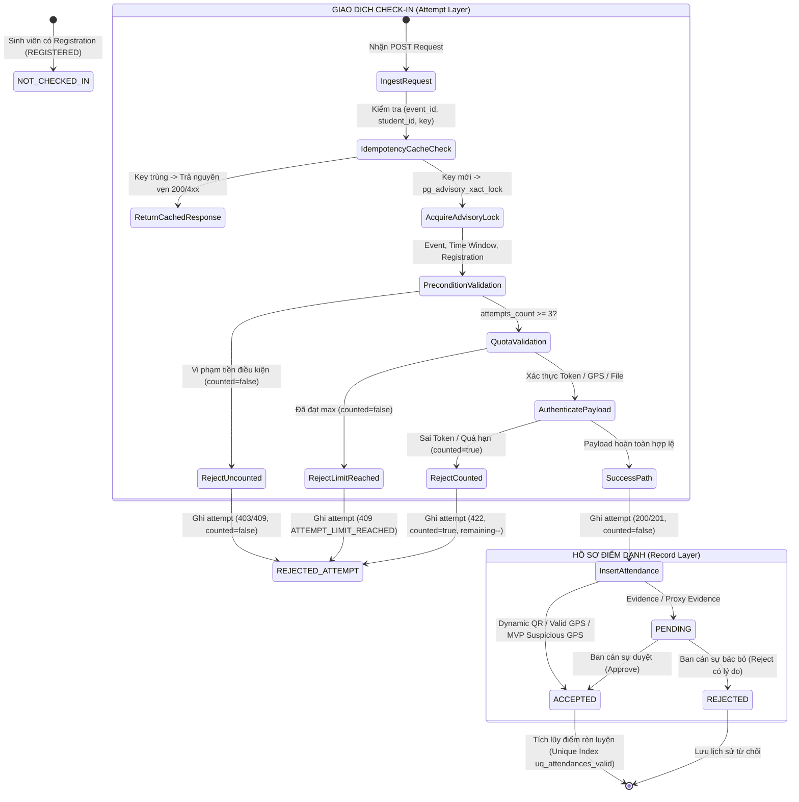

# TÀI LIỆU ĐẶC TẢ KIỂM THỬ TOÀN DIỆN (SENIOR QA/DEV LEAD SPECIFICATION)
## Ma Trận Kiểm Thử Nghiệp Vụ Điểm Danh (BR-ATT-01..10 & FSM Lifecycle Matrix)

- **Dự án:** QNU-Events — Hệ thống Quản trị & Điểm danh Sự kiện Đại học Quy Nhơn
- **Phân hệ:** Điểm danh & Xác thực Ngoại tuyến/Trực tuyến (`vn.edu.qnu.events.attendance`)
- **Tiêu chuẩn áp dụng:** ISO/IEC/IEEE 29119 Software Testing Standard, RFC 7231 (HTTP Semantics), RFC 6238 (TOTP-like Epoch Rotation), FSM Formal Modeling
- **Môi trường đối soát:** Spring Boot 4.1.2 (Java 21 LTS), PostgreSQL 17, React 19 / TypeScript 5.7
- **Tài liệu nền tảng:**
  - [`docs/spec/QNU_Event_Participation_Management_Project_Proposal_v2.docx`](../spec/QNU_Event_Participation_Management_Project_Proposal_v2.docx) (`BR-ATT-01..10`)
  - [`docs/spec/QNU_Event_SRS.docx`](../spec/QNU_Event_SRS.docx) (`v1.1`: `REQ-ATT-001..024`, `NFR-SEC-010`, `NFR-PERF-008`)
  - [`docs/api/error-codes.md`](../api/error-codes.md) · [`docs/decisions.md`](../decisions.md) · [`docs/agent/sprint1-rescue-plan.md`](../agent/sprint1-rescue-plan.md) (§8, §9)

---

## 1. MÔ HÌNH HÓA TOÁN HỌC & TRẠNG THÁI HỮU HẠN (FORMAL FSM)

Hệ thống điểm danh được mô hình hóa bằng một Máy trạng thái hữu hạn (Finite State Machine - FSM) phân tầng độc lập:
1. **Lớp Giao dịch & Thử nghiệm (Attempt Layer):** Thực thi trên bảng bất biến `attendance_attempts`.
2. **Lớp Thực thể Điểm danh (Attendance Record Layer):** Thực thi trên bảng nghiệp vụ `attendances`.

### 1.1 Ma trận Chuyển đổi Trạng thái Chi tiết (State Transition Matrix)

| Trạng thái Hiện tại ($S_t$) | Tác nhân / Sự kiện ($\Sigma$) | Điều kiện Chuyển đổi (Guard Conditions) | Trạng thái Tiếp theo ($S_{t+1}$) | Bản ghi CSDL Tác động | Tác động Phụ (Side Effects) |
|---|---|---|---|---|---|
| **`NOT_CHECKED_IN`** | Quét Dynamic QR | Token hợp lệ, trong cửa sổ, registered, failed attempts $< 3$ | **`ACCEPTED`** | `attendances`: INSERT 1 dòng `status='ACCEPTED'` `attendance_attempts`: INSERT `outcome='ACCEPTED'` | Ghi audit `ATTENDANCE_QR_ACCEPT`, cộng điểm rèn luyện |
| **`NOT_CHECKED_IN`** | Quét Dynamic QR | Sai mã, hết hạn grace period, sai chữ ký (lần 1 hoặc 2) | **`NOT_CHECKED_IN`** (Attempt = `REJECTED`) | `attendance_attempts`: INSERT `outcome='REJECTED'`, `counted=true`, `reason_code` | Trừ lượt: `remainingAttempts = 3 - failed`, `canRetry = true` |
| **`NOT_CHECKED_IN`** (đã fail 2 lần) | Quét Dynamic QR | Sai mã lần thứ 3 | **`NOT_CHECKED_IN`** (Attempt = `REJECTED`) | `attendance_attempts`: INSERT `outcome='REJECTED'`, `counted=true` | `remainingAttempts = 0`, `canRetry = false` |
| **`NOT_CHECKED_IN`** (đã fail 3 lần) | Quét Dynamic QR | Bất kỳ (kể cả mã QR hoàn toàn đúng) | **`NOT_CHECKED_IN`** (Khóa kênh tự động) | `attendance_attempts`: INSERT `outcome='REJECTED'`, `counted=false`, code=`ATTEMPT_LIMIT_REACHED` | HTTP 409; chặn nhóm kênh tự động (`QR`/`GPS`/`Offline`), vẫn cho nộp `EVIDENCE` dự phòng (`D-7`) |
| **`NOT_CHECKED_IN`** | Nộp ảnh minh chứng | Ảnh JPEG/PNG $< 5\text{MB}$, đúng hạn `evidence_deadline` | **`PENDING`** | `attendances`: INSERT `status='PENDING'`, `method='EVIDENCE'` | Đưa vào queue chờ Ban cán sự (`CLASS_REPRESENTATIVE`) duyệt; QR/GPS `ACCEPTED` có thể ghi đè (`D-7`) |
| **`PENDING`** | BCS phê duyệt | Người duyệt giữ role **`CLASS_REPRESENTATIVE` (`BCS`)** đúng lớp phân công (`bcs_class_assignment`), ảnh hợp lệ | **`ACCEPTED`** | `attendances`: UPDATE `status='ACCEPTED'`, `recorded_at=now()` | Kích hoạt ràng buộc duy nhất, cộng điểm rèn luyện (`D-2`) |
| **`PENDING`** | BCS từ chối | Ảnh không rõ mặt / sai ngữ cảnh | **`REJECTED`** | `attendances`: UPDATE `status='REJECTED'` | Ghi log lý do từ chối, sinh viên tra cứu được trên lịch sử |
| **`ACCEPTED`** | Quét lại mã QR (bằng key mới) | Đã có record `status='ACCEPTED'` | **`ACCEPTED`** (Attempt = `REJECTED`) | `attendance_attempts`: INSERT `outcome='REJECTED'`, code=`ALREADY_CHECKED_IN` | HTTP 409, giữ nguyên bản ghi attendance gốc |
| **Bất kỳ (`ACCEPTED` / `REJECTED`)** | Gửi lại cùng `Idempotency-Key` | Trùng bộ ba `(event_id, student_id, idempotency_key)` | **Giữ nguyên trạng thái** | Không ghi nhận thêm bất kỳ record nào | Trả về bản sao HTTP Status & Response Body trong CSDL |

---

## 2. PHÂN TÍCH GIÁ TRỊ BIÊN & PHÂN HOẠCH TƯƠNG ĐƯƠNG (BVA & EQUIVALENCE PARTITIONING)

Theo tiêu chuẩn kiểm thử kỹ thuật cao, các giá trị số và thời gian trong BR-ATT phải được kiểm thử tại các điểm biên cực tiểu ($Min^-$), cực tiểu ($Min$), danh nghĩa ($Nom$), cực đại ($Max$) và vượt biên ($Max^+$).

### 2.1 Ma trận Biên BR-ATT-02: Giới hạn 3 lần thử (Attempts Limit)
- **Miền tương đương hợp lệ:** $\text{attempts} \in \{0, 1, 2\}$
- **Miền tương đương bị khóa:** $\text{attempts} \ge 3$

| Điểm thử | Giá trị (Attempts đã lưu) | Hành vi / Đầu vào | Mã lỗi kỳ vọng | Cờ `counted` | `canRetry` |
|---|---|---|---|---|---|
| **$Min$** | $0$ | Quét sai mã lần đầu | `QR_BAD_SIGNATURE` (422) | `true` | `true` (còn 2) |
| **$Nom$** | $1$ | Quét đúng mã sau 1 lần sai | Thành công (200 `ACCEPTED`) | `false` | `false` (đã xong) |
| **$Nom$** | $2$ | Quét sai mã lần thứ 3 | `QR_BAD_SIGNATURE` (422) | `true` | `false` (còn 0) |
| **$Boundary$** | $3$ | Gửi request lần thứ 4 | `ATTEMPT_LIMIT_REACHED` (409) | `false` | `false` |
| **$Max^+$** | $5$ (Giả lập can thiệp DB) | Gửi request tiếp | `ATTEMPT_LIMIT_REACHED` (409) | `false` | `false` |

### 2.2 Ma trận Biên BR-ATT-03 & 04: Chu kỳ 10s và Grace Period 3s
Gọi $T$ là chu kỳ xoay vòng (10s), $G$ là thời gian ân hạn (3s). Giả sử token được sinh tại $\text{epoch } k$ ($t \in [10k, 10k+9.999]$).

| Điểm thời gian quét ($t$) | So với Epoch $k$ | Trạng thái xác thực | Mã lỗi / Kết quả | Vị trí kiểm tra mã nguồn |
|---|---|---|---|---|
| $t = 10k$ | Bắt đầu Epoch $k$ | **Hợp lệ** ($\text{epoch} == \text{currentEpoch}$) | 200 `ACCEPTED` | `QrTokenService.java:74` |
| $t = 10k + 9.999$s | Cuối Epoch $k$ | **Hợp lệ** ($\text{epoch} == \text{currentEpoch}$) | 200 `ACCEPTED` | `QrTokenService.java:74` |
| $t = 10k + 10.000$s | Bắt đầu Epoch $k+1$ ($0$s vào epoch mới) | **Hợp lệ** ($\text{secondsIntoEpoch} = 0 \le 3$) | 200 `ACCEPTED` (Grace Period) | `QrTokenService.java:78-83` |
| $t = 10k + 12.999$s | Epoch $k+1$ ($2.999$s vào epoch mới) | **Hợp lệ** ($\text{secondsIntoEpoch} \le 3$) | 200 `ACCEPTED` (Grace Period) | `QrTokenService.java:78-83` |
| $t = 10k + 13.001$s | Epoch $k+1$ ($3.001$s vào epoch mới) | **Hết hạn** ($\text{secondsIntoEpoch} > 3$) | 422 `QR_EXPIRED` | `QrTokenService.java:82` |
| $t = 10k + 20.000$s | Bước sang Epoch $k+2$ | **Hết hạn** ($\text{epoch} < \text{currentEpoch}-1$) | 422 `QR_EXPIRED` | `QrTokenService.java:85` |
| $t = 10k - 0.001$s | Trước khi Epoch $k$ bắt đầu (Clock lệch) | **Không hợp lệ** ($\text{epoch} > \text{currentEpoch}$) | 422 `QR_FROM_FUTURE` | `QrTokenService.java:70` |

---

## 3. MA TRẬN KIỂM THỬ KỸ THUẬT CHI TIẾT (FULL TRACEABILITY TEST MATRIX)

### 3.1 Nhóm Quy tắc Sprint 1 (Đã triển khai & Kiểm thử tự động 100%)

#### BR-ATT-01: Duy nhất 01 Attendance Hợp lệ & Chống Trùng lặp
* **Thiết kế kỹ thuật:**
  * CSDL: `CREATE UNIQUE INDEX uq_attendances_valid ON attendances(event_id, student_id) WHERE status = 'ACCEPTED';`
  * Đồng thời (Concurrency): `pg_advisory_xact_lock(hashtextextended(event_id || ':' || student_id, 0))` khóa độc quyền theo cặp (event, student) trong suốt transaction.
  * Bộ đệm Idempotency: `attendance_attempts(event_id, student_id, idempotency_key)` lưu response jsonb nguyên tử.

| Test ID | Kịch bản kiểm thử | Dữ liệu đầu vào & Mocking | Kỳ vọng Kỹ thuật (Technical Assertions) | Mã nguồn kiểm chứng |
|---|---|---|---|---|
| **TC-ATT-01-01** | Điểm danh QR lần đầu thành công | Token QR hợp lệ, header `Idempotency-Key: uuid-1` | • HTTP 200 OK, Body: `{"status":"ACCEPTED","acceptedAt":"..."}` • `attendances`: 1 record `(status='ACCEPTED', method='DYNAMIC_QR')` • `attendance_attempts`: 1 record `(outcome='ACCEPTED', counted=false, http_status=200)` • `audit_logs`: 1 log `action='ATTENDANCE_QR_ACCEPT'` | `AttendanceIT.java:194` `checkInWithValidQrTokenSuccess` |
| **TC-ATT-01-02** | Replay cùng Idempotency-Key (Network Retry) | Lặp lại request với cùng `Idempotency-Key: uuid-1` | • HTTP 200 OK với body và timestamp giống hệt lần 1 • Không sinh thêm dòng trong `attendances` • Không sinh thêm dòng trong `attendance_attempts` | `AttendanceIT.java:223` `checkInWithSameIdempotencyKey...` |
| **TC-ATT-01-03** | Điểm danh lần 2 với key mới khi đã có record ACCEPTED | Header `Idempotency-Key: uuid-2`, token hợp lệ | • HTTP 409 Conflict, `code: "ALREADY_CHECKED_IN"` • `attendance_attempts`: 1 record mới `(outcome='REJECTED', reason_code='ALREADY_CHECKED_IN', counted=false)` | `AttendanceIT.java:312` `checkInTwiceWithDifferentKeysFails` |
| **TC-ATT-01-04** | Tranh chấp đồng thời (Concurrency Race - 2 luồng song song) | 2 luồng gửi 2 key khác nhau tại cùng 1 mili-giây | • `CountDownLatch(1)` mở đồng thời 2 threads • Đúng 1 thread nhận HTTP 200, đúng 1 thread nhận HTTP 409 • Số record `ACCEPTED` trên DB luôn luôn bằng 1 | `AttendanceIT.java:523` `concurrentValidRequestsCreate...` |
| **TC-ATT-01-05** | Tranh chấp đồng thời cùng Idempotency-Key (5 luồng) | 5 luồng song song gửi cùng 1 `Idempotency-Key` | • Toàn bộ 5 luồng nhận HTTP 200 với body đồng nhất • Đúng 1 record được ghi nhận vào `attendance_attempts` | `AttendanceIT.java:581` `concurrentRequestsWithSameKey...` |

---

#### BR-ATT-02: Giới hạn 3 lần thử & Cơ chế Đếm Lượt (Attempt Quota)
* **Thiết kế kỹ thuật:**
  * Chỉ các lỗi do sinh viên nhập sai mã / token hết hạn / chữ ký giả mạo mới bị tính `counted = true`.
  * Các lỗi hạ tầng / tiền điều kiện (`ATTENDANCE_NOT_OPEN`, `NOT_REGISTERED`, `VALIDATION_FAILED`) được đánh dấu `counted = false` và không làm mất lượt của sinh viên.
  * Phản hồi lỗi chứa metadata mở rộng: `attemptCount`, `maxAttempts`, `remainingAttempts`, `canRetry`.

| Test ID | Kịch bản kiểm thử | Dữ liệu đầu vào & Mocking | Kỳ vọng Kỹ thuật (Technical Assertions) | Mã nguồn kiểm chứng |
|---|---|---|---|---|
| **TC-ATT-02-01** | Kiểm tra trạng thái ban đầu (Zero Attempt) | Chưa gửi request nào | `countByEventIdAndStudentIdAndCountedTrue == 0` | `AttendanceIT.java:722` `boundaryTest_ZeroAttempt...` |
| **TC-ATT-02-02** | Thất bại lần 1, thành công lần 2 | Lần 1 gửi mã sai; lần 2 gửi mã đúng | • Lần 1: HTTP 422, `counted=true`, `remainingAttempts=2`, `canRetry=true` • Lần 2: HTTP 200 `ACCEPTED`, tạo bản ghi attendance bình thường | `AttendanceIT.java:738` `boundaryTest_FailOnce...` |
| **TC-ATT-02-03** | Thất bại 2 lần, thành công lần 3 (Biên cuối) | Lần 1 & 2 gửi mã sai; lần 3 gửi mã đúng | • Lần 2: HTTP 422, `remainingAttempts=1`, `canRetry=true` • Lần 3: HTTP 200 `ACCEPTED`, điểm danh thành công | `AttendanceIT.java:774` `boundaryTest_FailTwice...` |
| **TC-ATT-02-04** | Thất bại 3 lần liên tiếp, lần 4 bị khóa cứng | Lần 1, 2, 3 sai; lần 4 gửi mã đúng | • Lần 3: HTTP 422, `remainingAttempts=0`, `canRetry=false` • Lần 4: HTTP 409 `ATTEMPT_LIMIT_REACHED`, `canRetry=false` • Lần 4 được lưu với `counted=false` (không tăng quá 3) | `AttendanceIT.java:817` `boundaryTest_FailThreeTimes...` |
| **TC-ATT-02-05** | Replay một lần thử sai đã lưu | Gửi lại key của một lần thử bị 422 | Trả lại chính xác HTTP 422 và error response đã lưu, không tính thêm lần thử mới | `AttendanceIT.java:431` `rejectedAttemptReplayReturns...` |
| **TC-ATT-02-06** | Lỗi chưa đăng ký không bị trừ lượt | Sinh viên chưa có `registrations` hợp lệ | HTTP 403 `NOT_REGISTERED`, ghi attempt `counted=false`, số lượt lỗi không tăng | `AttendanceIT.java:289` `checkInWithoutRegistrationFails` |

---

#### BR-ATT-03, 04, 05: Dynamic QR Rotation, Grace Period & Độc lập GPS
* **Thiết kế kỹ thuật:**
  * Mã hóa token: `qr1.<event_id>.<epoch>.<hmac_sha256_base64url>`
  * Xác thực chữ ký an toàn thời gian thực (`MessageDigest.isEqual` chống Timing Attack).
  * Payload API: Chỉ nhận `{ "token": "..." }`, tách biệt hoàn toàn với bất kỳ sensor GPS nào.

| Test ID | Kịch bản kiểm thử | Dữ liệu đầu vào & Mocking | Kỳ vọng Kỹ thuật (Technical Assertions) | Mã nguồn kiểm chứng |
|---|---|---|---|---|
| **TC-ATT-03-01** | Token thay đổi theo chu kỳ epoch 10s | Sinh token tại $t$ và $t + 10$s | • `token_t != token_{t+10}` • Epoch $t+10 = \text{Epoch } t + 1$ • Chữ ký HMAC thay đổi hoàn toàn | `QrTokenServiceTest.java:49` `tokenChangesAcrossEpochs` |
| **TC-ATT-03-02** | Hai sự kiện khác nhau có chữ ký độc lập | Cùng một thời điểm $t$, sinh token cho Event A và Event B | Chữ ký HMAC của Event A và B khác biệt dù cùng epoch và cùng bí mật hệ thống | `QrTokenServiceTest.java:61` `tokensForDifferentEventsAreDistinct` |
| **TC-ATT-04-01** | Chấp nhận token trong Grace Period 3s | Token sinh tại epoch $k$, quét tại $t = 10(k+1) + 2$s | `QrTokenService.verify` trả về valid, HTTP 200 `ACCEPTED` | `QrTokenServiceTest.java:27` `verifyTokenWithinGracePeriod...` |
| **TC-ATT-04-02** | Từ chối token quá Grace Period (> 3s) | Token sinh tại epoch $k$, quét tại $t = 10(k+1) + 4$s | Trả về `QR_EXPIRED` (422), attempt ghi nhận `counted=true` | `QrTokenServiceTest.java:37` `verifyTokenAfterGracePeriod...` |
| **TC-ATT-04-03** | Phát hiện token giả mạo chữ ký (Tampering) | Thay đổi 1 ký tự trong chuỗi signature | Trả về `QR_BAD_SIGNATURE` (422), attempt ghi nhận `counted=true` | `AttendanceIT.java:369` `checkInWithBadSignatureFails` |
| **TC-ATT-04-04** | Token sai định dạng (Malformed) | Token là chuỗi rỗng hoặc thiếu prefix `qr1.` | Trả về `QR_MALFORMED` (422), attempt ghi nhận `counted=true` | `AttendanceIT.java:483` `blankTokenIsCountedAsMalformed...` |
| **TC-ATT-05-01** | Check-in QR không phụ thuộc định vị GPS | Thiết bị không có tọa độ GPS, body chỉ có `token` | HTTP 200 `ACCEPTED` bình thường, máy chủ không validate GPS | `AttendanceIT.java:194` `checkInWithValidQrTokenSuccess` |
| **TC-ATT-05-02** | An toàn Audit: Không rò rỉ token gốc ra log | Check-in thành công | Trong `audit_logs.details`, chỉ lưu `tokenHash` (SHA-256 fingerprint 4 byte), không lưu raw token | `AttendanceIT.java:629` `acceptedCheckInAuditDoesNotLeakToken` |

---

### 3.2 Nhóm Quy tắc Sprint 2 (Đặc tả Sẵn sàng để Triển khai Code & Test)

#### BR-ATT-06 & BR-ATT-07: GPS Radius & Xử lý Tín hiệu Đáng ngờ (Mock Location)
* **Thuật toán máy chủ:**
  * Khoảng cách Haversine trên máy chủ:
    $$d = 2R \arcsin \left( \sqrt{\sin^2\left(\frac{\Delta \varphi}{2}\right) + \cos(\varphi_1)\cos(\varphi_2)\sin^2\left(\frac{\Delta \lambda}{2}\right)} \right)$$
  * Tiêu chí chấp nhận: $d \le \text{events.allowed\_radius\_meters}$ (cấu hình $10\text{–}500\text{m}$, mặc định **$50\text{m}$** theo `SRS REQ-EVT-009` — `D-7`).
  * MVP Rule BR-ATT-07: Nếu **trong bán kính** nhưng client gửi cờ `isMocked = true` hoặc độ chính xác bất thường ($\text{accuracy} > \text{threshold}$ — `TBD-ATT-03`), máy chủ **vẫn chấp nhận** (`ACCEPTED`) nhưng gắn `suspicious_flag = TRUE`. Ngoài bán kính luôn từ chối `422 GPS_OUT_OF_RANGE` (`counted = true`).

| Test ID | Kịch bản kiểm thử | Dữ liệu đầu vào & Tọa độ | Kỳ vọng Kỹ thuật | Kế hoạch thực hiện |
|---|---|---|---|---|
| **TC-ATT-06-01** | Tọa độ GPS nằm trong bán kính sự kiện | Tọa độ sinh viên cách tâm sự kiện $25\text{m}$ (radius mặc định $50\text{m}$) | HTTP 200 `ACCEPTED`, tạo record `attendances(method='GPS', status='ACCEPTED')` | Roadmap Sprint 2 (QE-55) |
| **TC-ATT-06-02** | Tọa độ GPS nằm ngoài bán kính sự kiện | Tọa độ sinh viên cách tâm sự kiện $120\text{m}$ (radius $50\text{m}$) | HTTP 422 `GPS_OUT_OF_RANGE`, ghi attempt `counted=true`, không tạo attendance | Roadmap Sprint 2 (QE-55) |
| **TC-ATT-06-03** | Tọa độ GPS không hợp lệ (NaN / Vượt cực) | Lat: $95.0$, Lng: $200.0$ | HTTP 400 `VALIDATION_FAILED`, ghi attempt `counted=false` | Roadmap Sprint 2 (QE-55) |
| **TC-ATT-07-01** | GPS giả lập (Mock Location) được chấp nhận kèm cờ cảnh báo | Payload kèm `isMocked: true` hoặc độ chính xác bất thường, khoảng cách $d \le \text{radius}$ | • HTTP 200 `ACCEPTED` • Ghi `attendances(status='ACCEPTED')` • `audit_logs`: Ghi nhận `suspicious_flag: true`, `reason: "MOCK_LOCATION_DETECTED"` | Roadmap Sprint 2 (QE-55) |

---

#### BR-ATT-08 & BR-ATT-09: Minh chứng Ngoại lệ (Evidence) & Điểm danh Hộ (Proxy)
* **Quy trình Duyệt thủ công (`D-2`, `D-8`):**
  * Lưu trữ: Ảnh upload qua `EvidenceStoragePort` (mặc định Local Private Filesystem ngoài public root, tên file UUID, retention `150 ngày` từ `events.end_at`, pluggable MinIO/S3), gắn với `attendances(status='PENDING', method='EVIDENCE'/'PROXY_EVIDENCE')` và `attendance_evidences`.
  * Ràng buộc tệp (REQ-ATT-009): Kiểm tra magic bytes `image/jpeg` hoặc `image/png`, kích thước $< 5\text{MB}$ (`5 * 1024 * 1024` bytes).
  * Proxy Attendance (BR-ATT-09): Chỉ định rõ sinh viên được điểm danh $A$ và người nộp thay $B$, ảnh chụp nhận diện cả hai người (`submitted_by`, `is_proxy = true`).

| Test ID | Kịch bản kiểm thử | Dữ liệu đầu vào | Kỳ vọng Kỹ thuật | Kế hoạch thực hiện |
|---|---|---|---|---|
| **TC-ATT-08-01** | Nộp ảnh minh chứng hợp lệ | File PNG $2.4\text{MB}$, trong hạn `evidence_deadline` | HTTP 201/202, tạo `attendances(status='PENDING')` + `attendance_evidences`, chưa cộng điểm | Roadmap Sprint 2 (QE-42) |
| **TC-ATT-08-02** | Nộp file sai định dạng hoặc quá dung lượng | File PDF hoặc ảnh JPEG $5.2\text{MB}$ | HTTP 422 `INVALID_EVIDENCE_FILE`, không tạo bản ghi trong `attendances` (`counted = false`) | Roadmap Sprint 2 (QE-42) |
| **TC-ATT-08-03** | Ban cán sự phê duyệt (Approve) minh chứng | **`CLASS_REPRESENTATIVE (BCS)`** đúng lớp phân công gọi `POST /api/v1/attendances/{id}/approve` | • HTTP 200 OK • Cập nhật `attendances.status = 'ACCEPTED'` • Cộng điểm rèn luyện; user ngoài lớp hoặc `EVENT_OWNER`/`SYSTEM_ADMIN` gọi trả `403 FORBIDDEN` (`D-2`) | Roadmap Sprint 2 (QE-43) |
| **TC-ATT-08-04** | Ban cán sự từ chối (Reject) minh chứng | **`CLASS_REPRESENTATIVE (BCS)`** đúng lớp phân công gọi `POST /api/v1/attendances/{id}/reject` kèm `reason: "Ảnh mờ"` (`<= 255` ký tự) | • HTTP 200 OK • Cập nhật `attendances.status = 'REJECTED'` • Ghi lý do từ chối & đặt `T0 = reviewed_at` cho quyền nộp Appeal Vòng 1 lên `CVHT` | Roadmap Sprint 2 (QE-43) |
| **TC-ATT-09-01** | Nộp hồ sơ điểm danh hộ qua minh chứng | Sinh viên B nộp thay cho A kèm ảnh chụp chung | Tạo hồ sơ `attendances` cho A (`method='PROXY_EVIDENCE'`, `status='PENDING'`) và `attendance_evidences(submitted_by=B, is_proxy=true)` | Roadmap Sprint 2 (QE-19) |
| **TC-ATT-09-02** | Ngăn chặn điểm danh hộ qua QR/GPS | Sinh viên B gửi request QR nhưng chèn mã sinh viên A | Bị triệt tiêu: Máy chủ bắt buộc đọc danh tính từ JWT Claims (`CurrentUser.userId`), bỏ qua client body (`R9`) | Đã bảo vệ bởi kiến trúc Core Sprint 1 |

---

#### BR-ATT-10: Chế Tài No-Show (Sinh viên Vắng mặt Không phép — `D-9`)
* **Quy trình Chế tài Tự động:**
  * Định nghĩa No-show: Sinh viên có `registrations(status='REGISTERED')` nhưng không có `attendances(status='ACCEPTED')` và **không** có `EVIDENCE` trạng thái `PENDING` sau mốc **`MAX(attendance_close_at + 24h, COALESCE(evidence_deadline, attendance_close_at))`** (bỏ qua `WAITING_LIST`, `CANCELLED` và sự kiện `CANCELLED`; tạm dừng bộ đếm khi có Appeal Vòng 1 hợp lệ).
  * Chế tài: Ghi vào **`student_restrictions`** khóa đăng ký sự kiện mới 07 ngày; nếu nhiều án phạt chồng nhau lấy **`banned_until = MAX(current_banned_until, now + 7 days)`**.

| Test ID | Kịch bản kiểm thử | Điều kiện & Kích hoạt | Kỳ vọng Kỹ thuật | Kế hoạch thực hiện |
|---|---|---|---|---|
| **TC-ATT-10-01** | Tiến trình quét tự động phát hiện No-show | Cron job đối soát chạy sau `MAX(attendance_close_at + 24h, COALESCE(evidence_deadline, attendance_close_at))` | • Xác định danh sách `REGISTERED` vắng (miễn `PENDING` Evidence) • Tạo/cập nhật `student_restrictions(student_id, banned_until = MAX(current, now() + 7 days))` | Roadmap Sprint 3 (QE-14) |
| **TC-ATT-10-02** | Sinh viên đang trong hạn phạt cố tình đăng ký mới | Sinh viên đang chịu án phạt gọi `POST /api/v1/events/{id}/registrations` | • HTTP 403 Forbidden, `code: "STUDENT_PENALIZED"` • Response trả về thời điểm hết hạn phạt `bannedUntil` | Roadmap Sprint 3 (QE-14) |
| **TC-ATT-10-03** | Sinh viên đã hết thời hạn 7 ngày phạt (hoặc được `EVENT_OWNER` gỡ sau Appeal R2) | Đăng ký sau thời điểm `bannedUntil` hoặc sau khi gỡ phạt | Cho phép đăng ký sự kiện mới bình thường | Roadmap Sprint 3 (QE-14, QE-60) |

---

## 4. MA TRẬN PHÂN LOẠI LỖI & MÃ PHẢN HỒI HTTP (HTTP & ERROR CODES MAPPING)

Bảng chuẩn hóa khớp hoàn toàn với [`docs/api/error-codes.md`](../api/error-codes.md):

| Nhóm lỗi | Mã lỗi (`ErrorCode`) | HTTP Status | Cờ `counted` | Thông điệp hiển thị cho người dùng |
|---|---|---|:---:|---|
| **Quyền & Phiên** | `UNAUTHENTICATED` | 401 Unauthorized | `false` | Yêu cầu đăng nhập để thực hiện. |
| | `FORBIDDEN` | 403 Forbidden | `false` | Bạn không có quyền thực hiện thao tác này. |
| | `NOT_REGISTERED` | 403 Forbidden | `false` | Bạn chưa có suất đăng ký sự kiện này. |
| | `STUDENT_PENALIZED` | 403 Forbidden | `false` | Tài khoản đang bị tạm đình chỉ đăng ký do vắng mặt sự kiện trước đó. |
| **Trạng thái Sự kiện** | `EVENT_NOT_PUBLISHED` | 409 Conflict | `false` | Sự kiện chưa được công bố. |
| | `ATTENDANCE_NOT_OPEN`| 409 Conflict | `false` | Chưa đến hoặc đã hết thời gian điểm danh. |
| **Xung đột Nghiệp vụ**| `ALREADY_CHECKED_IN` | 409 Conflict | `false` | Bạn đã điểm danh sự kiện này rồi. |
| | `ATTEMPT_LIMIT_REACHED`| 409 Conflict | `false` | Bạn đã vượt quá số lần thử xác thực tự động cho phép (tối đa 3 lần). |
| **Dữ liệu Điểm danh** | `QR_MALFORMED` | 422 Unprocessable | `true` | Mã QR không đúng định dạng chuẩn. |
| | `QR_BAD_SIGNATURE` | 422 Unprocessable | `true` | Chữ ký mã QR không hợp lệ hoặc đã bị can thiệp. |
| | `QR_WRONG_EVENT` | 422 Unprocessable | `true` | Mã QR không thuộc về sự kiện này. |
| | `QR_EXPIRED` | 422 Unprocessable | `true` | Mã QR đã hết hạn (chu kỳ xoay vòng 10 giây). |
| | `QR_FROM_FUTURE` | 422 Unprocessable | `true` | Mã QR không hợp lệ (thời gian trên thiết bị bị lệch). |
| | `GPS_OUT_OF_RANGE` | 422 Unprocessable | `true` | Vị trí hiện tại nằm ngoài bán kính cho phép của sự kiện. |
| | `OFFLINE_SYNC_WINDOW_EXPIRED` | 422 Unprocessable | `true` | Quá cửa sổ đồng bộ ngoại tuyến 24 giờ sau khi đóng điểm danh. |
| | `INVALID_EVIDENCE_FILE` | 422 Unprocessable | `false` | Tệp minh chứng không hợp lệ (sai định dạng hoặc quá 5MB). |

---

## 5. KẾT LUẬN & ĐÁNH GIÁ CHUẨN MỰC SENIOR LEAD

1. **Tính hoàn thiện của Sprint 1:**
   - Đạt độ phủ toàn diện cho **BR-ATT-01 đến BR-ATT-05**: **25 bài kiểm thử tích hợp (`AttendanceIT`) + 5 unit tests (`AttendanceServiceTest`) + 13 unit tests (`QrTokenServiceTest`)** xanh trên `main`, bao quát tranh chấp tải đồng thời, Advisory Lock, Idempotent replay, timing attack, biên 3 lần thử và khôi phục trạng thái reload (`/attendance/me` — `QE-98`).
   - Cơ sở dữ liệu và trigger bảo đảm tính bất biến (`attendance_attempts` và `audit_logs`).
2. **Kế hoạch thực thi Sprint 2–3:**
   - Tận dụng schema `V1` và phần mở rộng `V2` trong [`docs/Design/v2-schema-blueprint.md`](../Design/v2-schema-blueprint.md).
   - Hiện thực Haversine GPS (`50m` mặc định, `422 GPS_OUT_OF_RANGE`), Evidence qua `EvidenceStoragePort` + BCS lớp duyệt (`QE-42`, `QE-43`), Proxy (`QE-19`), Student Offline Store-and-Forward 24h (`D-6`), và Appeal 2 vòng CVHT → EVENT_OWNER (`D-2`, `D-9`).
